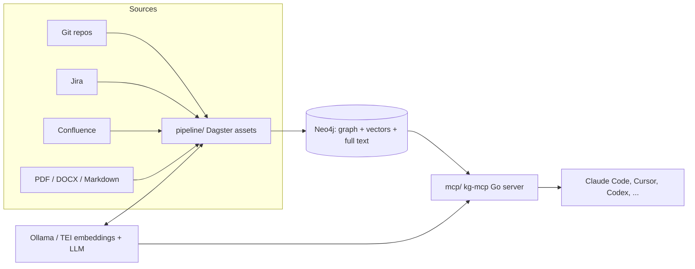

# Knowledge graph for coding agents

A knowledge graph of code, documents, Jira and git history, served to coding agents through MCP.
Agents ask questions in business words and get code, domain concepts, tickets, history, tests and
requirement verdicts back, with citations.



| Folder | What it is |
|---|---|
| [`pipeline/`](pipeline/) | Python ingestion: code graph (Tree-sitter + SCIP), domain extraction, Jira, Confluence, documents, git history, embeddings, hybrid search, requirement verification, evaluation, Dagster definitions |
| [`mcp/`](mcp/) | Read-only MCP server in Go (12 tools, stdio and Streamable HTTP, ACL scope) |
| [`deploy/helm/knowledge-graph/`](deploy/helm/knowledge-graph/) | One-shot Helm chart: Neo4j, PostgreSQL, Dagster, Docling, TEI, kg-mcp. Profiles for small clusters and kind |
| [`docs/`](docs/) | [Developer and user guide](docs/GUIDE.md), [operations runbook](docs/RUNBOOK.md) |

## Quick start (local)

```bash
docker run -d --name kg-neo4j -p 7474:7474 -p 7687:7687 -e NEO4J_AUTH=neo4j/<password> neo4j:2026.10.1-community
ollama pull qwen3-embedding:0.6b
cd pipeline && python -m venv .venv && .venv/Scripts/pip install -e ".[dev]"   # bin/ on Linux and macOS
export NEO4J_PASSWORD=<password> EMBEDDINGS_URL=http://localhost:11434 EMBEDDINGS_MODEL=qwen3-embedding:0.6b
kg-ingest-code --repo /path/to/repo --name my-repo
kg-domain --repo my-repo        # needs an LLM (LLM_BASE_URL, LLM_MODEL); skip for roles only
kg-embed --repo my-repo
kg-search "how do users sign in" --repo my-repo
```

Then build `mcp/` and register it with your agent: see [docs/GUIDE.md](docs/GUIDE.md#5-use-the-knowledge-base-from-an-agent).
