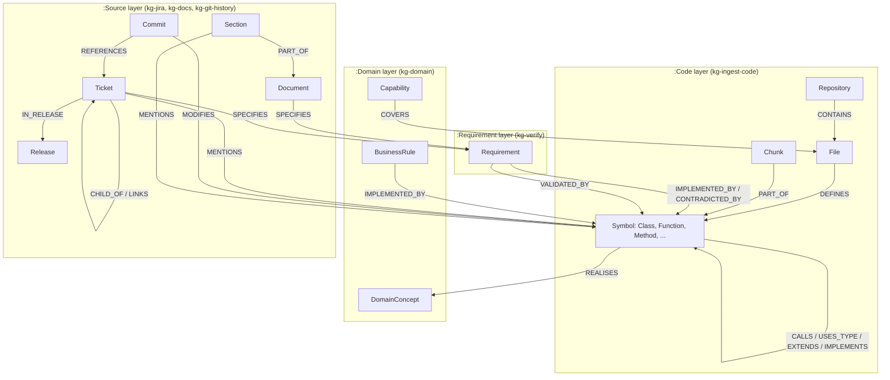
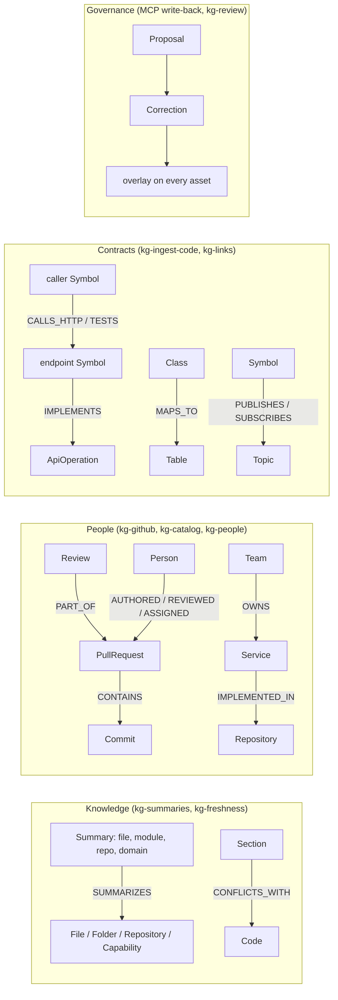
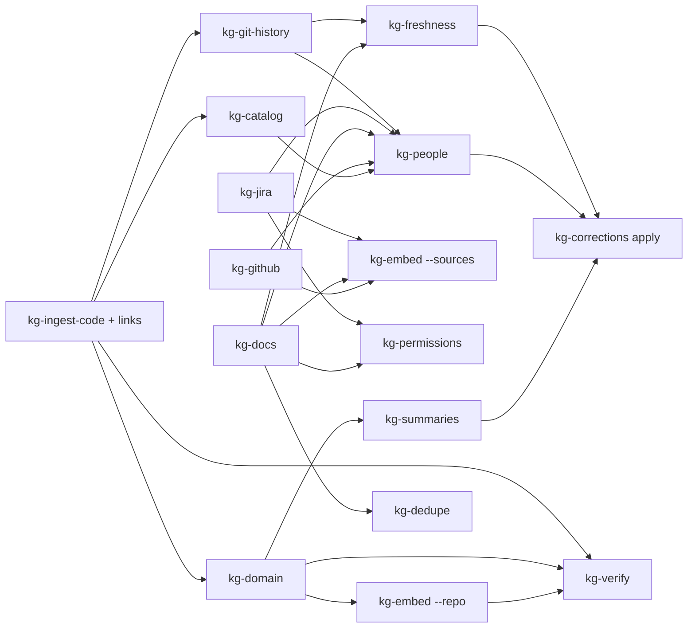
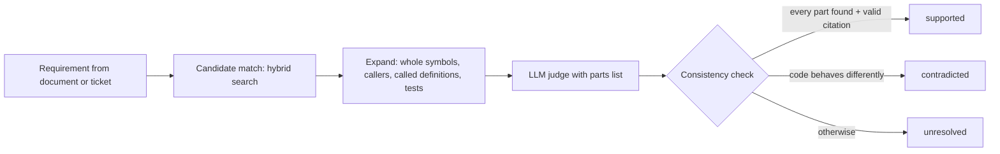
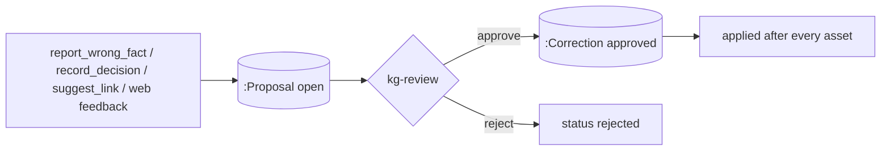

# Developer and user guide

This guide tells you how to set up the knowledge base, ingest data, test it and use it from a coding
agent or from the web UI. For deployment and incidents, see the [runbook](RUNBOOK.md). The stream
notes in [`docs/streams/`](streams/) give the full detail of each part:

| Note | Content |
|---|---|
| [data-trust.md](streams/data-trust.md) | deletes and moves, secret and PII masking, provenance, duplicate documents |
| [retrieval.md](streams/retrieval.md) | reranker, query router, `ask`, result size limits and paging |
| [knowledge.md](streams/knowledge.md) | summaries, document freshness, corrections overlay |
| [people.md](streams/people.md) | GitHub pull requests and reviews, service catalog, people, experts and owners |
| [contracts.md](streams/contracts.md) | API specs, database schemas, HTTP calls and topics across repositories |
| [web.md](streams/web.md) | web UI and REST layer |
| [governance.md](streams/governance.md) | OAuth, access per user, audit log, write-back with review, permission sync |
| [ops-eval.md](streams/ops-eval.md) | CI, answer evaluation, scale test, tracing, metrics, backups, agent benchmark |
| [kg-test-e2e.md](streams/kg-test-e2e.md) | end-to-end check of the whole system on kind |

- [1. Concepts](#1-concepts)
- [2. Set up a local environment](#2-set-up-a-local-environment)
- [3. Ingest data](#3-ingest-data)
- [4. Test the knowledge base](#4-test-the-knowledge-base)
- [5. Use the knowledge base from an agent](#5-use-the-knowledge-base-from-an-agent)
- [6. Extend the pipeline](#6-extend-the-pipeline)
- [7. Reference](#7-reference)

## 1. Concepts

The graph has four layers. Each layer has its own command and its own Dagster asset.



| Term | Meaning |
|---|---|
| Symbol | A class, interface, enum, function or method. Its id is `<repo>:<path>#<qualified name>`. |
| Chunk | Up to 120 lines of code, aligned to a symbol or to file-level code. Chunks carry the embeddings. |
| Edge method and confidence | Each code edge says how it was found: `scip` (compiler-grade, 1.0), `parser` (1.0), `treesitter` name match (0.4 to 0.8), `git` (0.6 to 1.0), `text` (0.6) or `llm`. Treat `llm` and low-confidence edges as hints. |
| Hybrid search | Vector search, full-text search and concept search, fused with reciprocal rank fusion (RRF, k = 60), then expanded through the graph. |
| Verdict | The result of a requirement check: `supported`, `contradicted` or `unresolved`. "Supported" needs every part of the requirement found in the evidence. |
| ACL group | A string such as `repo:precept`, `jira:PREC`, `confluence:ENG` or `docs:<collection>` on each source node. Each caller sees only its groups (see [5.4](#54-access-control)). |
| Provenance | Every source node has `url`, `source_updated_at`, `ingested_at` and `author`. |
| Stale | A section or document whose code changed after it was written has `stale: true` and `stale_reason`. |
| Proposal and correction | A write from an agent or a person is a `:Proposal`. A reviewer turns it into an approved `:Correction`, which the pipeline applies after each ingestion. |

More layers sit on top of the four layers above:



## 2. Set up a local environment

### Prerequisites

| Tool | Version | Use |
|---|---|---|
| Docker Desktop | 4.x | Neo4j, image builds, kind |
| Python | 3.13 | pipeline |
| Go | 1.26 | MCP server |
| Ollama | 0.12 or later | embeddings (`qwen3-embedding:0.6b`) and LLM (`qwen3.6:35b-a3b`) |
| Node.js 22 | optional | SCIP indexers for TypeScript and Python |

### Steps

1. Start Neo4j:

   ```bash
   docker run -d --name kg-neo4j -p 7474:7474 -p 7687:7687 -e NEO4J_AUTH=neo4j/<password> neo4j:2026.10.1-community
   ```

2. Pull the models:

   ```bash
   ollama pull qwen3-embedding:0.6b
   ollama pull qwen3.6:35b-a3b
   ```

3. Install the pipeline:

   ```bash
   cd pipeline
   python -m venv .venv
   .venv/Scripts/pip install -e ".[dev,dagster]"      # .venv/bin/pip on Linux and macOS
   ```

4. Optional: install SCIP indexers for compiler-grade call edges:

   ```bash
   npm install -g @sourcegraph/scip-typescript@0.6.0 @sourcegraph/scip-python@0.6.8
   go install github.com/scip-code/scip-go/cmd/scip-go@v0.2.9
   ```

   Without them, the pipeline uses Tree-sitter name matching (95.7 % precision against SCIP).

5. Set the environment. Do not write passwords into files that you commit:

   ```bash
   export NEO4J_URI=bolt://localhost:7687 NEO4J_USER=neo4j NEO4J_PASSWORD=<password>
   export EMBEDDINGS_URL=http://localhost:11434 EMBEDDINGS_MODEL=qwen3-embedding:0.6b
   export LLM_PROVIDER=ollama LLM_BASE_URL=http://localhost:11434 LLM_MODEL=qwen3.6:35b-a3b
   export LLM_CACHE_DIR=.kg-cache/llm
   ```

   On Windows PowerShell, use `scripts/local-env.ps1` as a template.

## 3. Ingest data

Run the steps in this order. Each step is idempotent: run it again at any time.



In Dagster, the assets run in this order by themselves, and every asset applies the approved
corrections after its writes. From the CLI, run `kg-corrections apply` at the end.

### 3.0 Local folders and code outside git

Dagster reads code only from git URLs (`sources.git.repositories`): `code_snapshot` makes a bare
mirror with `git clone --mirror` and parses a checkout of the configured branch. A folder on disk
that is not a git repository (an export, a vendor drop, a network share) is ingested with the CLI
from a machine that can reach Neo4j, for example through a port-forward:

```bash
kubectl -n kg port-forward svc/kg-neo4j 7687:7687     # or set NEO4J_URI to a reachable address
export NEO4J_URI=bolt://127.0.0.1:7687 NEO4J_USER=neo4j NEO4J_PASSWORD=...
export EMBEDDINGS_URL=... EMBEDDINGS_MODEL=... EMBEDDINGS_DIMENSIONS=...   # same model as kg-mcp

kg-ingest-code --repo /data/fis-codebase --name fis-codebase     # code, contracts and links
kg-domain      --repo fis-codebase --no-llm                      # roles; drop --no-llm when an LLM is set
kg-embed       --repo fis-codebase
kg-summaries   --repo fis-codebase --no-llm                      # extractive; drop --no-llm when an LLM is set
kg-docs        --path /data/fis-codebase/business-docs --name fis-docs
kg-embed       --sources
kg-corrections apply
```

| Step | Works without git? | Notes |
|---|---|---|
| `kg-ingest-code`, `kg-links` | Yes | `--name` sets the repository id. Without it the folder name is used. Keep the name stable: node ids are `<name>:<path>#<qualname>`. |
| `kg-domain`, `kg-embed`, `kg-summaries` | Yes | They read what `kg-ingest-code` wrote. |
| `kg-docs --path` | Yes | `.md` and `.txt` are read directly; `.pdf`, `.docx`, `.pptx` and `.html` need Docling (`DOCLING_URL`). |
| `kg-git-history` | No | Needs a checkout with history. Without it there are no `Commit` nodes, no `MODIFIES` edges and no `get_change_history`, and `kg-people` finds no authors. |
| Dagster assets and schedules | No | Only git URLs. Re-run the CLI after the folder changes; unchanged files are not written again. |

To get history and scheduling, put the folder in git (`git init`, commit, push to an internal
remote) and add the URL to `sources.git.repositories`. A one-commit repository still gives the
schedules; history starts at that commit.

**Caution:** SCIP indexers build the project. A Maven or Gradle project whose parent POM or
dependencies cannot be resolved (private repository not reachable) falls back to Tree-sitter name
matching, with lower-confidence `CALLS` edges and no edges for ambiguous names. Run the indexer where
the build works, for example in CI, and pass the index with `--scip index.scip`.

### 3.1 Code

```bash
kg-ingest-code --repo /path/to/checkout --name my-repo
```

| Option | Default | Effect |
|---|---|---|
| `--scip` | `auto` | `auto` runs installed indexers, `off` uses Tree-sitter only, or give `a.scip,b.scip=frontend` |
| `--scip-cache` | `.kg-cache/scip` | Reuse the index of a project folder whose files did not change |
| `--full-write` | off | Rewrite every node and edge. By default only changed items are written |
| `--json DIR` | none | Also write `nodes.jsonl`, `edges.jsonl` and `stats.json` |

The first run writes everything. Later runs write only changes: on a 5,300-node repository the
second run takes 4 s instead of 25 s and writes 0 nodes.

Supported languages: Java, Kotlin, TypeScript, JavaScript, Python, Go, C#, plus IBM ODM rule projects
(`.brl`, `.dta`, `.rfl`, `.ilr`, `.bom`, `.voc`, `.b2x`).

The same step reads API contracts and database schemas: OpenAPI, Swagger and AsyncAPI files, SQL
migrations and ORM models, HTTP client calls, HTTP tests and message topics. After the write,
`links.sync` connects callers, tests and topics across all repositories (`CALLS_HTTP`, `TESTS`,
`IMPLEMENTS`, `PUBLISHES`, `SUBSCRIBES`). Use `--no-links` to skip it and `kg-links` to relink only.
A `kg-links.yaml` file in the repository root maps base-URL names to repositories. See
[contracts.md](streams/contracts.md).

### 3.2 Git history

Run it after `kg-ingest-code`, because it maps changes to the current symbols:

```bash
kg-git-history --repo /path/to/checkout --name my-repo
```

The cursor is stored in the graph (`SyncState`). The next run reads only new commits. Use `--full`
to read the last `--max` commits again. Ticket keys (`PREC-123`) and feature ids (`P14-02`) in commit
messages become `REFERENCES` edges.

### 3.3 Domain model

```bash
kg-domain --repo my-repo                 # LLM per folder; about 45 s per module on a CPU
kg-domain --repo my-repo --no-llm        # roles only: entity, endpoint, controller, repository, ...
kg-domain --repo my-repo --module backend/app/routers --module frontend/src/store
```

Answers are cached by content hash in `LLM_CACHE_DIR`. A second run with no code change makes no LLM call.

### 3.4 Embeddings

```bash
kg-embed --repo my-repo        # code chunks and domain concepts
kg-embed --sources             # tickets and document sections
```

Only items whose text changed are embedded again.

### 3.5 Jira

1. Create an API token for a service account in Atlassian.
2. Set the environment:

   ```bash
   export JIRA_BASE_URL=https://your-site.atlassian.net JIRA_EMAIL=bot@example.com JIRA_API_TOKEN=<token>
   export JIRA_ACCEPTANCE_FIELD=customfield_10042    # optional
   ```

3. Run the sync:

   ```bash
   kg-jira --project PREC              # issues updated since the last run
   kg-jira --project PREC --full       # all issues
   kg-jira --project PREC --jql "sprint in openSprints()"
   ```

4. Embed the tickets: `kg-embed --sources`.

The sync reads descriptions, acceptance criteria, the last 10 comments, epics, issue links and fix
versions (releases). It links each file path or code name in the text to the code when the match is unique.

### 3.6 Documents and Confluence

```bash
kg-docs --path /path/to/docs --name product-docs     # .md .txt .pdf .docx .pptx .html
kg-docs --confluence ENG                             # one Confluence Cloud space
```

- PDF, DOCX, PPTX and HTML need Docling Serve at `DOCLING_URL` (default `http://localhost:5001`):
  `docker run -p 5001:5001 quay.io/docling-project/docling-serve:v1.38.2`.
- Confluence needs `CONFLUENCE_BASE_URL` (site root, without `/wiki`), `CONFLUENCE_EMAIL` and
  `CONFLUENCE_API_TOKEN`.
- Unchanged files (content hash) and pages (version number) are skipped. Deleted files and pages are
  removed from the graph.

### 3.7 Requirement checks

```bash
kg-verify --doc docs/features/P10-03-scenario-builder.md --repo my-repo --out report.md
kg-verify --ticket PREC-123 --repo my-repo
kg-verify --doc spec.pdf --repo my-repo --limit 10
```



### 3.8 Summaries

```bash
kg-summaries --repo my-repo                  # LLM within SUMMARY_BUDGET (300 calls), extractive text for the rest
kg-summaries --repo my-repo --no-llm         # extractive text only
```

The command writes one `:Summary` for each file, folder, repository and capability. A summary is
generated again only when its input changed. See [knowledge.md](streams/knowledge.md).

### 3.9 Pull requests, service catalog and people

```bash
export GITHUB_TOKEN=<token>                       # read access to pull requests and contents
kg-github --repo acme/shop --name shop            # pull requests, reviews, review comments
kg-catalog --repo /path/to/shop --name shop       # catalog-info.yaml and CODEOWNERS
kg-people --aliases people-aliases.yaml          # merge identities from all sources into :Person
```

- Run `kg-people` after `kg-git-history`, `kg-github`, `kg-catalog`, `kg-jira` and `kg-docs`.
- The graph stores no email address, only a salted hash (`PEOPLE_EMAIL_SALT`).
- Two identities merge only on a strong key (email hash, Atlassian account id, GitHub login, catalog
  reference) or an alias entry. The same name alone gives a `MAYBE_SAME` edge, not a merge.
- Without a token, GitHub allows 60 calls per hour. A first run of 1000 pull requests needs about 4000 calls.

See [people.md](streams/people.md).

### 3.10 Data trust: deletes, duplicates, masking

```bash
kg-jira --project PREC --reconcile               # remove deleted and moved issues
kg-docs --confluence ENG --reconcile             # remove deleted, archived and moved pages
kg-git-history --repo /path/to/checkout --name my-repo --reconcile   # remove rewritten commits
kg-dedupe                                        # DUPLICATE_OF between copies of documents
```

- A reconcile that would remove more than half of a source (more than 20 items) stops with
  `TooManyRemovals`. Use `--force` for one run when the removal is correct.
- Secrets are removed from all stored source text. PII (email, phone, card, IBAN, SSN) is masked in
  `text_masked`, embeddings, LLM prompts and MCP output. `KG_PII_MODE=off` turns PII masking off;
  `KG_PII_ALLOW` adds allowed values.

See [data-trust.md](streams/data-trust.md).

### 3.11 Freshness and corrections

```bash
kg-freshness                                 # after kg-git-history and kg-docs
kg-freshness --llm --budget 20               # also ask the LLM if a stale section conflicts with the code
kg-corrections list --status approved
kg-corrections apply                         # after any CLI ingestion
```

### 3.12 Permissions

```bash
kg-permissions --jira PREC --confluence ENG             # ACLs from permission schemes, security levels, page restrictions
kg-permissions --jira PREC --dry-run                    # print the ACLs, write nothing
```

Run it after `kg-jira` and `kg-docs --confluence`. When the service account cannot read a
permission, `KG_ACL_DEFAULT=deny` (default) writes `acl:deny`. See [governance.md](streams/governance.md).

## 4. Test the knowledge base

### 4.1 Unit and integration tests

```bash
cd pipeline && .venv/Scripts/python -m pytest -q      # about 160 tests; Neo4j tests skip without NEO4J_PASSWORD
cd pipeline && .venv/Scripts/python -m ruff check .
cd mcp && go vet ./... && go test ./...                # integration tests skip without NEO4J_PASSWORD
cd web && npm test && npm run typecheck                # web UI
```

The Neo4j tests create their own data (repositories `it-*`, Jira project `KGT`, Confluence space
`KGT`) and delete it at the end. They do not change other data.

CI (`.github/workflows/ci.yml`) runs these tests on every pull request. It also builds the images,
renders the Helm chart, ingests the `bookshop` fixture with a fake embedder and runs `kg-eval` with
gates. See [ops-eval.md](streams/ops-eval.md).

**Caution:** an antivirus that inspects TLS and HTTP on `127.0.0.1` (for example Avast Web/Mail
Shield) can make local HTTP tests fail with an empty or broken body. The same tests pass in CI.

### 4.2 Search quality (evaluation set)

1. Write an evaluation file. Use the questions that developers ask, not the names in the code:

   ```yaml
   repo: my-repo
   k: 8
   search:
     - q: invite many people to an org at once
       expect: [bulk_invite, UsersView.onBulkInvite]   # qualified name, short name or path suffix
   impact:
     - symbol: ScenariosView
       depth: 2
       expect: [App]
   requirements:
     - ref: FR-P10-03-01
       verdict: supported
   ```

2. Run it:

   ```bash
   kg-eval pipeline/eval/precept.yaml --json eval.json
   kg-eval pipeline/eval/precept.yaml --min-hit 0.85     # exit 1 below 85 % (use in CI)
   ```

3. Compare `eval.json` with the last run before you merge a change to parsing, search or prompts.

Baseline on `precept` (31 questions):

| Metric | Value |
|---|---|
| Search hit@8 | 94 % |
| Search hit@3 | 77 % |
| MRR | 0.53 |
| Seconds per query | 2.2 |

Other measured results:

| Set | Setup | hit@8 | MRR |
|---|---|---|---|
| `precept`, 2026-11-04 | Tree-sitter only, `kg-domain --no-llm`, RRF without the reranker | 74 % | 0.392 |
| `fixture.yaml` (bookshop) | CI: fake embedder | 93 % | 0.81 |
| `fixture.yaml` (bookshop) | kind: `qwen3-embedding:0.6b` | 93 % | 0.845 |

The effect of the reranker (`RERANK_URL`) is not measured yet. To measure it, run the same set
without and with `RERANK_URL` and compare (see [retrieval.md](streams/retrieval.md)).

Answer cases test the `ask` tool. They need `KG_MCP_URL` and an MCP server with an LLM:

```yaml
answer:
  - question: Who may invite somebody as an owner of an organisation?
    expect: [create_invitation]          # citations must match these
    facts: [owner, [403, forbidden]]     # each fact must be in the answer; an inner list gives alternatives
```

```bash
KG_MCP_URL=http://localhost:8000/mcp kg-eval eval/precept.yaml --min-citation-recall 0.6 --json eval.json
```

### 4.3 Manual checks

| Check | Command |
|---|---|
| Search | `kg-search "who can invite users" --repo my-repo` |
| Counts per label | `MATCH (n) RETURN labels(n)[1] AS label, count(*) ORDER BY 2 DESC` in Neo4j Browser (`http://localhost:7474`) |
| Edges by method | `MATCH ()-[r]->() RETURN type(r), r.method, count(*) ORDER BY 3 DESC` |
| One ticket | MCP tool `get_context_for_ticket` with `{"key": "PREC-123"}` |

## 5. Use the knowledge base from an agent

### 5.1 Build and register the MCP server

```bash
cd mcp && go build -o kg-mcp .
claude mcp add kg --scope user -e NEO4J_PASSWORD=$NEO4J_PASSWORD -e EMBEDDINGS_URL=http://localhost:11434 \
  -e EMBEDDINGS_MODEL=qwen3-embedding:0.6b -e KG_DEFAULT_REPO=my-repo -- /path/to/kg-mcp
claude mcp get kg
```

For Cursor, Codex and opencode, use the same command and environment (see `mcp/.mcp.json.example`).
For a cluster, register the HTTP endpoint: `claude mcp add kg --transport http https://kg.example.com/mcp`.

### 5.2 Tools

| Tool | Ask it to | Example |
|---|---|---|
| `search_graph` | find code for a question | "where are users invited in bulk?" |
| `find_symbol` | look up a name | `{"name": "Invit*", "kind": "Class"}` |
| `get_symbol_code` | read one symbol | `{"symbol": "ScenariosView.onSave"}` |
| `impact_analysis` | see what a change breaks | `{"symbol": "create_invitation", "depth": 3}` |
| `find_related_tests` | know which tests to run | `{"symbol": "scenarioToRun"}` |
| `get_neighbors` | walk typed edges | `{"node_id": "...", "edge_types": ["CALLS"], "direction": "in"}` |
| `trace_requirement` | check a requirement | `{"requirement": "FR-P10-03-10"}` |
| `domain_overview` | get the business view | `{"repo": "my-repo"}` |
| `get_context_for_ticket` | start work on a ticket | `{"key": "PREC-123"}` |
| `search_knowledge` | find tickets and document sections | `{"query": "why scenarios are not in local storage"}` |
| `get_change_history` | see why code changed | `{"symbol": "scenarioStore.ts"}` |
| `read_cypher` | anything else, read only | `{"query": "MATCH (s:Symbol {role: 'endpoint'}) RETURN s.route LIMIT 20"}` |
| `get_summary` | get a short description of a file, folder, repository or capability | `{"path": "backend/app/routers"}` |
| `get_contract` | see an API operation, table or topic with its users | `{"contract": "POST /api/orders"}` |
| `find_experts` | find people who know some code or a topic | `{"node": "src/cart.py"}` |
| `get_owners` | find the owning team and service | `{"node": "cart"}` |
| `ask` | get an answer in prose with numbered citations (needs an LLM) | `{"question": "why are scenarios not kept in local storage?"}` |
| `report_wrong_fact` | report a wrong node or edge (write-back) | `{"node_id": "...", "reason": "..."}` |
| `record_decision` | record a design or business decision (write-back) | `{"text": "...", "links": ["..."]}` |
| `suggest_link` | suggest a missing edge (write-back) | `{"src": "...", "edge_type": "IMPLEMENTS", "dst": "...", "reason": "..."}` |

The server has 16 read tools, 3 write-back tools and `ask`:

- `ask` is on only when `LLM_BASE_URL` and `LLM_MODEL` are set. `KG_ASK=off` removes it.
- `KG_WRITEBACK=off` removes the 3 write-back tools.
- All read tools take `max_chars` (1,000 to 200,000, default 30,000) and `cursor`. A list result that
  is too long gets `next_cursor` for the next page. A document result is cut and counts the items it
  left out in `omitted`.
- Results carry `stale` and `stale_reason` when a node is out of date. `search_knowledge` returns
  one row for each group of duplicate documents, with the other copies in `also_in`.

### 5.3 Tell agents to use it

Add this to the `CLAUDE.md` or `AGENTS.md` of each repository:

```markdown
## Knowledge graph
Use the `kg` MCP tools before you read files at random:
- `get_context_for_ticket` when the task names a ticket.
- `search_graph` to find code; `search_knowledge` for specifications, ADRs and runbooks.
- `impact_analysis` and `find_related_tests` before you change shared code.
- `trace_requirement` to check a requirement.
- `get_summary` for an overview; `find_experts` and `get_owners` to know whom to ask.
- `report_wrong_fact` when a tool result is wrong.
```

### 5.4 Access control

The agent cannot change its access in a tool call. Access comes from the server settings and, over
HTTP with OAuth, from the caller's token.

| Mode | Groups of a caller |
|---|---|
| stdio, or HTTP without `KG_OIDC_ISSUER` | `KG_ACL_GROUPS` for every caller |
| HTTP with `KG_OIDC_ISSUER` (OAuth 2.1) | the token groups, mapped with `acl-mapping.yaml` (`KG_ACL_MAPPING`), and only those that are also in `KG_ACL_GROUPS` |

| `KG_ACL_GROUPS` value | The server sees |
|---|---|
| `*` (default) | everything; `read_cypher` is on |
| `repo:precept,jira:PREC,confluence:ENG,docs:precept-docs` | code of `precept`, project PREC, space ENG and that document collection; `read_cypher` is off |

```yaml
# acl-mapping.yaml: identity-provider group -> ACL groups
default: []
passthrough: true            # keep token groups that already are ACL groups (repo:, jira:, ...)
groups:
  kg-admins: ["*"]
  team-precept: [repo:precept, jira:PREC, confluence:ENG]
```

Register a server with OAuth: `claude mcp add kg --transport http https://kg.example.com/mcp`. The
client gets the issuer from `/.well-known/oauth-protected-resource/mcp` and signs in there.

Every tool call writes one audit line (`KG_AUDIT`, `KG_AUDIT_FILE`): user, groups, tool, a hash of
the arguments, result count and the count of results that the ACL hid. It never holds tokens or text.
See [governance.md](streams/governance.md).

### 5.5 Write-back and review

Agents and people never change the graph directly. They make proposals; a reviewer decides.



```bash
kg-review list
kg-review approve proposal:3f2a9c... --reviewer sam
kg-review approve proposal:3f2a9c... --kind mark_outdated --text "Replaced by the v2 API"
kg-review reject proposal:3f2a9c... --reviewer sam --reason "The link is correct"
```

| Proposal | Correction after approval |
|---|---|
| Wrong edge | `suppress_edge`: the edge is deleted after each ingestion |
| Wrong node, web feedback `wrong` or `outdated` | `mark_outdated`: `stale = true` with the reason |
| Link | `add_fact`: the edge is added with `method = 'human'` |
| Decision | a `:Decision` node with `ABOUT` edges to the linked nodes |

### 5.6 Web UI

The web UI (`web/`, Next.js) is for people. It calls the same tools through the REST layer of the
MCP server (`/api/*`), so a person sees exactly what their groups allow.

| Page | Route | Use |
|---|---|---|
| Search | `/search?q=` | code, tickets and documents |
| Ask | `/ask` | answers with citations (needs `ask`) |
| Entity | `/entity?id=` | properties, code, neighbours, change history, graph explorer, feedback buttons |
| Domain | `/domain?repo=` | capabilities, concepts, rules, endpoints |
| Requirements | `/requirements` | verdicts and evidence |

Run it locally:

```bash
cd mcp && go build -o kg-mcp . && ./kg-mcp -http :8000        # with NEO4J_PASSWORD and EMBEDDINGS_* set
```

```bash
cd web && npm ci && KG_API_URL=http://localhost:8000 npm run dev
```

With `OIDC_ISSUER`, `OIDC_CLIENT_ID`, `OIDC_CLIENT_SECRET`, `AUTH_SECRET` and `AUTH_URL`, the web app
signs people in through Keycloak and sends their token to the REST layer. See [web.md](streams/web.md).

## 6. Extend the pipeline

### 6.1 Add a source

A source is a module that reads one external system (a tracker, a wiki, a database, a REST API, a
file share) and writes `:Source` nodes with edges to code, tickets and documents. Jira
(`sources/jira.py`) is the reference: read it next to this section.

#### Design first

Decide these before you write code:

| Decision | Rule | Jira example |
|---|---|---|
| Label | One extra label per kind of item, next to `:Source`. | `:Source:Ticket`, `:Source:Release` |
| Id | `<source>:<stable key>`, never a title or a position. Ids are the merge key; a changed id is a delete plus an add. | `jira:PREC-123` |
| Text | `title` plus `text` is what search and the LLM see. Put the useful content in `text` and cap it (Jira: 12,000 characters). | description, acceptance criteria, last 10 comments |
| ACL | A list of groups that may read the item. An empty or missing list means **everyone**. Use the coarsest correct group (project, space); a permission sync can narrow it later. | `["jira:PREC"]` |
| Incremental cursor | A value that says what to fetch next time: an update timestamp, a version, a sequence number. | `jira:PREC:updated` |
| Edges | Which items link to each other, and which link to code. | `CHILD_OF`, `LINKS`, `IN_RELEASE`, `MENTIONS` |

#### Write the module

`pipeline/kg_pipeline/sources/incidents.py`, a tracker with a REST API:

```python
"""Incidents from the tracker into the graph.

    kg-incidents --team payments            # incremental
    kg-incidents --team payments --full     # all incidents

Graph:
    (:Source:Incident {key, status, severity, title, text, ...})
        -[:MENTIONS]-> (:Code)      files and symbols named in the text
        -[:RELATES_TO]-> (:Ticket)  Jira keys named in the text
"""
from ..graph.neo4j_writer import Neo4jWriter
from .jira import link_mentions


def incident_row(item: dict, team: str) -> dict:
    return {
        "id": f"incident:{item['number']}", "key": item["number"], "title": item["short_description"],
        "text": (item.get("description") or "")[:12_000], "status": item["state"], "severity": item.get("severity"),
        "url": item["link"], "acl": [f"incident:{team}"], "source": "incidents",
        "source_updated_at": item["updated_at"], "author": item.get("opened_by"),
    }


def sync(w: Neo4jWriter, api, team: str, full: bool = False) -> dict:
    cursor_key = f"incidents:{team}:updated"
    since = None if full else w.state(cursor_key)
    items = api.incidents(team, updated_since=since)            # your client; page through all results
    rows = [incident_row(i, team) for i in items]
    w.upsert(("Incident",), rows)                               # masks secrets and PII, keeps embeddings
    ids = [r["id"] for r in rows]
    tickets = [{"src": r["id"], "dst": f"jira:{k}", "method": "key", "confidence": 1.0}
               for r, i in zip(rows, items) for k in i.get("jira_keys", [])]
    w.link("RELATES_TO", tickets, dst="Source", replace_from=ids)   # missing targets are skipped
    mentioned = link_mentions(w, rows)                          # Incident -> File/Symbol, unique names only
    if rows:
        w.state(cursor_key, max(r["source_updated_at"] for r in rows))
    return {"team": team, "incidents": len(rows), "tickets": len(tickets), "mentions": mentioned, "since": since}
```

What the writer does for you:

- `upsert` merges by `id`, adds the extra labels and sets `ingested_at`. It removes secrets from
  `title`, `text` and `description` and stores a PII-masked copy in `text_masked` (`privacy.py`,
  `KG_PII_MODE`). It keeps `embedding` and `embedding_hash`, so unchanged text is not embedded again.
  It keeps an `acl` that `kg-permissions` has narrowed (`acl_synced_at`).
- `link` merges edges between nodes of the anchor labels `Code`, `Source`, `Domain` and
  `Requirement`. An edge whose end does not exist yet is skipped, not created; run the linking again
  after the other source (Jira calls `link_references` for commits ingested before the tickets).
  `replace_from` deletes the old edges of this type from these ids first, so removed links disappear.
- Every edge carries `method` and `confidence` (`key` 1.0, `text` 0.6). Agents use them to rank.
- `state` stores the cursor in a `SyncState` node in the graph. Keep a small overlap (Jira re-reads
  the last minute) so items updated during the run are not missed.

#### Make it searchable

A new label is not found by `search_knowledge` until it is in three places:

1. `_source_texts` in `pipeline/kg_pipeline/vectors.py`: add `OR n:Incident`, so `kg-embed --sources` embeds it.
2. The `source_text` full-text index in `SCHEMA` (`graph/neo4j_writer.py`): add `Incident` to the label
   list. The index is created with `IF NOT EXISTS`, so an existing database keeps the old definition:
   drop it once (`DROP INDEX source_text`) and run any writer to create it again.
3. The label filter of `Knowledge` in `mcp/search.go`: add `OR node:Incident`, and document the new
   `kind` value in the tool description.

#### Run it

1. CLI: add `kg-incidents = "kg_pipeline.sources.incidents:main"` to `[project.scripts]` in
   `pyproject.toml`, with a `main()` like `jira.main` (argparse, `Neo4jWriter` from `NEO4J_*`, print
   the stats as JSON).
2. Dagster: in `definitions.py` add an asset in `group_name="sources"` that opens `_writer()` (it
   applies approved corrections after the writes), add it to `deps` of `source_vectors` and to the
   `SOURCES` list, so `sources_every_15_min` runs it. Read the settings from environment variables.
3. Helm: add the values under `sources.<name>` and the secret keys to `sources.credentials`, then
   document them in the [runbook](RUNBOOK.md#3-configure-sources) table.

#### Keep it correct

- **Deletes and moves.** An incremental sync never sees deleted items. Add a reconcile function in
  `reconcile.py` that lists the current keys, looks up each missing one, and deletes only those it
  confirmed are gone. Use `_guard` so a partial listing cannot remove more than half of a source, and
  never delete what you did not look up. Add it to the `daily_reconcile` assets.
- **Permissions.** If the system has finer permissions than your coarse `acl`, add a sync to
  `sources/permissions.py` that writes the precise `acl` and stamps `acl_synced_at`. Map the
  identity-provider groups to your ACL groups in `acl-mapping.yaml`.
- **People.** To show owners and experts, return `author` or identity fields as Jira does
  (`jira_identity`) and add the asset to the `people` dependencies.

#### Test it

Add a fixture of the API responses and a test in `pipeline/tests/` that runs `sync` against a fake
writer or the Neo4j integration fixture. Check the rows (id, acl, text), the edges, a second run with
the cursor, and that a run with an empty response writes nothing. Run `pytest -q`; the Neo4j tests run
when `NEO4J_PASSWORD` is set.

### 6.2 Add an MCP tool

1. Add an input struct with `json` and `jsonschema` tags. Embed `Page` in it, so the tool takes
   `max_chars` and `cursor`.
2. Register the tool with `addTool` (applies the size limits) and a description that tells the agent
   when to use it. Write-back tools use `mcp.AddTool` and must write only through `writeProposal`.
3. Use `$repos IS NULL OR x.repo IN $repos` in every query that returns code, and
   `s.allowed(ctx, acl)` for source nodes. Both use the groups of the caller in `ctx`.
4. Update the tool count in `TestToolSchemas` (`mcp/retrieval_test.go`) and `mcp/server_test.go`.

### 6.3 Conventions

- Writes go only through `Neo4jWriter`; the MCP server only reads, in read transactions.
- Every edge carries `method` and `confidence`.
- LLM output is validated against a JSON schema, and citations must match the evidence.
- Change `PROMPT_VERSION` or `JUDGE_VERSION` when you change a prompt, so caches do not serve old answers.

## 7. Reference

### Commands

| Command | Purpose |
|---|---|
| `kg-ingest-code` | code layer (incremental) |
| `kg-git-history` | commits, changed symbols, references |
| `kg-domain` | roles, concepts, rules, capabilities |
| `kg-embed` | embeddings (`--repo`, `--sources`) |
| `kg-jira` | Jira issues and releases |
| `kg-docs` | documents and Confluence pages |
| `kg-verify` | requirement checks |
| `kg-search` | hybrid search from the shell |
| `kg-eval` | evaluation set (search, impact, requirements, answers) |
| `kg-links` | relink HTTP calls, tests and topics across repositories |
| `kg-summaries` | file, module, repository and domain summaries |
| `kg-freshness` | stale flags and conflicts for documents |
| `kg-corrections` | list and apply approved corrections |
| `kg-github` | pull requests, reviews, review comments |
| `kg-catalog` | Backstage catalog and CODEOWNERS |
| `kg-people` | people merged from all sources |
| `kg-permissions` | ACLs from Jira and Confluence permissions |
| `kg-review` | list, approve and reject proposals |
| `kg-dedupe` | duplicate documents |
| `kg-backup` | online backup, check and restore of Neo4j |
| `kg-fake-embedder` | deterministic embedder for tests and offline work |

### Environment variables

| Variable | Used by | Default |
|---|---|---|
| `NEO4J_URI`, `NEO4J_USER`, `NEO4J_PASSWORD` | all | `bolt://localhost:7687`, `neo4j` |
| `EMBEDDINGS_URL`, `EMBEDDINGS_MODEL`, `EMBEDDINGS_DIMENSIONS`, `EMBEDDINGS_API_KEY` | embed, search, MCP | `http://localhost:8080`, `Qwen/Qwen3-Embedding-0.6B`, `1024` |
| `LLM_PROVIDER`, `LLM_BASE_URL`, `LLM_MODEL`, `LLM_CONTEXT_TOKENS`, `LLM_CACHE_DIR` | domain, verify | `ollama`, `http://localhost:11434` |
| `DOCLING_URL` | docs, verify | `http://localhost:5001` |
| `JIRA_BASE_URL`, `JIRA_EMAIL`, `JIRA_API_TOKEN`, `JIRA_ACCEPTANCE_FIELD`, `JIRA_PROJECTS` | Jira | none |
| `CONFLUENCE_BASE_URL`, `CONFLUENCE_EMAIL`, `CONFLUENCE_API_TOKEN`, `CONFLUENCE_SPACES` | Confluence | none |
| `ATLASSIAN_EMAIL`, `ATLASSIAN_API_TOKEN` | Jira and Confluence fallback | none |
| `GIT_REPOSITORIES`, `GIT_BRANCH`, `GIT_TOKEN`, `SOURCE_ARCHIVE_PATH` | Dagster | `main`, `/archive` |
| `SCIP_CACHE_DIR` | code | `.kg-cache/scip` |
| `KG_DEFAULT_REPO`, `KG_ACL_GROUPS`, `MCP_HTTP_ADDR` | MCP | none, `*`, stdio |
| `KG_OIDC_ISSUER`, `KG_OIDC_AUDIENCE`, `KG_OIDC_GROUPS_CLAIM`, `KG_OIDC_SCOPES`, `KG_OIDC_WRITE_SCOPE` | MCP (OAuth) | off, `kg-mcp`, `groups` |
| `KG_ACL_MAPPING`, `KG_AUDIT`, `KG_AUDIT_FILE`, `KG_WRITEBACK` | MCP | none, `stdout` (HTTP), none, on |
| `LLM_BASE_URL`, `LLM_MODEL`, `LLM_API_KEY`, `LLM_REASONING_EFFORT`, `KG_ASK`, `KG_ROUTER_LLM` | MCP (`ask`) | none (`ask` off), on, off |
| `RERANK_URL`, `RERANK_MODEL`, `RERANK_API_KEY`, `RERANK_CANDIDATES` | MCP, search | none (off), `BAAI/bge-reranker-v2-m3`, 30 |
| `SUMMARY_LLM`, `SUMMARY_BUDGET`, `FRESHNESS_LLM`, `FRESHNESS_LLM_BUDGET` | summaries, freshness | on, 300, off, 20 |
| `KG_PII_MODE`, `KG_PII_ALLOW`, `KG_DUP_THRESHOLD`, `RECONCILE_FORCE` | data trust | `mask`, none, 0.8, off |
| `GITHUB_TOKEN`, `GITHUB_API_URL`, `GITHUB_REPOSITORIES` | GitHub | none, `https://api.github.com`, the github.com URLs of `GIT_REPOSITORIES` when `GITHUB_TOKEN` is set |
| `PEOPLE_ALIASES`, `PEOPLE_EMAIL_SALT` | people | none, `kg-people-v1` |
| `KG_ACL_DEFAULT` | permissions | `deny` |
| `KG_LINKS_CONFIG` | links | none |
| `OTEL_EXPORTER_OTLP_ENDPOINT`, `KG_TRACE_CONTENT` | tracing (MCP, pipeline) | off |
| `KG_MCP_URL`, `KG_MCP_TOKEN` | `kg-eval` answer cases | none |
| `KG_API_URL`, `OIDC_ISSUER`, `OIDC_CLIENT_ID`, `OIDC_CLIENT_SECRET`, `AUTH_SECRET`, `AUTH_URL` | web | `http://localhost:8000`, off |
