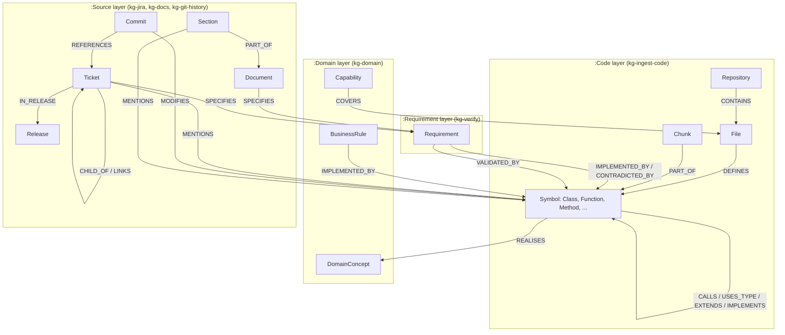
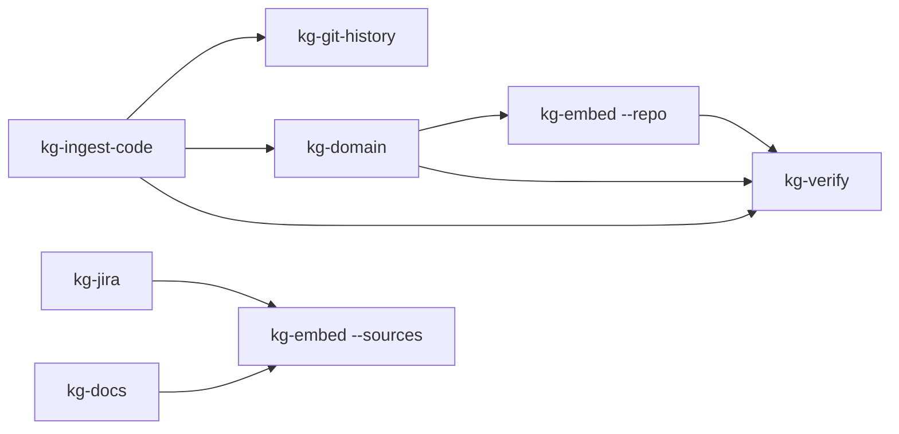
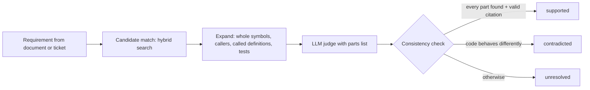

# Developer and user guide

This guide tells you how to set up the knowledge base, ingest data, test it and use it from a coding
agent. For deployment and incidents, see the [runbook](RUNBOOK.md).

- [1. Concepts](#1-concepts)
- [2. Set up a local environment](#2-set-up-a-local-environment)
- [3. Ingest data](#3-ingest-data)
- [4. Test the knowledge base](#4-test-the-knowledge-base)
- [5. Use the knowledge base from an agent](#5-use-the-knowledge-base-from-an-agent)
- [6. Extend the pipeline](#6-extend-the-pipeline)
- [7. Reference](#7-reference)

## 1. Concepts

The graph has four layers. Each layer has its own command and its own Dagster asset.



| Term | Meaning |
|---|---|
| Symbol | A class, interface, enum, function or method. Its id is `<repo>:<path>#<qualified name>`. |
| Chunk | Up to 120 lines of code, aligned to a symbol or to file-level code. Chunks carry the embeddings. |
| Edge method and confidence | Each code edge says how it was found: `scip` (compiler-grade, 1.0), `parser` (1.0), `treesitter` name match (0.4 to 0.8), `git` (0.6 to 1.0), `text` (0.6) or `llm`. Treat `llm` and low-confidence edges as hints. |
| Hybrid search | Vector search, full-text search and concept search, fused with reciprocal rank fusion (RRF, k = 60), then expanded through the graph. |
| Verdict | The result of a requirement check: `supported`, `contradicted` or `unresolved`. "Supported" needs every part of the requirement found in the evidence. |
| ACL group | A string such as `repo:precept`, `jira:PREC`, `confluence:ENG` or `docs:<collection>` on each source node. The MCP server sees only its groups. |

## 2. Set up a local environment

### Prerequisites

| Tool | Version | Use |
|---|---|---|
| Docker Desktop | 4.x | Neo4j, image builds, kind |
| Python | 3.13 | pipeline |
| Go | 1.26 | MCP server |
| Ollama | 0.12 or later | embeddings (`qwen3-embedding:0.6b`) and LLM (`qwen3.6:35b-a3b`) |
| Node.js 22 | optional | SCIP indexers for TypeScript and Python |

### Steps

1. Start Neo4j:

   ```bash
   docker run -d --name kg-neo4j -p 7474:7474 -p 7687:7687 -e NEO4J_AUTH=neo4j/<password> neo4j:2026.10.1-community
   ```

2. Pull the models:

   ```bash
   ollama pull qwen3-embedding:0.6b
   ollama pull qwen3.6:35b-a3b
   ```

3. Install the pipeline:

   ```bash
   cd pipeline
   python -m venv .venv
   .venv/Scripts/pip install -e ".[dev,dagster]"      # .venv/bin/pip on Linux and macOS
   ```

4. Optional: install SCIP indexers for compiler-grade call edges:

   ```bash
   npm install -g @sourcegraph/scip-typescript@0.6.0 @sourcegraph/scip-python@0.6.8
   go install github.com/scip-code/scip-go/cmd/scip-go@v0.2.9
   ```

   Without them, the pipeline uses Tree-sitter name matching (95.7 % precision against SCIP).

5. Set the environment. Do not write passwords into files that you commit:

   ```bash
   export NEO4J_URI=bolt://localhost:7687 NEO4J_USER=neo4j NEO4J_PASSWORD=<password>
   export EMBEDDINGS_URL=http://localhost:11434 EMBEDDINGS_MODEL=qwen3-embedding:0.6b
   export LLM_PROVIDER=ollama LLM_BASE_URL=http://localhost:11434 LLM_MODEL=qwen3.6:35b-a3b
   export LLM_CACHE_DIR=.kg-cache/llm
   ```

   On Windows PowerShell, use `scripts/local-env.ps1` as a template.

## 3. Ingest data

Run the steps in this order. Each step is idempotent: run it again at any time.



### 3.1 Code

```bash
kg-ingest-code --repo /path/to/checkout --name my-repo
```

| Option | Default | Effect |
|---|---|---|
| `--scip` | `auto` | `auto` runs installed indexers, `off` uses Tree-sitter only, or give `a.scip,b.scip=frontend` |
| `--scip-cache` | `.kg-cache/scip` | Reuse the index of a project folder whose files did not change |
| `--full-write` | off | Rewrite every node and edge. By default only changed items are written |
| `--json DIR` | none | Also write `nodes.jsonl`, `edges.jsonl` and `stats.json` |

The first run writes everything. Later runs write only changes: on a 5,300-node repository the
second run takes 4 s instead of 25 s and writes 0 nodes.

Supported languages: Java, Kotlin, TypeScript, JavaScript, Python, Go, C#, plus IBM ODM rule projects
(`.brl`, `.dta`, `.rfl`, `.ilr`, `.bom`, `.voc`, `.b2x`).

### 3.2 Git history

Run it after `kg-ingest-code`, because it maps changes to the current symbols:

```bash
kg-git-history --repo /path/to/checkout --name my-repo
```

The cursor is stored in the graph (`SyncState`). The next run reads only new commits. Use `--full`
to read the last `--max` commits again. Ticket keys (`PREC-123`) and feature ids (`P14-02`) in commit
messages become `REFERENCES` edges.

### 3.3 Domain model

```bash
kg-domain --repo my-repo                 # LLM per folder; about 45 s per module on a CPU
kg-domain --repo my-repo --no-llm        # roles only: entity, endpoint, controller, repository, ...
kg-domain --repo my-repo --module backend/app/routers --module frontend/src/store
```

Answers are cached by content hash in `LLM_CACHE_DIR`. A second run with no code change makes no LLM call.

### 3.4 Embeddings

```bash
kg-embed --repo my-repo        # code chunks and domain concepts
kg-embed --sources             # tickets and document sections
```

Only items whose text changed are embedded again.

### 3.5 Jira

1. Create an API token for a service account in Atlassian.
2. Set the environment:

   ```bash
   export JIRA_BASE_URL=https://your-site.atlassian.net JIRA_EMAIL=bot@example.com JIRA_API_TOKEN=<token>
   export JIRA_ACCEPTANCE_FIELD=customfield_10042    # optional
   ```

3. Run the sync:

   ```bash
   kg-jira --project PREC              # issues updated since the last run
   kg-jira --project PREC --full       # all issues
   kg-jira --project PREC --jql "sprint in openSprints()"
   ```

4. Embed the tickets: `kg-embed --sources`.

The sync reads descriptions, acceptance criteria, the last 10 comments, epics, issue links and fix
versions (releases). It links each file path or code name in the text to the code when the match is unique.

### 3.6 Documents and Confluence

```bash
kg-docs --path /path/to/docs --name product-docs     # .md .txt .pdf .docx .pptx .html
kg-docs --confluence ENG                             # one Confluence Cloud space
```

- PDF, DOCX, PPTX and HTML need Docling Serve at `DOCLING_URL` (default `http://localhost:5001`):
  `docker run -p 5001:5001 quay.io/docling-project/docling-serve:v1.38.2`.
- Confluence needs `CONFLUENCE_BASE_URL` (site root, without `/wiki`), `CONFLUENCE_EMAIL` and
  `CONFLUENCE_API_TOKEN`.
- Unchanged files (content hash) and pages (version number) are skipped. Deleted files and pages are
  removed from the graph.

### 3.7 Requirement checks

```bash
kg-verify --doc docs/features/P10-03-scenario-builder.md --repo my-repo --out report.md
kg-verify --ticket PREC-123 --repo my-repo
kg-verify --doc spec.pdf --repo my-repo --limit 10
```



## 4. Test the knowledge base

### 4.1 Unit and integration tests

```bash
cd pipeline && .venv/Scripts/python -m pytest -q      # 25 tests; Neo4j tests skip without NEO4J_PASSWORD
cd mcp && go test ./...                                # 7 tests; integration tests skip without NEO4J_PASSWORD
```

The Neo4j tests create their own data (repositories `it-*`, Jira project `KGT`, Confluence space
`KGT`) and delete it at the end. They do not change other data.

### 4.2 Search quality (evaluation set)

1. Write an evaluation file. Use the questions that developers ask, not the names in the code:

   ```yaml
   repo: my-repo
   k: 8
   search:
     - q: invite many people to an org at once
       expect: [bulk_invite, UsersView.onBulkInvite]   # qualified name, short name or path suffix
   impact:
     - symbol: ScenariosView
       depth: 2
       expect: [App]
   requirements:
     - ref: FR-P10-03-01
       verdict: supported
   ```

2. Run it:

   ```bash
   kg-eval pipeline/eval/precept.yaml --json eval.json
   kg-eval pipeline/eval/precept.yaml --min-hit 0.85     # exit 1 below 85 % (use in CI)
   ```

3. Compare `eval.json` with the last run before you merge a change to parsing, search or prompts.

Baseline on `precept` (31 questions):

| Metric | Value |
|---|---|
| Search hit@8 | 94 % |
| Search hit@3 | 77 % |
| MRR | 0.53 |
| Seconds per query | 2.2 |

### 4.3 Manual checks

| Check | Command |
|---|---|
| Search | `kg-search "who can invite users" --repo my-repo` |
| Counts per label | `MATCH (n) RETURN labels(n)[1] AS label, count(*) ORDER BY 2 DESC` in Neo4j Browser (`http://localhost:7474`) |
| Edges by method | `MATCH ()-[r]->() RETURN type(r), r.method, count(*) ORDER BY 3 DESC` |
| One ticket | MCP tool `get_context_for_ticket` with `{"key": "PREC-123"}` |

## 5. Use the knowledge base from an agent

### 5.1 Build and register the MCP server

```bash
cd mcp && go build -o kg-mcp .
claude mcp add kg --scope user -e NEO4J_PASSWORD=$NEO4J_PASSWORD -e EMBEDDINGS_URL=http://localhost:11434 \
  -e EMBEDDINGS_MODEL=qwen3-embedding:0.6b -e KG_DEFAULT_REPO=my-repo -- /path/to/kg-mcp
claude mcp get kg
```

For Cursor, Codex and opencode, use the same command and environment (see `mcp/.mcp.json.example`).
For a cluster, register the HTTP endpoint: `claude mcp add kg --transport http https://kg.example.com/mcp`.

### 5.2 Tools

| Tool | Ask it to | Example |
|---|---|---|
| `search_graph` | find code for a question | "where are users invited in bulk?" |
| `find_symbol` | look up a name | `{"name": "Invit*", "kind": "Class"}` |
| `get_symbol_code` | read one symbol | `{"symbol": "ScenariosView.onSave"}` |
| `impact_analysis` | see what a change breaks | `{"symbol": "create_invitation", "depth": 3}` |
| `find_related_tests` | know which tests to run | `{"symbol": "scenarioToRun"}` |
| `get_neighbors` | walk typed edges | `{"node_id": "...", "edge_types": ["CALLS"], "direction": "in"}` |
| `trace_requirement` | check a requirement | `{"requirement": "FR-P10-03-10"}` |
| `domain_overview` | get the business view | `{"repo": "my-repo"}` |
| `get_context_for_ticket` | start work on a ticket | `{"key": "PREC-123"}` |
| `search_knowledge` | find tickets and document sections | `{"query": "why scenarios are not in local storage"}` |
| `get_change_history` | see why code changed | `{"symbol": "scenarioStore.ts"}` |
| `read_cypher` | anything else, read only | `{"query": "MATCH (s:Symbol {role: 'endpoint'}) RETURN s.route LIMIT 20"}` |

### 5.3 Tell agents to use it

Add this to the `CLAUDE.md` or `AGENTS.md` of each repository:

```markdown
## Knowledge graph
Use the `kg` MCP tools before you read files at random:
- `get_context_for_ticket` when the task names a ticket.
- `search_graph` to find code; `search_knowledge` for specifications, ADRs and runbooks.
- `impact_analysis` and `find_related_tests` before you change shared code.
- `trace_requirement` to check a requirement.
```

### 5.4 Access control

Set `KG_ACL_GROUPS` on the server, not in the tool call. The agent cannot change it.

| Value | The server sees |
|---|---|
| `*` (default) | everything; `read_cypher` is on |
| `repo:precept,jira:PREC,confluence:ENG,docs:precept-docs` | code of `precept`, project PREC, space ENG and that document collection; `read_cypher` is off |

Run one server (or one Helm release) per audience.

## 6. Extend the pipeline

### 6.1 Add a source

1. Create `pipeline/kg_pipeline/sources/<name>.py` with a `sync(w, ...)` function.
2. Write nodes with `w.upsert(("<Label>",), rows)`. Each row needs `id`, `title`, `text`, `acl` and `source`.
3. Write edges with `w.link("<TYPE>", rows, dst="Code" | "Source", replace_from=ids)`.
4. Store a cursor with `w.state("<name>:<key>", value)` for incremental runs.
5. Call `link_mentions(w, rows)` to link code names in the text.
6. Add a CLI entry in `pyproject.toml`, an asset in `definitions.py` and fixtures and tests in `tests/`.
7. Add the label to `_source_texts` in `vectors.py` if agents must find it by meaning.

### 6.2 Add an MCP tool

1. Add an input struct with `json` and `jsonschema` tags in `mcp/tools.go` or `mcp/sources.go`.
2. Register the tool with `mcp.AddTool` and a description that tells the agent when to use it.
3. Use `$repos IS NULL OR x.repo IN $repos` in every query that returns code, and `s.allowed(acl)` for source nodes.
4. Add the tool to `TestToolsIntegration` and update the tool count.

### 6.3 Conventions

- Writes go only through `Neo4jWriter`; the MCP server only reads, in read transactions.
- Every edge carries `method` and `confidence`.
- LLM output is validated against a JSON schema, and citations must match the evidence.
- Change `PROMPT_VERSION` or `JUDGE_VERSION` when you change a prompt, so caches do not serve old answers.

## 7. Reference

### Commands

| Command | Purpose |
|---|---|
| `kg-ingest-code` | code layer (incremental) |
| `kg-git-history` | commits, changed symbols, references |
| `kg-domain` | roles, concepts, rules, capabilities |
| `kg-embed` | embeddings (`--repo`, `--sources`) |
| `kg-jira` | Jira issues and releases |
| `kg-docs` | documents and Confluence pages |
| `kg-verify` | requirement checks |
| `kg-search` | hybrid search from the shell |
| `kg-eval` | evaluation set |

### Environment variables

| Variable | Used by | Default |
|---|---|---|
| `NEO4J_URI`, `NEO4J_USER`, `NEO4J_PASSWORD` | all | `bolt://localhost:7687`, `neo4j` |
| `EMBEDDINGS_URL`, `EMBEDDINGS_MODEL`, `EMBEDDINGS_DIMENSIONS`, `EMBEDDINGS_API_KEY` | embed, search, MCP | `http://localhost:8080`, `Qwen/Qwen3-Embedding-0.6B`, `1024` |
| `LLM_PROVIDER`, `LLM_BASE_URL`, `LLM_MODEL`, `LLM_CONTEXT_TOKENS`, `LLM_CACHE_DIR` | domain, verify | `ollama`, `http://localhost:11434` |
| `DOCLING_URL` | docs, verify | `http://localhost:5001` |
| `JIRA_BASE_URL`, `JIRA_EMAIL`, `JIRA_API_TOKEN`, `JIRA_ACCEPTANCE_FIELD`, `JIRA_PROJECTS` | Jira | none |
| `CONFLUENCE_BASE_URL`, `CONFLUENCE_EMAIL`, `CONFLUENCE_API_TOKEN`, `CONFLUENCE_SPACES` | Confluence | none |
| `ATLASSIAN_EMAIL`, `ATLASSIAN_API_TOKEN` | Jira and Confluence fallback | none |
| `GIT_REPOSITORIES`, `GIT_BRANCH`, `GIT_TOKEN`, `SOURCE_ARCHIVE_PATH` | Dagster | `main`, `/archive` |
| `SCIP_CACHE_DIR` | code | `.kg-cache/scip` |
| `KG_DEFAULT_REPO`, `KG_ACL_GROUPS`, `MCP_HTTP_ADDR` | MCP | none, `*`, stdio |
