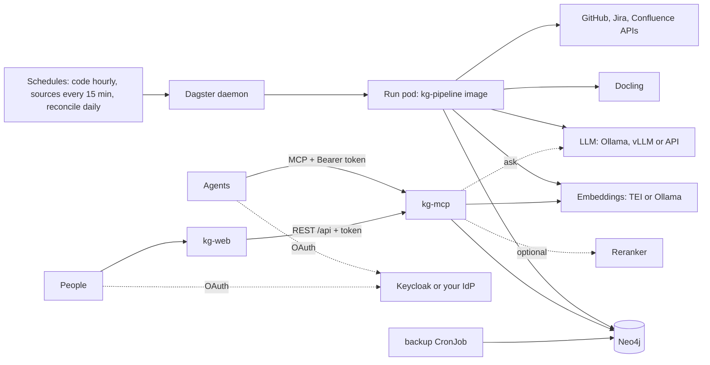

# Operations runbook

Procedures to deploy, run, check and repair the knowledge base on Kubernetes. For local development,
see the [guide](GUIDE.md).

- [1. Components](#1-components)
- [2. Deploy](#2-deploy)
- [3. Configure sources](#3-configure-sources)
- [4. Run ingestion](#4-run-ingestion)
- [5. Daily checks](#5-daily-checks)
- [6. Incidents](#6-incidents)
- [7. Maintenance](#7-maintenance)
- [8. Known limits](#8-known-limits)

## 1. Components

| Component | Kind | Port | Health check | Data |
|---|---|---|---|---|
| `kg-neo4j` | StatefulSet | 7687 (bolt), 7474 (HTTP) | startup probe on 7687 | graph, vectors, full text (PVC) |
| `kg-postgres` | StatefulSet | 5432 | `pg_isready` | Dagster runs and schedules (PVC) |
| `kg-dagster-webserver` | Deployment | 80 | `/server_info` | none |
| `kg-dagster-daemon` | Deployment | none | Dagster heartbeat | none |
| `kg-dagster-user-deployments-kg-pipeline` | Deployment | 3030 (gRPC) | gRPC ping | none |
| `dagster-run-*` | Job (one per run) | none | run status in Dagster | uses `kg-source-archive` PVC |
| `kg-docling` | Deployment | 5001 | `/health` | none |
| `kg-embeddings` (TEI) | Deployment | 8080 | `/health` | model cache |
| `kg-mcp` | Deployment | 8000 | `/healthz` (checks Neo4j) | none |
| `kg-reranker` (TEI, optional) | Deployment | 8080 | `/health` | model cache |
| `kg-web` (optional) | Deployment | 3000 | `/healthz` | none |
| `kg-keycloak` (optional, dev only) | Deployment | 8080 | `/health/ready` | realm `kg` from `files/keycloak/kg-realm.json` |
| `kg-neo4j-backup` (optional) | CronJob | none | job status | backup files on a PVC or in S3 |

`kg-mcp` also serves the REST layer for the web UI (`/api/*`), Prometheus metrics (`/metrics`) and,
with OAuth, the protected-resource metadata (`/.well-known/oauth-protected-resource`).



## 2. Deploy

### 2.1 Build the images

```bash
docker build -t <registry>/kg-pipeline:0.2.4 pipeline/       # add --build-arg WITH_JAVA=0 WITH_DOTNET=0 for a smaller image
docker build -t <registry>/kg-mcp:0.2.0 mcp/
docker build -t <registry>/kg-web:0.1.0 web/
docker push <registry>/kg-pipeline:0.2.4
docker push <registry>/kg-mcp:0.2.0
docker push <registry>/kg-web:0.1.0
```

### 2.2 Install

1. Select the cluster. Make sure the context is the one you intend:

   ```bash
   kubectl config current-context
   ```

2. Write a values file for your site (`values-site.yaml`):

   ```yaml
   mcp:
     enabled: true
     image: <registry>/kg-mcp:0.2.0
     aclGroups: "*"
   sources:
     git:
       repositories: [https://github.com/acme/app.git]
     jira:
       baseUrl: https://acme.atlassian.net
       projects: [APP]
     confluence:
       baseUrl: https://acme.atlassian.net
       spaces: [ENG]
   llm:
     baseUrl: http://ollama.ollama.svc:11434
   dagster:
     dagster-user-deployments:
       deployments:
         - name: kg-pipeline
           image: { repository: <registry>/kg-pipeline, tag: 0.2.1, pullPolicy: IfNotPresent }
           dagsterApiGrpcArgs: ["--module-name", "kg_pipeline.definitions"]
           port: 3030
           includeConfigInLaunchedRuns: { enabled: true }
           envConfigMaps: [{ name: kg-endpoints }]
           envSecrets: [{ name: kg-credentials }, { name: kg-source-credentials }]
           volumes: [{ name: source-archive, persistentVolumeClaim: { claimName: kg-source-archive } }]
           volumeMounts: [{ name: source-archive, mountPath: /archive }]
   ```

3. Create the source credentials. Do not put tokens in a values file in git:

   ```bash
   kubectl create namespace kg
   kubectl -n kg create secret generic kg-source-credentials \
     --from-literal=ATLASSIAN_EMAIL=bot@acme.com --from-literal=ATLASSIAN_API_TOKEN=<token> \
     --from-literal=GIT_TOKEN=<token>
   ```

4. Install with a profile and your values. Set `sources.createSecret=false`, because you made the secret:

   ```bash
   helm install kg deploy/helm/knowledge-graph -n kg -f deploy/helm/knowledge-graph/values-small.yaml \
     -f values-site.yaml --set sources.createSecret=false
   ```

5. Wait for the pods:

   ```bash
   kubectl -n kg wait --for=condition=Ready pod --all --timeout=600s
   ```

| Profile | File | Size |
|---|---|---|
| Default | `values.yaml` | production: TEI embeddings and reranker in the cluster, larger Neo4j |
| Small | `values-small.yaml` | pilot: 1 node of 8 vCPU / 32 GB, or 3 nodes of 4 vCPU / 16 GB |
| kind | `values-kind.yaml` | laptop test: about 2 vCPU / 4 GiB; models in Ollama on the host |

### 2.3 Test on a laptop (kind)

**Caution:** `kind create cluster` changes your current kube context. Use a separate kubeconfig.

```bash
export KUBECONFIG=$HOME/.kube/kg-test.kubeconfig
kind create cluster --name kg-test
docker build -t kg-pipeline:0.2.4 --build-arg WITH_JAVA=0 --build-arg WITH_DOTNET=0 pipeline/
docker build -t kg-mcp:0.2.0 mcp/
docker build -t kg-web:0.1.0 web/
kind load docker-image kg-pipeline:0.2.4 kg-mcp:0.2.0 kg-web:0.1.0 --name kg-test
helm install kg deploy/helm/knowledge-graph -n kg --create-namespace -f deploy/helm/knowledge-graph/values-kind.yaml
```

- Add `-f deploy/helm/knowledge-graph/values-kind-oidc.yaml` to test OAuth with a dev Keycloak
  (see [governance.md](streams/governance.md#test-on-kind)).
- Open the web UI with `kubectl -n kg port-forward svc/kg-web 3000`.
- Materialize the code assets for the test repository in the Dagster UI, or from the code-server pod:

  ```bash
  kubectl -n kg exec deploy/kg-dagster-user-deployments-kg-pipeline -- sh -c \
    'DAGSTER_HOME=/tmp/dh dagster asset materialize -m kg_pipeline.definitions --select "code_snapshot,git_history,domain_model,vector_index,summaries,service_catalog" --partition itsdangerous'
  ```

The result of the last end-to-end check is in [kg-test-e2e.md](streams/kg-test-e2e.md).

Remove it with `kind delete cluster --name kg-test`.

## 3. Configure sources

| Source | Values | Secret keys | Asset |
|---|---|---|---|
| Git | `sources.git.repositories` | `GIT_TOKEN` (private repositories) | `code_snapshot`, `git_history` |
| Jira | `sources.jira.baseUrl`, `projects`, `acceptanceField` | `ATLASSIAN_EMAIL`, `ATLASSIAN_API_TOKEN` | `jira_issues` |
| Confluence | `sources.confluence.baseUrl` (site root), `spaces` | same as Jira | `confluence_pages` |
| LLM | `llm.*` | `LLM_API_KEY` if needed | `domain_model` |
| Embeddings | `models.*` (TEI) or `models.selfHosted=false` + `externalUrl` | `EMBEDDINGS_API_KEY` if needed | `vector_index`, `source_vectors` |
| Reranker (optional) | `models.reranker.enabled`, or `models.reranker.externalUrl` | `RERANK_API_KEY` if needed | used by `kg-mcp` and search |
| GitHub | `sources.github.repositories`, `apiUrl` | `GITHUB_TOKEN` (required for repositories taken from `sources.git`) | `github_prs` |
| Catalog and people | `sources.people.aliasesFile` | none | `service_catalog`, `people` |
| Permissions | `sources.jira`, `sources.confluence` | the Atlassian account needs to read permission schemes and restrictions | `source_permissions` |
| Masking | `sources.privacy.mode`, `allow` | none | every write |
| Summaries and freshness | `llm.enabled`, `llm.summaryBudget`, `llm.freshnessCheck`, `llm.freshnessBudget` | none | `summaries`, `doc_freshness` |
| MCP access | `mcp.aclGroups`, `mcp.oidc.*`, `mcp.aclMapping`, `mcp.audit`, `mcp.writeback` | none (public keys come from the issuer) | `kg-mcp` |
| Web UI | `web.enabled`, `web.image`, `web.oidc.*` | `web.oidc.existingSecret` with `OIDC_CLIENT_SECRET` and `AUTH_SECRET` | `kg-web` |
| Tracing and metrics | `observability.otlpEndpoint`, `observability.prometheusAnnotations` | `OTEL_EXPORTER_OTLP_HEADERS` in `sources.credentials` | all |
| Backup | `backup.*` | `backup.s3.secretName` for S3 | CronJob |

With `llm.enabled=false`, `kg-mcp` has no `ask` tool and the summaries are extractive.

Dagster reads code only from git URLs. To ingest a folder that is not a git repository, run the CLI
steps in [guide 3.0](GUIDE.md#30-local-folders-and-code-outside-git). To connect a system that is not in
this table, see [guide 6.1](GUIDE.md#61-add-a-source).

**Caution:** The embedding model must be the same for the pipeline and `kg-mcp`. If you change it,
delete the embeddings and the vector indexes, then embed again (see [7.3](#73-change-the-embedding-model)).

## 4. Run ingestion

### 4.1 Schedules

All schedules are off after install. Turn them on in the Dagster UI (Overview > Schedules):

| Schedule | Cron | Assets |
|---|---|---|
| `hourly_code` | `0 * * * *` | `code_snapshot` (with links), `git_history`, `domain_model`, `vector_index`, `summaries`, `service_catalog` (one run per repository) |
| `sources_every_15_min` | `*/15 * * * *` | `jira_issues`, `confluence_pages`, `source_permissions`, `github_prs`, `source_vectors`, `doc_freshness`, `people` |
| `daily_reconcile` | `0 3 * * *` | `source_reconcile` (deletes and moves), `document_duplicates` |

Every asset applies the approved corrections after its writes.

**Caution:** `source_reconcile` stops with `TooManyRemovals` when it would remove more than half of a
source. Check the source before you set `RECONCILE_FORCE=1` for one run (see [6.9](#69-reconcile-stops-with-toomanyremovals)).

Code runs are cheap when nothing changed: only changed nodes and edges are written, and SCIP indexes
of unchanged project folders are reused.

### 4.2 Run once

1. Open the Dagster UI:

   ```bash
   kubectl -n kg port-forward svc/kg-dagster-webserver 3000:80
   ```

2. Go to `http://localhost:3000` > Assets.
3. Select the assets and a partition (repository), then click **Materialize**.
4. Follow the run in Runs. Each run is a pod `dagster-run-<id>`.

The first run of a large repository takes longest (SCIP indexing and the LLM for each module). The
LLM step takes about 45 s per module on a CPU; use a GPU server for many repositories.

### 4.3 Requirement checks

Run them from a pipeline pod when a specification changes:

```bash
kubectl -n kg exec deploy/kg-dagster-user-deployments-kg-pipeline -- \
  kg-verify --ticket APP-123 --repo app
```

## 5. Daily checks

| Check | How | Expected |
|---|---|---|
| Pods | `kubectl -n kg get pods` | all `Running`, no restarts that increase |
| Failed runs | Dagster UI > Runs, filter `Failure` | none in the last 24 h |
| MCP health | `kubectl -n kg port-forward svc/kg-mcp 8000:8000` then `curl localhost:8000/healthz` | `ok` |
| Freshness | Cypher: `MATCH (s:SyncState) RETURN s.key, s.value, s.updated_at ORDER BY s.updated_at` | each cursor updated within its schedule |
| Search quality | `kg-eval eval/<repo>.yaml --min-hit 0.85` (weekly, or after each release) | exit code 0 |
| Disk | `kubectl -n kg exec kg-neo4j-0 -- df -h /data` | less than 80 % used |
| Tool errors and latency | Prometheus: `sum by (tool) (rate(kg_mcp_tool_errors_total[5m]))` and p95 of `kg_mcp_tool_duration_seconds` | no tool with a rising error rate |
| Open proposals | `kubectl -n kg exec deploy/kg-dagster-user-deployments-kg-pipeline -- kg-review list` | reviewed within a working day |
| Denied calls | audit lines with `"denied":true` in the `kg-mcp` log (or `KG_AUDIT_FILE`) | only expected callers |
| Backup | last `kg-neo4j-backup` job `Complete`; `kg-backup check <file>` on the newest file | one complete file per day |
| Stale documents | Cypher: `MATCH (n:Source {stale: true}) RETURN labels(n)[1], count(*)` | the owners know about them |

## 6. Incidents

### 6.1 Neo4j pod in CrashLoopBackOff

1. Read the log: `kubectl -n kg logs kg-neo4j-0 --previous`.
2. Find the cause in this table:

| Log message | Cause | Fix |
|---|---|---|
| `Unrecognized setting. No declared setting with name: ...` | A `NEO4J_*` env name that this Neo4j version does not know. In env names `_` is `.` and `__` is `_`. | Correct the name in `templates/neo4j.yaml`, then `helm upgrade`. |
| `OutOfMemoryError` | Heap too small | Increase `neo4j.heapSize` and the memory limit |
| `No space left on device` | PVC full | Increase `neo4j.persistence.size` (if the StorageClass allows expansion) |

3. After `helm upgrade`, delete the pod so that the StatefulSet starts it with the new spec:
   `kubectl -n kg delete pod kg-neo4j-0`.

### 6.2 kg-mcp not ready

`/healthz` returns 503 when Neo4j does not answer. Repair Neo4j first; kg-mcp becomes ready by itself.

### 6.3 Run fails at start with `Couldn't import module dagster_postgres`

The pipeline image does not have the Dagster storage libraries. Build it from the current
`pipeline/Dockerfile`: the `dagster` extra includes `dagster-postgres` and `dagster-k8s`.

### 6.4 Run fails in `code_snapshot`

| Message | Cause | Fix |
|---|---|---|
| `Set GIT_REPOSITORIES` | No repositories configured | Set `sources.git.repositories` |
| `git ... Authentication failed` | Private repository without token | Add `GIT_TOKEN` to `kg-source-credentials` |
| `scip-<lang> failed in <folder>` (warning) | The project does not build (missing dependencies) | Not an error: Tree-sitter edges are used for that folder |

### 6.5 Run fails in `jira_issues` or `confluence_pages`

| Message | Cause | Fix |
|---|---|---|
| `HTTP 401` | Wrong email or token | Replace the token in the secret, then restart the run |
| `HTTP 403` or `space ... not found or not visible` | The service account has no access | Give the account browse access to the project or space |
| `HTTP 429` (in logs, then success) | Rate limit | Nothing; the client waits for `Retry-After` |
| `invalid Jira project key` | Wrong key in `sources.jira.projects` | Use the key, for example `APP`, not the name |

### 6.6 Search returns poor results

1. Run `kg-eval` and compare with the last report.
2. Check that the embedding model of the pipeline and `kg-mcp` are the same (`EMBEDDINGS_MODEL`).
3. Check that `vector_index` and `source_vectors` ran after the last code or source change.
4. Check that the vector indexes are online: `SHOW VECTOR INDEXES`.

### 6.7 Docker Desktop stops during a kind test

TEI on CPU and large image loads can stall the Docker VM. Use `values-kind.yaml` (models in Ollama
on the host), load one image at a time and restart Docker Desktop if `docker info` does not answer.

### 6.8 Run fails in `github_prs` with `GitHub rate limit: reset in N s`

| Cause | Fix |
|---|---|
| No `GITHUB_TOKEN`: GitHub allows 60 calls per hour | Add `GITHUB_TOKEN` to the source credentials. Without a token, set only `sources.github.repositories` for small repositories. |
| First run of a large repository: about 4 calls per pull request | Nothing: the next run continues from the cursor. Or run `kg-github --repo <owner/repo> --name <name> --max 200` once from the pipeline pod. |

`people` depends on `github_prs`. When `github_prs` fails, materialize `people` alone.

### 6.9 Reconcile stops with `TooManyRemovals`

The run would remove more than half of a project, space, folder or repository with more than 20 items.
A broken listing or a lost permission looks the same as a mass delete.

1. Read the summary in Neo4j: `MATCH (s:SyncState) WHERE s.key STARTS WITH 'reconcile:' RETURN s.key, s.value`.
2. Check in the source that the items are really gone.
3. If they are gone, run the asset once with `RECONCILE_FORCE=1`, or the CLI with `--force`.
4. If they are not gone, repair the service account permissions. Do not force.

### 6.10 Agents or the web UI get 401 or 403 from `kg-mcp`

| Answer | Cause | Fix |
|---|---|---|
| 401 with `WWW-Authenticate` | no token, expired token, wrong issuer or audience | The client must sign in again. Check that the token `iss` equals `mcp.oidc.issuer` and `aud` contains `mcp.oidc.audience`. |
| 403 | a scope in `KG_OIDC_SCOPES` is missing, or a write-back tool without `KG_OIDC_WRITE_SCOPE` | Add the scope to the client in the identity provider |
| Tool result empty or "not found or not visible" | the caller's groups do not include the ACL of the data | Check `mcp.aclMapping` and the token `groups` claim; the audit line shows the effective groups |
| `read_cypher is off for scoped callers` | the caller's groups do not include `*` | Expected. Give `*` only to administrators. |

### 6.11 `ask` times out or is missing

- Missing: `llm.enabled` is `false`, or `KG_ASK=off`. This is the expected result without an LLM.
- Timeout: the LLM is too slow (for example a 35B model on CPU). Use a GPU server (vLLM), or set
  `mcp.env.LLM_REASONING_EFFORT: none` for Ollama models with a thinking phase.

### 6.12 `kubectl` fails with `x509: certificate signed by unknown authority` on a laptop

An antivirus that inspects TLS on `127.0.0.1` (for example Avast Web/Mail Shield) replaces the
certificate of the kind API server. Do not turn off the antivirus. Run `kubectl` and `helm` in a
container on the `kind` network with the internal kubeconfig instead (see [kg-test-e2e.md](streams/kg-test-e2e.md)).

## 7. Maintenance

### 7.1 Upgrade

1. Build and push the new images with a new tag.
2. Update the tags in your values file.
3. Run `helm upgrade kg deploy/helm/knowledge-graph -n kg -f <profile> -f values-site.yaml`.
4. Run `kg-eval` and compare with the last report.

### 7.2 Back up and restore Neo4j (Community)

Use the online logical backup for daily backups. Use the offline dump below for a physical copy in a
maintenance window.

**Online backup (`kg-backup`).** Set `backup.enabled=true` and `backup.target` (`pvc` or `s3`). The
CronJob runs `kg-backup dump` at 02:30 and keeps `backup.keep` files on the PVC. For S3 (SeaweedFS,
MinIO, AWS), set a lifecycle rule on the bucket.

```bash
kg-backup dump --out /archive/backups/neo4j --keep 7
kg-backup check /archive/backups/neo4j/neo4j-<time>.jsonl.gz
```

To restore:

1. Stop the writers: `kubectl -n kg scale deploy -l app.kubernetes.io/name=dagster-user-deployments --replicas=0`, and stop the schedules.
2. Get an empty database: scale `kg-neo4j` to 0, delete the PVC `data-kg-neo4j-0`, scale it to 1.
3. In a pod with the kg-pipeline image, run `kg-backup check <file>`, then `kg-backup restore <file>`.
4. Compare `MATCH (n) RETURN count(n)` and `MATCH ()-[r]->() RETURN count(r)` with the counts of `kg-backup check`.
5. Start the Dagster user deployment and the schedules again.

**Caution:** the archive PVC is `ReadWriteOnce`. If the backup pod can run on another node than the
run pods, use a `ReadWriteMany` claim or the S3 target. See [ops-eval.md](streams/ops-eval.md#6-backup-and-restore).

**Offline dump.**

1. Scale the writers down: turn off the schedules and wait for the runs to finish.
2. Dump the database:

   ```bash
   kubectl -n kg exec kg-neo4j-0 -- neo4j-admin database dump neo4j --to-path=/data/backups --overwrite-destination
   kubectl -n kg cp kg-neo4j-0:/data/backups/neo4j.dump ./neo4j-$(date +%F).dump
   ```

   On Community, `dump` needs the database offline in some versions; if it refuses, stop Neo4j with
   `kubectl -n kg scale statefulset kg-neo4j --replicas=0` and dump from a pod that mounts the PVC.

3. To restore, copy the dump back and run `neo4j-admin database load neo4j --from-path=/data/backups --overwrite-destination`
   with Neo4j stopped.

All data can also be rebuilt from the sources: run every asset with `--full` options.

### 7.3 Change the embedding model

1. Set the new model and dimensions for the pipeline and `kg-mcp`.
2. Delete the old vectors and indexes:

   ```cypher
   MATCH (n) WHERE n.embedding IS NOT NULL REMOVE n.embedding, n.embedding_hash;
   DROP INDEX chunk_embedding IF EXISTS; DROP INDEX concept_embedding IF EXISTS;
   DROP INDEX requirement_embedding IF EXISTS; DROP INDEX source_embedding IF EXISTS;
   ```

3. Materialize `vector_index` for every repository and `source_vectors`.

### 7.4 Rotate credentials

1. Update `kg-source-credentials` (or `sources.credentials` and `helm upgrade`).
2. Restart the code server: `kubectl -n kg rollout restart deploy/kg-dagster-user-deployments-kg-pipeline`.
3. New runs read the new values.

### 7.5 Remove a repository or source

| Remove | Cypher |
|---|---|
| A repository | `MATCH (n:Code {repo: 'app'}) DETACH DELETE n` and `MATCH (n:Commit {repo: 'app'}) DETACH DELETE n` |
| A Jira project | `MATCH (n:Source) WHERE n.id STARTS WITH 'jira:APP-' OR n.id STARTS WITH 'jira:release:APP:' DETACH DELETE n` |
| A Confluence space | `MATCH (n:Source) WHERE n.id STARTS WITH 'confluence:ENG:' DETACH DELETE n` |
| The pull requests of a GitHub repository | `MATCH (n:Source) WHERE n.id STARTS WITH 'github:acme/app#' DETACH DELETE n` |
Also delete its `SyncState` cursor: `MATCH (s:SyncState) WHERE s.key STARTS WITH 'jira:APP' DELETE s`.

## 8. Known limits

| Limit | Effect | Workaround |
|---|---|---|
| HTTP calls and routes are found with regular expressions | URLs built at run time and some route prefixes (Express `app.use`, Django `urls.py`) are not linked | use `kg-links.yaml`; search the test folder for the route |
| Tests that call methods on pytest fixtures | no `CALLS` edge, so `find_related_tests` finds no test | search the test folder for the method name |
| The reranker effect is not measured | the reranker is off by default | measure with `kg-eval` before you turn it on |
| `ask`, LLM summaries and the freshness LLM check are not tested with the production LLM | answer quality is unknown | run the answer cases of `kg-eval` against the LLM server |
| Not tested against real Jira, Confluence, GitHub or Keycloak | API or permission differences can show up | start with one project and one space; compare the ACLs with `kg-permissions --dry-run` |
| Tokens are not introspected | a revoked token works until it expires | keep token lifetimes short |
| One MCP replica with a small Neo4j is saturated near 50 concurrent clients | latency grows | add `kg-mcp` replicas |
| Older commits map to symbols through hunk headers (confidence 0.6) | less exact history for old changes | use file-level `MODIFIES` edges |
| The LLM judge can disagree with a human reviewer | verdicts are evidence, not proof | review `unresolved` and `contradicted` items; tune the evaluation set |
| Jira and Confluence: Cloud REST APIs only | Data Center is not tested | use the Cloud API or add a client |
| Neo4j Community has no role-based access | ACL is enforced in `kg-mcp` only | do not give agents direct Neo4j access |
