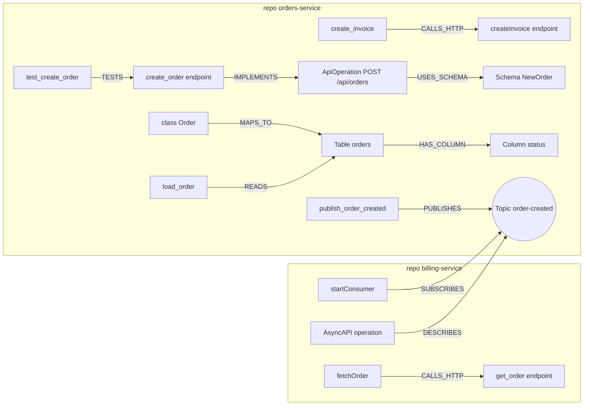
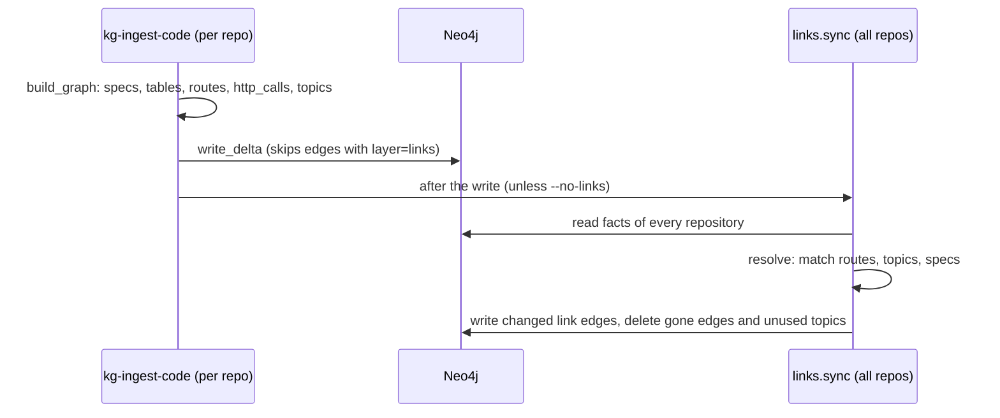

# Stream 5: API contracts, database schemas and links between repositories

This stream adds a contracts layer to the code graph. It finds API specs, database schemas, HTTP
client calls, HTTP tests and message topics, and links them across repositories.

## 1. What it builds



`E2` is in `orders-service`. The diagram puts it here to keep the arrows short.

| Part | File | Output |
|---|---|---|
| OpenAPI 3.x, Swagger 2.0, AsyncAPI 2.x / 3.x | `kg_pipeline/code/openapi.py` | `:Contract:ApiOperation`, `:Contract:Schema`, `USES_SCHEMA` |
| Database schemas | `kg_pipeline/code/dbschema.py` | `:Table`, `:Column`, `HAS_COLUMN`, `FOREIGN_KEY`, `DEFINES` / `MIGRATES`, `MAPS_TO`, `READS`, `WRITES` |
| Routes, HTTP calls and topics (facts per repository) | `kg_pipeline/code/httpcalls.py` | properties on symbols: `endpoint_method`, `endpoint_route`, `http_calls`, `publishes`, `subscribes`; `:Symbol:Route` nodes for inline route handlers |
| Hook into the code ingest | `kg_pipeline/code/contracts.py` | called by `build_graph` after name resolution |
| Links between repositories | `kg_pipeline/code/links.py` (`kg-links`) | `CALLS_HTTP`, `TESTS`, `IMPLEMENTS` (endpoint to operation), `PUBLISHES`, `SUBSCRIBES`, `DESCRIBES`, `:Topic` |
| MCP | `mcp/contracts.go`, small changes in `mcp/tools.go` | tool `get_contract`; `impact_analysis` and `find_related_tests` follow the new edges |

### 1.1 Node ids

| Node | Id |
|---|---|
| ApiOperation | `<repo>:<spec path>#<METHOD> <path>`, for example `orders-service:openapi.yaml#POST /api/orders`. AsyncAPI: `#PUBLISH <channel>` or `#SUBSCRIBE <channel>` |
| Schema | `<repo>:<spec path>#schema:<name>` |
| Table | `<repo>:db:<table name in lower case>` |
| Column | `<table id>.<column name>` |
| Route | `<repo>:<path>#route:<METHOD> <path>` (route with an inline handler function) |
| Topic | `topic:<name>`. A topic belongs to no repository. `brokers` and `repos` list where it is used |

### 1.2 Edge direction

All new edges point from the dependant to the thing it depends on, as the existing `CALLS` edges do.
The endpoint implements the operation, so the edge is `endpoint -IMPLEMENTS-> ApiOperation`. This is
the same direction as `class -IMPLEMENTS-> interface`.

### 1.3 Edge evidence

| Edge | `method` | `confidence` |
|---|---|---|
| `USES_SCHEMA`, `HAS_COLUMN`, `FOREIGN_KEY`, `DEFINES`, `MIGRATES` | `parser` | 1.0 |
| `MAPS_TO` ORM class to table | `parser` | 0.9 with an explicit table name, 0.7 with a derived name (Django `<app>_<model>`, JPA snake case) |
| `READS` / `WRITES` from SQL in a string | `heuristic` | 0.8 for a known table; 0.5 for an unknown table in upper-case SQL (the step then makes the table, with `sources: [code]`) |
| `READS` / `WRITES` from ORM calls | `heuristic` | 0.6 (SQLAlchemy), 0.7 (Django, Spring Data repository), 0.8 (Prisma) |
| `CALLS_HTTP`, `TESTS`, `IMPLEMENTS` | `heuristic` | 0.9 same route, 0.8 parameter against literal segment, 0.6 suffix match (at least 2 segments); +0.05 when a `kg-links.yaml` service matches; x0.8 for 2 or 3 tied targets; not linked for more than 3 |
| `PUBLISHES`, `SUBSCRIBES` | `heuristic` | 0.8 |
| `DESCRIBES` | `heuristic` | 0.9 |

Link edges also carry `layer: links`, `route`, `http_method`, `match` (`exact`, `param`, `suffix`) and
`cross_repo: true` when the two ends are in different repositories.

## 2. How the links step works



1. `kg-ingest-code` writes facts on symbols. It does not make edges between repositories, because one
   repository does not know the others.
2. After the write, `links.sync` reads the facts of all repositories and recomputes every link edge.
   It compares `content_hash` and writes only changes. A second run with no change writes 0 edges.
3. `write_delta` ignores edges with `layer = 'links'`, so a code snapshot of one repository does not
   delete the links to other repositories.
4. A caller links to the endpoint symbol first. It links to the ApiOperation only when no endpoint
   matches (for example, a spec of an external service).
5. When the caller path matches the test rule of the MCP server (`testPathRegex`), the edge is
   `TESTS`, not `CALLS_HTTP`.

### 2.1 What is detected

| Kind | Patterns |
|---|---|
| Endpoint routes | Decorators and annotations that `domain/roles.py` marks as endpoints. Prefixes: FastAPI `APIRouter(prefix=)` through `include_router` chains, Flask `Blueprint(url_prefix=)` / `register_blueprint`, Spring class `@RequestMapping`, NestJS `@Controller`, ASP.NET `[Route]` with `[controller]` |
| Route registrations | Express / Koa / Fastify `router.post('/x', handler)`, gin / echo / chi `r.GET("/x", h)`, Go `http.HandleFunc("GET /x", h)`, ASP.NET `app.MapGet("/x", ...)` |
| HTTP clients | `fetch` (method from the options), axios, requests, httpx, Go `http.Get` / `http.NewRequest`, Java `RestTemplate` / `WebClient`, C# `HttpClient` / `HttpRequestMessage` |
| HTTP test clients | supertest `request(app).post`, FastAPI / Starlette `TestClient`, Go `httptest.NewRequest`, Spring `MockMvc` `perform(get(...))`, ASP.NET `WebApplicationFactory` clients |
| Topics | Kafka (`kafkaTemplate.send`, `ProducerRecord`, kafkajs, kafka-python, `@KafkaListener`), RabbitMQ (`basic_publish`, `basic_consume`, `convertAndSend`, `sendToQueue`, `@RabbitListener`), SQS (`send_message`, `SendMessageCommand`, `@SqsListener`, name = last URL segment), NATS (`nc.publish`, `nc.subscribe`), NestJS `@EventPattern` / `@MessagePattern` |
| Database schemas | SQL `CREATE TABLE`, `ALTER TABLE ADD / DROP COLUMN`, `DROP TABLE`, `REFERENCES`; Alembic `op.create_table` / `op.add_column` / `op.drop_column`; Prisma `model` with `@@map` / `@map`; SQLAlchemy, Django, JPA / Hibernate, TypeORM, EF `[Table]` models |
| ODM | A `BomClass` that maps to a Java class (existing `odm.py` and `link_bom` output) also gets `MAPS_TO` to the table of that class |

Base URLs: a URL that starts with `${NAME}`, `{NAME}`, `NAME +` or a host (`http://billing:3000`) gives
a hint. A constant in the same file such as `PROVIDERS = "/api/ai/providers"` becomes part of the path.

## 3. Configuration

`kg-links.yaml` maps the base-URL names and hosts that callers use to the repository that serves them.
Put it in the root of a repository (the ingest stores it on the `Repository` node), or give it with
`kg-links --config` or the environment variable `KG_LINKS_CONFIG`.

```yaml
services:
  billing:                      # matched against BILLING_URL, BILLING_SERVICE_URL, host billing, ...
    repo: billing-service
    base_path: /api             # optional: prefix that the base URL adds
    hints: [PAYMENTS_HOST]      # optional: more names
```

Without the file, routes match in all repositories; a tie prefers the caller's own repository.

| Setting | Where | Default |
|---|---|---|
| `kg-links.yaml` in the repository root | ingest | none |
| `KG_LINKS_CONFIG` or `kg-links --config` | links step | none |
| `kg-ingest-code --no-links` | ingest | links run after each Neo4j write |
| Dagster `code_snapshot` | `definitions.py` | runs `links.sync` after `write_delta` |

## 4. Use it

1. Ingest each repository: `kg-ingest-code --repo ../orders-service --name orders-service`. The links
   step runs at the end.
2. To relink only, run `kg-links`.
3. In the MCP server, call `get_contract`:

   | Input | Result |
   |---|---|
   | `{"contract": "createOrder"}` or `{"contract": "POST /api/orders"}` | operation, schemas, implementers, callers in all repositories, HTTP tests |
   | `{"contract": "<endpoint symbol id>"}` | operations it implements, its callers and HTTP tests |
   | `{"contract": "orders"}` | columns, foreign keys, mapped classes, readers, writers, migrations, tests that reach them |
   | `{"contract": "order-created"}` | publishers, subscribers, AsyncAPI specs |

4. `impact_analysis` now follows `CALLS_HTTP`, `TESTS` and `IMPLEMENTS`, and it adds the subscribers
   of topics that the symbol publishes to. `find_related_tests` follows `CALLS_HTTP` and `TESTS`, and
   it adds tests that drive a publisher of a topic that the symbol consumes. The edge lists are
   `impactEdges` and `testEdges` in `mcp/contracts.go`.

## 5. Test

| Test | Command | Needs |
|---|---|---|
| Unit tests (fixture services, patterns per language, match rules) | `cd pipeline && .venv/Scripts/python -m pytest tests/test_contracts.py` | nothing |
| Links sync is incremental and survives a code snapshot | same, with `NEO4J_URI` and `NEO4J_PASSWORD` | Neo4j |
| precept login test reaches the login endpoint | same, with `KG_PRECEPT_REPO=C:/workspace/precept` | a precept checkout (read only) |
| MCP `get_contract`, impact and tests across the fixture services | `cd mcp && go test ./...` with `NEO4J_PASSWORD` | Neo4j with `orders-service` and `billing-service` ingested |

The fixtures are in `pipeline/tests/fixtures/services/`: `orders-service` (Python, FastAPI, SQL
migrations, SQLAlchemy, Kafka producer, OpenAPI spec) and `billing-service` (TypeScript, Express,
Prisma, kafkajs consumer, AsyncAPI spec). Each one calls the other over HTTP.
`tests/fixtures/conftest.py` stops pytest from collecting the fixture tests.

Result on precept (no SCIP, 4 s for the whole build):

| Measure | Value |
|---|---|
| Endpoints with a full route | 85 |
| Symbols with HTTP calls | 270 |
| Symbols linked to an endpoint | 263 (the 7 others call external APIs, send CORS preflights or call a probe route that the test adds) |
| `TESTS` edges | 291 |
| `CALLS_HTTP` edges (frontend to backend) | 60 |
| Login test (`test_login_sets_last_login_and_records_event`) | `TESTS` to `backend/app/routers/auth.py#login`, confidence 0.9 |
| Frontend `auth.ts#login` | `CALLS_HTTP` to the same endpoint, confidence 0.9 |

## 6. Limits

- Detection uses regular expressions on source text. A URL that is built at run time (a variable
  without a literal path) is not found. Relative URLs without a leading `/` (`"api/orders"`) are not found.
- The `fetch` method comes from the `method:` option inside the same call. A method set elsewhere is read as `GET`.
- Route prefixes: Express `app.use('/api', router)`, Django `urls.py`, Go sub-routers and NestJS
  global prefixes are not followed. The suffix match (confidence 0.6) covers some of these cases.
- ORM writes in SQLAlchemy are found only for `add(Model(...))`, `insert(Model)`, `update(Model)` and
  `delete(Model)`. `db.add(order)` with a variable is not linked to a table.
- Tables are per repository. Two repositories that share one database get two `Table` nodes.
- JPA column names come only from `@Column(name = ...)`. EF and TypeORM columns are not read.
- A test inside an anonymous callback (`it("...", async () => ...)`) is attributed to the test file
  node, not to a symbol. `find_related_tests` and `impact_analysis` accept such file nodes.
- Topic names must be literals. A topic id has no broker part: the same name on two brokers is one topic.
- The links step reads all repositories each time. On very large graphs this is one read of all
  symbols with facts and all operations per ingest.
