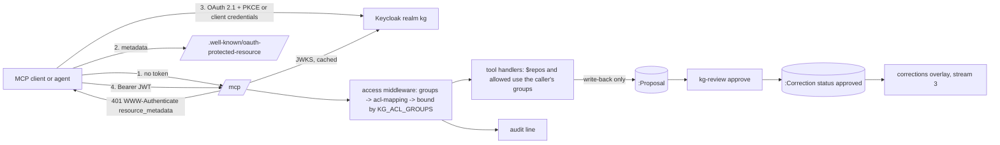

# Stream 7: governance, per-user access and write-back with review

This stream adds OAuth for the MCP server, an ACL per caller, precise ACLs from Jira and
Confluence, an audit log and write-back through reviewed proposals.

| Part | Files | Command or endpoint |
|---|---|---|
| OAuth 2.1 protected resource | `mcp/auth.go` | `/mcp` (401 + `WWW-Authenticate`), `/.well-known/oauth-protected-resource[/mcp]` |
| Per-user ACL | `mcp/access.go`, `mcp/acl.go`, `mcp/graph.go` | `KG_ACL_MAPPING` (acl-mapping.yaml) |
| Audit log | `mcp/audit.go` | `KG_AUDIT`, `KG_AUDIT_FILE` |
| Write-back tools | `mcp/writeback.go` | `report_wrong_fact`, `record_decision`, `suggest_link` |
| REST feedback and identity | `mcp/feedback.go`, `mcp/feedback_types.go` | `FeedbackSink`, `OIDC.Caller` for stream 6 |
| Permission sync | `pipeline/kg_pipeline/sources/permissions.py` | `kg-permissions`, Dagster asset `source_permissions` |
| Review | `pipeline/kg_pipeline/review.py` | `kg-review list\|approve\|reject` |
| Helm | `templates/mcp-governance.yaml`, `templates/keycloak.yaml`, `files/keycloak/kg-realm.json`, `values-kind-oidc.yaml` | `mcp.oidc`, `mcp.aclMapping`, `mcp.audit`, `mcp.writeback`, `keycloak` |



## 1. OAuth for the HTTP transport

The server is an OAuth 2.1 resource server as the MCP authorization specification describes. It
never sees passwords. The client gets the token from the issuer.

| Variable | Default | Meaning |
|---|---|---|
| `KG_OIDC_ISSUER` | empty (OAuth off) | Issuer URL, e.g. `https://sso.example.com/realms/kg`. The `iss` claim must be equal. |
| `KG_OIDC_AUDIENCE` | `kg-mcp` | The `aud` claim must contain this value. |
| `KG_OIDC_GROUPS_CLAIM` | `groups` | Claim with the caller's groups. Dotted paths work (`realm_access.roles`). |
| `KG_OIDC_JWKS_URL` | from discovery | JWKS URL. By default from `<issuer>/.well-known/openid-configuration`. |
| `KG_OIDC_RESOURCE` | from the request | Public URL of `/mcp`, used in the metadata and in `WWW-Authenticate`. |
| `KG_OIDC_SCOPES` | empty | Scopes that every call needs (comma-separated). Missing scope: 403. |
| `KG_OIDC_WRITE_SCOPE` | empty | Scope that the write-back tools need, e.g. `kg:write`. |

Token checks: signature (RS, PS and ES algorithms only; `none` and HMAC are refused), `iss`,
`aud`, `exp` (required, 30 s leeway). The user name is `preferred_username`, else `sub`.

JWKS cache: keys stay 10 minutes. A token with an unknown `kid` fetches the JWKS again, at most
every 30 s (key rotation). When the issuer is down, the known keys stay in use. Encryption keys
(`use: enc`) and RSA keys shorter than 2048 bits are ignored.

stdio mode does not change: it uses `KG_ACL_GROUPS`, and the user is `KG_USER` (default `local`).
HTTP without `KG_OIDC_ISSUER` also uses `KG_ACL_GROUPS` for every caller, and the server logs a warning.

## 2. Per-user ACL

Each tool call gets an `Access` in its context: user, effective groups, scopes and source
(`token`, `rest` or `env`). `graph.go` takes `$repos` from it, and `s.allowed(ctx, acl)` and
`s.allowedRepo(ctx, repo)` use it.

| Rule | Effect |
|---|---|
| Upper bound | The effective groups are the mapped token groups that are also in `KG_ACL_GROUPS`. With `KG_ACL_GROUPS=*` there is no bound. A token with `*` gets exactly `KG_ACL_GROUPS`. |
| `read_cypher` | Only for callers whose effective groups contain `*`. |
| OIDC mode, no caller | A query without an Access sees no repository and no protected source node. |
| Hidden nodes | Write-back tools answer "not found or not visible" for both, so a caller cannot probe for hidden nodes. |

`acl-mapping.yaml` (`KG_ACL_MAPPING`; Helm value `mcp.aclMapping`):

```yaml
default: []                 # groups that every authenticated caller gets
passthrough: true           # keep token groups that already are ACL groups (repo:, jira:, jira-group:, confluence:, confluence-group:, docs:)
groups:                     # identity-provider group -> ACL groups; case-insensitive, leading "/" ignored
  kg-admins: ["*"]
  team-precept: [repo:precept, jira:PREC, confluence:ENG]
  precept-devs: [jira-group:precept-devs]
```

The REST layer of stream 6 calls the same handlers. Its in-memory session puts a `Caller` into the
context, and the access middleware maps the caller's groups like token groups (`restAccess`).

## 3. Permission sync

`kg-permissions` runs after `kg-jira` and `kg-docs --confluence`. In Dagster, the asset
`source_permissions` depends on `jira_issues` and `confluence_pages` and runs for
`JIRA_PROJECTS` and `CONFLUENCE_SPACES`.

```bash
kg-permissions --jira PREC --confluence ENG
kg-permissions --jira PREC --dry-run          # print the ACLs, write nothing
```

| Source | API (Cloud) | ACL groups written |
|---|---|---|
| Jira project | `GET /rest/api/3/project/{key}/permissionscheme`, `GET /rest/api/3/permissionscheme/{id}/permission?expand=group`, `GET /rest/api/3/project/{key}/role[/{id}]` | `jira:<KEY>`, `jira-group:<group>` for each `BROWSE_PROJECTS` group or role group, `jira:users` for "anyone" or an application role |
| Jira security level | `GET /rest/api/3/project/{key}/issuesecuritylevelscheme`, `GET /rest/api/3/issuesecurityschemes/level/member?schemeId=`, `GET /rest/api/3/search/jql` (`level IS NOT EMPTY`, field `security`) | `jira:<KEY>:level:<id>` and the level's groups. A restricted issue does not get `jira:<KEY>`. |
| Confluence space | `GET /wiki/api/v2/spaces/{id}/permissions`, `GET /wiki/rest/api/group/by-id` | `confluence:<KEY>`, `confluence-group:<group>` for each group with `read` on the space |
| Confluence page | `GET /wiki/rest/api/content?spaceKey=&expand=restrictions.read.restrictions.group,restrictions.read.restrictions.user,ancestors` | The groups that every read restriction of the page and its ancestors names. Restrictions with users only: `acl:deny`. Sections get the ACL of their page. |

Group names are written in lower case. User holders (user, reporter, assignee, project lead) are
not mapped, because the graph has no user groups.

`KG_ACL_DEFAULT` decides what unknown permissions give (HTTP 403 or 404, for example without admin
rights): `deny` (default) writes `acl:deny`, `project` writes `jira:<KEY>` or `confluence:<KEY>`.
When the restricted issues or the page restrictions cannot be read, all nodes of the project or
space get the default, never the wider project ACL. A list is never empty, because an empty ACL
means public. Only nodes whose ACL changed are written (`acl_synced_at`).

## 4. Audit log

One JSON line per tool call. `KG_AUDIT`: `stdout` (HTTP default), `stderr` (stdio default, because
stdout is the MCP protocol there) or `off`. `KG_AUDIT_FILE` also appends to a file (mode 0600).

```json
{"time":"2026-11-04T10:00:00.1Z","event":"tool_call","user":"alice","via":"token","groups":["jira:PREC","repo:precept"],
 "tool":"search_knowledge","args_sha256":"4ce8d4bc1fe64610","args_summary":"k=5 kind=Ticket query=<26 chars>",
 "results":5,"hidden":2,"latency_ms":41,"denied":false,"error":false}
```

| Field | Meaning |
|---|---|
| `args_sha256` | First 16 hex characters of the SHA-256 of the raw arguments. Equal arguments give equal hashes. |
| `args_summary` | Keys with short values. Free text (`query`, `text`, `reason`, `comment`, `title`, `requirement`, `params`) shows its length only. |
| `results` | Length of `results`, or 1 for a non-empty `data` or proposal. |
| `hidden` | Results that the ACL removed. |
| `denied` | The ACL refused the call (hidden ticket, repository out of scope, `read_cypher`, write scope). |

The log never contains tokens, results or full text.

## 5. Write-back with review

| Tool | Input | Proposal |
|---|---|---|
| `report_wrong_fact` | `node_id`, or `edge_src` + `edge_type` + `edge_dst`; `reason` (required, max 2000) | `kind: wrong_fact`. The edge must exist. |
| `record_decision` | `text` (required, max 4000), `title`, `links` (max 20 node ids) | `kind: decision` |
| `suggest_link` | `src`, `edge_type`, `dst`, `reason` | `kind: link` |
| REST `POST /api/feedback` | `node_id`, `kind`, `comment` | `kind: feedback`, `feedback_kind` |

```
(:Proposal {id: proposal:<16 hex>, kind, target_id, edge_type, other_id, links, title, text, feedback_kind,
            author, author_via, source: mcp|rest, created_at, status: open|approved|rejected, content_hash,
            reviewed_by, reviewed_at, review_reason, correction_ids})
```

- The caller must see every node it names. Identical proposals of one author (same `content_hash`) are stored once.
- The one write statement is `MERGE (p:Proposal {content_hash: ...}) ON CREATE SET p = $props`.
  `checkProposalWrite` refuses any other statement before the write transaction starts.
- All other tools stay in read transactions. A test scans the sources: only `writeProposal` may
  open a write transaction. The three tools carry `readOnlyHint: false`, all others have no write annotation.
- `KG_WRITEBACK=off` (Helm `mcp.writeback: false`) removes the three tools.

Review:

```bash
kg-review list                                    # open proposals
kg-review approve proposal:3f2a9c... --reviewer sam
kg-review approve proposal:3f2a9c... --kind mark_outdated --text "Replaced by the v2 API"
kg-review reject proposal:3f2a9c... --reviewer sam --reason "The link is correct"
```

| Proposal | Default correction |
|---|---|
| Wrong edge | `suppress_edge` (target_id, edge_type, other_id) |
| Wrong node | `mark_outdated` (target_id, text) |
| Link | `add_fact` (target_id, edge_type, other_id) |
| Feedback `wrong`, `outdated` | `mark_outdated`. Other feedback kinds need `--kind` or a reject. |
| Decision | A node `(:Source:Decision {id: decision:<id>, title, text, author, acl})` and one `add_fact` correction `(decision)-[:ABOUT]->(node)` per link. The ACL is the union of the linked nodes' ACLs and `repo:` groups. |

`(:Correction {id, kind, target_id, edge_type, other_id, text, author, created_at, status: approved,
proposal_id, approved_by, approved_at})`. The corrections overlay of stream 3 applies corrections
with `status = 'approved'` after every Dagster asset.

## 6. Helm

```yaml
mcp:
  aclGroups: "*"                       # upper bound
  oidc: { enabled: true, issuer: https://sso.example.com/realms/kg, audience: kg-mcp, writeScope: kg:write }
  aclMapping: { groups: { team-precept: [repo:precept, jira:PREC] } }
  audit: { mode: stdout, file: "" }
  writeback: true
keycloak:
  enabled: false                       # true: dev Keycloak (start-dev) with realm kg for kind
```

`values-kind-oidc.yaml` turns on the dev Keycloak and OIDC for the kind test. The realm
(`files/keycloak/kg-realm.json`) has:

| Item | Values |
|---|---|
| Groups | `kg-admins`, `team-precept`, `team-hr` |
| Client scope `kg-mcp` | audience mapper `kg-mcp`, group mapper (claim `groups`, no full path) |
| Optional scope | `kg:write` |
| Public client | `kg-mcp-client` (authorization code with PKCE S256, redirect `http://localhost/*`) |
| Test clients | `kg-agent-admin`, `kg-agent-precept`, `kg-agent-hr` (client credentials; service accounts in the groups) |
| Users | `alice` (team-precept), `bob` (team-hr), without passwords |

Keycloak runs with `KC_HOSTNAME=http://kg-keycloak:8080`, so tokens fetched through a port-forward
carry the in-cluster issuer that the MCP server checks. Client secrets are generated at import.

### Test on kind

1. Install with both files: `-f values-kind.yaml -f values-kind-oidc.yaml`.
2. Forward the ports: `kubectl -n kg port-forward svc/kg-keycloak 8080` and `kubectl -n kg port-forward svc/kg-mcp 8000`.
3. Read the admin password from the Secret `kg-keycloak` and get the secret of `kg-agent-precept`
   in the admin console (Clients, Credentials). Do not paste secrets into files that you commit.
4. Get a token:

   ```bash
   curl -s -d grant_type=client_credentials -d client_id=kg-agent-precept -d client_secret="$SECRET" -d scope=kg:write \
     http://localhost:8080/realms/kg/protocol/openid-connect/token
   ```

5. Call `http://localhost:8000/mcp` with `Authorization: Bearer <access_token>`. Without the header the answer is 401.

## 7. Tests

```bash
cd mcp && go vet ./... && go test ./...
cd pipeline && .venv/Scripts/python -m pytest -q
```

| Test | What it proves |
|---|---|
| `TestOIDCVerify` | Test JWKS and signed tokens: valid RS256 and ES256 tokens pass; wrong audience, wrong issuer, expired, no `exp`, foreign key, `alg: none` and garbage fail; a rotated key causes one JWKS fetch. |
| `TestHTTPUnauthorized` | 401 with `WWW-Authenticate: Bearer resource_metadata=...`; the metadata names the resource and the issuer. |
| `TestPerUserACLOverHTTP` | Streamable HTTP with three tokens: each user sees only its groups; `read_cypher` is off for scoped users; proposals carry the author; audit lines are complete and hold no free text. |
| `TestACLMappingAndBound`, `TestGroupsFromContext`, `TestStdioUsesEnvACL`, `TestMiddlewareRESTCaller` | Mapping, upper bound, stdio fallback, OIDC mode without a caller, REST callers. |
| `TestCheckProposalWrite`, `TestOnlyProposalsWrite` | Guard: only a single `(p:Proposal)` can be written; only `writeProposal` opens a write transaction; exactly three tools are not read-only. |
| `TestProposalsNeo4j` (needs Neo4j) | Proposals in a real write transaction, deduplication, section ACL through its document. |
| `test_jira_*`, `test_confluence_*` | Recorded Cloud responses: roles, permission schemes, security levels with paging, space permissions, inherited page restrictions, `KG_ACL_DEFAULT`. |
| `test_permission_sync_writes_only_changed_acls`, `test_corrections_from_proposals`, `test_review_cli_approve_and_reject` | Incremental ACL writes; correction rows; approve and reject. |
| `test_permissions_and_review_in_neo4j` (needs Neo4j) | The whole flow in Neo4j, with decision nodes and their ACL. |

## 8. Limits

- Not tested against a real Keycloak or on kind: the Go tests use a test identity provider; the
  realm file and the Helm templates are checked with `helm lint` and `helm template` only.
- Not tested against real Jira or Confluence: the fixtures follow the documented Cloud formats.
- Atlassian groups are matched by name. Nested groups, user holders and the AND of space and page
  permissions are not modelled: a restricted page gets only its restriction groups.
- A page or issue that `source_permissions` has never synced has the default ACL of the base sync
  (`jira:<KEY>` or `confluence:<KEY>`) until the next permission sync. Once synced (`acl_synced_at`),
  a re-ingest keeps the synced ACL; a lifted restriction therefore stays until the next permission sync.
- REST callers carry the token's scopes: `KG_OIDC_SCOPES` is enforced on every REST route (403 when missing)
  and `KG_OIDC_WRITE_SCOPE` on write-back tools. `POST /api/feedback` needs a valid token with the required
  scopes but not the write scope, because the web client does not request it.
- One issuer per server. Tokens are not introspected, so a revoked token works until it expires (Keycloak default 15 minutes in the dev realm).
- No rate limit on proposals.

## 9. Merge notes for the coordinator

- `mcp/feedback_types.go` copies `Caller`, `WithCaller`, `CallerFrom`, `Feedback` and `FeedbackSink`
  from `rest.go` (stream 6). Delete the file when `rest.go` is merged.
- In `main.go`, after `newREST`: `api.Feedback = s.feedbackSink()` and, when `oidc != nil`,
  `api.Identity = oidc.Caller`.
- `tools.go`: `Server` embeds `gov`; `register()` calls `s.registerWriteback(m)`; `s.allowed` and
  `s.allowedRepo` take `ctx`. Tools of other streams that call `s.allowed(acl)` must pass `ctx`.
- `server_test.go` checks at least 15 tools instead of exactly 12.
