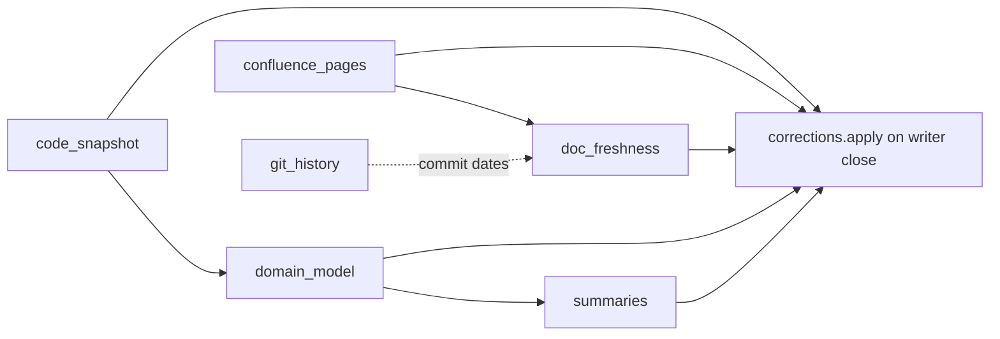

# Stream 3: knowledge layer

This stream adds three things on top of the code, domain and source layers:

| Part | Module | Command | Dagster asset |
|---|---|---|---|
| Hierarchical summaries | `kg_pipeline/summaries.py` | `kg-summaries` | `summaries` (per repository, after `domain_model`) |
| Document freshness and conflicts | `kg_pipeline/freshness.py` | `kg-freshness` | `doc_freshness` (after `confluence_pages`) |
| Corrections overlay | `kg_pipeline/corrections.py` | `kg-corrections apply\|list` | every asset, after its writes |
| MCP tool `get_summary`, `stale` in results | `mcp/summaries.go` | — | — |



## 1. Summaries

### Schema

```
(:Summary {id, level, text, content_hash, model, generated_at, embedding, embedding_hash,
           repo, path, target_id})
    -[:SUMMARIZES {method: 'llm' | 'extractive', confidence: 1.0, content_hash}]->
        (:File)        level = file      id = summary:file:<file id>
        (:Folder)      level = module    id = summary:module:<repo>:<folder or />
        (:Repository)  level = repo      id = summary:repo:<repo>
        (:Capability)  level = domain    id = summary:domain:<capability id>
(:Folder {id: <repo>:folder:<path or />, repo, path, name, content_hash}) -[:CONTAINS]-> (:File)
```

Indexes: `summary_embedding` (vector, `EMBEDDINGS_DIMENSIONS`, cosine), `summary_text` (full text on
`text`), `summary_target` (`target_id`), `summary_repo` (`repo`, `level`). `target_id` and `path` are
extra properties for direct lookups; the `SUMMARIZES` edge is the link of record.

### How it works

| Level | Input | Order |
|---|---|---|
| file | path, language, file comment, symbols with kind, signature, role, route and docstring | most symbols first |
| module | file summaries of the folder, plus the capability of that folder | largest folder first |
| repo | module summaries, largest first, cut at 12,000 characters | — |
| domain | capability name and summary, its concepts and the business rules of its module | — |

- `content_hash` is a hash of the prompt version, the level and the input text. A summary is generated
  again only when that hash changes. A changed file regenerates its file, folder and repository
  summaries; other folders and the domain summaries stay as they are.
- `--budget` (`SUMMARY_BUDGET`, default 300) is the maximum number of LLM calls in one run. Cache
  hits in `LLM_CACHE_DIR` are free.
- A summary without an LLM answer (budget used, LLM failed, `--no-llm`, `SUMMARY_LLM=off`) gets an
  extractive text from the same input, with `model = "extractive"`. A later run with budget left
  replaces it with an LLM text.
- Docstrings: Python docstrings and leading `/** */`, `//` or `#` comments inside the first chunk of
  a symbol or file. License headers are skipped.
- Summaries and folders whose target is gone are deleted. Embeddings are computed again only when
  the text changed.

## 2. Freshness

- A Section is stale when a file or symbol that it `MENTIONS` was modified (`MODIFIES`) by a commit
  dated after the section time. The section time is the first of `source_updated_at` (section, then
  document), `updated` (Confluence) and `ingested_at`.
- A Document is stale when a commit that `REFERENCES` it (feature id) is newer, or when one of its
  sections is stale.
- Stale nodes get `stale = true`, `stale_reason` (commits, dates and code names), `stale_by = 'freshness'`
  and `stale_checked_at`. When a node is no longer stale, these properties are removed.
- Flags with `stale_by = 'correction'` are never changed by freshness.
- Optional LLM check (`--llm`, `FRESHNESS_LLM=on`): for each (stale section, changed code) pair, the
  LLM compares the section with the current code. A conflict with confidence 0.5 or more becomes
  `(:Section)-[:CONFLICTS_WITH {reason, confidence, method: 'llm', content_hash, checked_at}]->(:Code)`.
  `--budget` (`FRESHNESS_LLM_BUDGET`, default 20) bounds the calls; answers are cached. Conflict edges
  of pairs that are no longer candidates are deleted.

## 3. Corrections overlay

Stream 7 creates the nodes through its review flow. This stream applies them.

```
(:Correction {id, kind, target_id, edge_type, other_id, text, author, created_at, status,
              applied_at, applied_count, error})
```

| kind | Needs | Effect when `status = 'approved'` |
|---|---|---|
| `suppress_edge` | `target_id`, `edge_type`, `other_id` | delete `(target)-[edge_type]->(other)` (not human edges) |
| `add_fact` | `target_id`, `edge_type`, `other_id` | MERGE the edge with `method = 'human'`, `confidence = 1.0`, `correction_id`, `text`, `author` |
| `mark_outdated` | `target_id` | `stale = true`, `stale_reason = text`, `stale_by = 'correction'`, `correction_id` |

- `target_id` and `other_id` can be the id of any `:Code`, `:Source`, `:Domain`, `:Requirement`,
  `:Summary` or `:Folder` node. `edge_type` must be UPPER_SNAKE_CASE.
- The Dagster writer (`_writer()` in `definitions.py`) calls `corrections.apply` after every asset, so
  suppressed edges stay suppressed and added facts come back after each ingestion.
- When an applied correction is no longer approved, its `add_fact` edge and its stale flag are
  removed. A suppressed edge comes back at the next ingestion of its source.
- Invalid corrections get `error` and are not applied. Applied ones get `applied_at` and
  `applied_count` (0 means the target or the edge was not found).

## 4. MCP

| Change | Detail |
|---|---|
| `get_summary` (new, tool 13) | Input `node_id`, `path`, `repo` or `domain`. Returns `summary`, `requested_level`, `children` one level down, and `note` when it fell back. |
| Fallback order | file → folder → parent folders → repository. A symbol or chunk uses its file. A capability, concept or rule uses its capability, then its module folder. |
| `stale`, `stale_reason` | Added where present to `search_graph`, `find_symbol`, `get_symbol_code`, `get_neighbors`, `search_knowledge` (section, else its document), `get_context_for_ticket` (ticket and related code). Empty values are dropped. |

## 5. Configuration

| Variable | Default | Effect |
|---|---|---|
| `SUMMARY_LLM` | on | `off`: extractive summaries only |
| `SUMMARY_BUDGET` | 300 | LLM calls per summaries run |
| `FRESHNESS_LLM` | off | `on`: LLM conflict check |
| `FRESHNESS_LLM_BUDGET` | 20 | LLM calls per freshness run |
| `LLM_CACHE_DIR` | `.kg-cache/llm` | CLI answer cache (Dagster: `<archive>/cache/llm`) |

Helm: `llm.summaryBudget`, `llm.freshnessCheck`, `llm.freshnessBudget` in `values.yaml`.

## 6. Run and test

```bash
kg-summaries --repo my-repo                  # LLM within budget, extractive text for the rest
kg-summaries --repo my-repo --no-llm --no-embed
kg-freshness                                 # after kg-git-history and kg-docs
kg-freshness --llm --budget 20
kg-corrections list --status approved
kg-corrections apply                         # after any CLI ingestion
```

```bash
cd pipeline && .venv/Scripts/python -m pytest -q tests/test_knowledge.py
cd mcp && go vet ./... && go test ./...
```

`tests/test_knowledge.py` uses the fixture `tests/fixtures/knowledge/repo.json`, a mocked LLM and a
writer that records the Cypher calls. `test_knowledge_layer_in_neo4j` runs the three parts end to end
against Neo4j and skips without `NEO4J_PASSWORD`.

## 7. Limits

- Freshness needs `kg-git-history`: without commits, code changes are not visible. Code changes that
  were not committed through the ingested branch are not seen.
- Documents in files have no source time yet: freshness uses `ingested_at` until a source sets
  `source_updated_at`.
- Docstrings that come before a symbol (Javadoc, Go doc comments) are outside the symbol chunk and
  are not used.
- Modules are folders (the parent folder of each file), as in `kg-domain`; folders without files of
  their own get no summary.
- A suppressed edge is deleted again after each ingestion; between the ingestion and the overlay
  (one asset run) it is visible. CLI runs need `kg-corrections apply` afterwards.
- Verified against Neo4j 2026.10.1 (port 7703): all pipeline tests (38) and the MCP integration tests
  pass. On `precept` (592 files) the first `kg-summaries --no-llm` writes 659 summaries in about 15 s;
  the second run writes nothing in about 7 s. `helm template` was not run (Helm is not installed).
  One real Ollama call checked the file prompt and schema; a full LLM summary run was not done.
