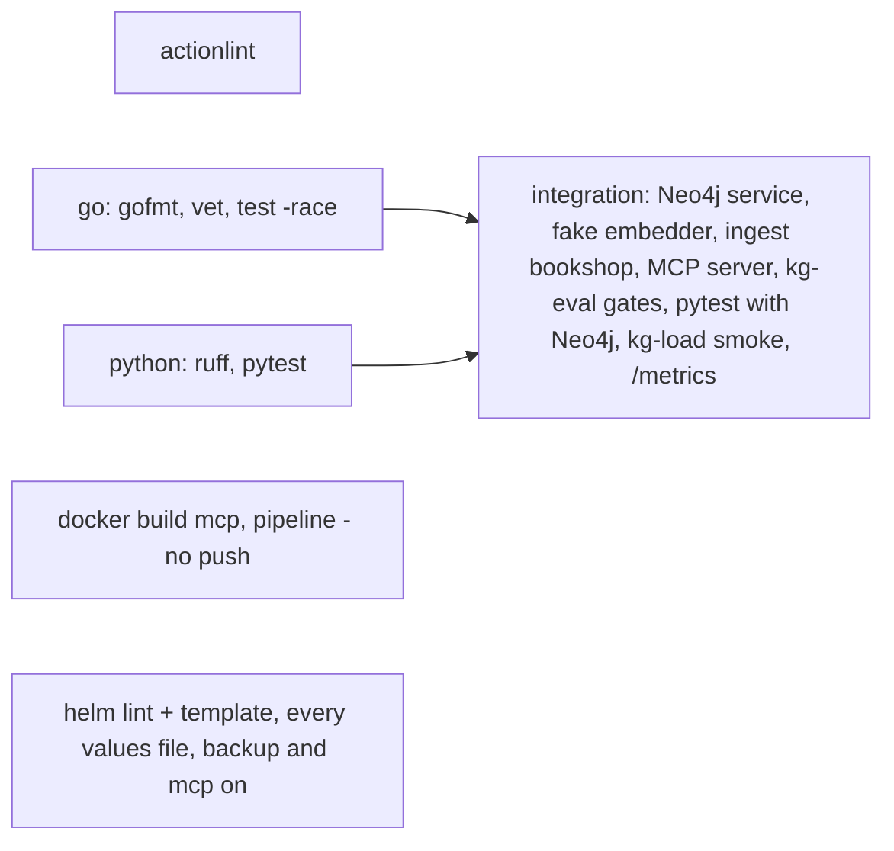
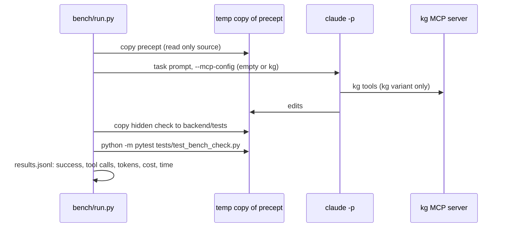

# Stream 8: CI, evaluation, scale test, tracing and backups

This stream adds the operations around the knowledge base: a CI workflow, answer evaluation in
`kg-eval`, a scale test harness, OpenTelemetry tracing, Prometheus metrics, a Neo4j backup CronJob
and an agent benchmark harness.

| Part | Files |
|---|---|
| CI | `.github/workflows/ci.yml`, `pipeline/tests/fixtures/bookshop/`, `pipeline/eval/fixture.yaml`, `[tool.ruff]` in `pipeline/pyproject.toml` |
| Fake embedder | `pipeline/kg_pipeline/fake_embed.py` (`kg-fake-embedder`) |
| Answer evaluation | `pipeline/kg_pipeline/eval_answer.py`, `pipeline/kg_pipeline/mcp_client.py`, gates in `evaluate.py`, 10 `answer` cases in `pipeline/eval/precept.yaml` |
| Scale test | `pipeline/scale/generate.py`, `mcp/cmd/kg-load/main.go` |
| Tracing and metrics | `mcp/telemetry.go` (hooks in `main.go`, `graph.go`, `embed.go`), `pipeline/kg_pipeline/telemetry.py` (decorators in `models.py`, `definitions.py`) |
| Backup | `pipeline/kg_pipeline/backup.py` (`kg-backup`), `deploy/helm/knowledge-graph/templates/backup-cronjob.yaml`, `backup:` and `observability:` in `values.yaml` |
| Agent benchmark | `bench/run.py`, `bench/tasks/*.yaml`, `bench/checks/*.py`, `bench/mcp-kg.json.example` |
| Tests | `pipeline/tests/test_ops_eval.py`, `mcp/telemetry_test.go` |

## 1. CI



| Job | What it checks |
|---|---|
| `workflows` | `actionlint` on the workflow files |
| `go` | `gofmt -l`, `go vet ./...`, `go test -race ./...` in `mcp/` |
| `python` | `ruff check .` and `pytest -q` in `pipeline/` (Neo4j tests skip) |
| `images` | `docker build` of `mcp/` and `pipeline/`, with the GitHub Actions cache, no push |
| `helm` | `helm lint` and `helm template` for `values.yaml`, `values-kind.yaml`, `values-small.yaml`, plus templates with `mcp.enabled`, `backup.enabled` (pvc and s3) |
| `integration` | see below |

The integration job runs with the LLM off and a deterministic embedder:

1. Start Neo4j `neo4j:2026.10.1` as a service container and `kg-fake-embedder` (256 dimensions).
2. Ingest the fixture: `kg-ingest-code --repo tests/fixtures/bookshop --name bookshop --scip off`,
   `kg-domain --repo bookshop --no-llm`, `kg-embed --repo bookshop`.
3. Start `kg-mcp -http 127.0.0.1:8000`.
4. Run `kg-eval eval/fixture.yaml` with the gates `--min-hit 0.9 --min-mrr 0.7 --min-impact 1
   --min-citation-recall 0.5 --min-citation-validity 0.9`.
5. Run `pytest -q` again, now with `NEO4J_PASSWORD` (writer, Jira, Confluence, backup and scale tests).
6. Run `kg-load` for 5 s at 1 and 4 clients, and read `/metrics`.
7. Upload `eval.json`, `load.json` and the server logs as the `integration` artifact.

All actions are pinned by commit SHA, with the tag in a comment. To update one, resolve the new tag
with `gh api repos/<owner>/<action>/commits/<tag> --jq .sha`.

### Fake embedder

`kg-fake-embedder` serves the OpenAI-compatible `POST /v1/embeddings`. Each text becomes a hashed bag
of words (camelCase and snake_case split, plural `s` removed), L2-normalised. The same text gives the
same vector on every machine. Texts that share words are near each other, so search quality tests are
meaningful without a model. Use it also for the scale test and for offline development:

```bash
kg-fake-embedder --port 8089 --dimensions 256
export EMBEDDINGS_URL=http://localhost:8089 EMBEDDINGS_MODEL=fake EMBEDDINGS_DIMENSIONS=256
```

The vector index dimension comes from the first `kg-embed` run. Do not mix the fake embedder and a real
model in one database.

## 2. Answer evaluation

`kg-eval` has a new case type `answer`. It calls the MCP `ask` tool (stream 2) over Streamable HTTP and
scores the answer.

```yaml
answer:
  - question: Who may invite somebody as an owner of an organisation?
    expect: [create_invitation]          # node ids, qualified names, short names or path suffixes
    facts: [owner, [403, forbidden]]     # each fact must be in the answer; an inner list gives alternatives
```

| Metric | Meaning |
|---|---|
| Citation recall | Share of `expect` items that one citation matches (id, symbol or path) |
| Citation validity | Share of citations whose `id` is a node in the graph (`:Code`, `:Source`, `:Domain`, `:Requirement`) |
| Fact coverage | Share of `facts` in the answer. `--judge string` (default): case-insensitive text match. `--judge llm`: the LLM decides, cached in `LLM_CACHE_DIR` |

| Option | Effect |
|---|---|
| `--mcp-url URL` or `KG_MCP_URL` | MCP endpoint, for example `http://localhost:8000/mcp`. `KG_MCP_TOKEN` adds a bearer token |
| `--min-hit`, `--min-mrr`, `--min-impact` | exit 1 below the search hit@k, search MRR or impact recall |
| `--min-citation-recall`, `--min-citation-validity`, `--min-fact-coverage` | exit 1 below these answer metrics; ignored when the answer cases are skipped |

The answer cases are skipped, not failed, when `KG_MCP_URL` is not set, when the server cannot be
reached or when it has no `ask` tool. The report then says why. `pipeline/eval/precept.yaml` has 10
answer cases for precept (invitations, rate limits, owners, encryption of API keys, hard delete,
fault types). They were written from the precept source, read only.

```bash
KG_MCP_URL=http://localhost:8000/mcp kg-eval eval/precept.yaml --min-citation-recall 0.6 --json eval.json
```

## 3. Scale test

### Generator

`pipeline/scale/generate.py` writes a synthetic graph through `Neo4jWriter` (`write_delta`, `upsert`,
`link`). Run it from `pipeline/`. It is deterministic for one `--seed`.

| Preset | Repos | Files per repo | Symbols | Tickets | Sections | Commits |
|---|---|---|---|---|---|---|
| `tiny` | 1 | 40 | about 300 | 500 | 200 | 200 |
| `small` | 3 | 200 | about 4,600 | 10,000 | 2,000 | 2,000 |
| `full` | 20 | 600 | about 91,000 | 100,000 | 20,000 | 50,000 |

Each repository has modules, files with a service class and 6 methods, one chunk per method, imports,
and a call graph: 1 to 4 calls per method, 70 % in the same module, 60 % `scip` and 40 % `treesitter`
edges. Each module has a test file whose tests call 3 methods. Tickets have epics (`CHILD_OF`), links,
releases and code mentions. Documents have sections with code mentions. Commits modify files and
symbols and reference tickets. `--embed 256` (default) writes fake vectors for chunks, tickets and
sections; serve the MCP server with `kg-fake-embedder --dimensions 256`.

```bash
cd pipeline
python -m scale.generate --preset small --json scale-small.json
python -m scale.generate --preset full --json scale-full.json     # full size: run on a server, not a laptop
python -m scale.generate --preset small --repos 5 --tickets 50000 # override single values
```

CAUTION: the generator writes into the database in `NEO4J_URI`. Use an empty database for scale
tests. Repositories are `scale-r000` and up, projects `SCA` and up, documents `docs:scale:*`.

### MCP load test

`mcp/cmd/kg-load` opens one MCP session per client and calls the tools in turn for a fixed time. It
reads symbol ids with `find_symbol <prefix>*` and ticket keys with `search_knowledge` first.

```bash
kg-fake-embedder --dimensions 256 &
EMBEDDINGS_URL=http://localhost:8089 EMBEDDINGS_MODEL=fake KG_DEFAULT_REPO=scale-r000 kg-mcp -http :8000 &
cd mcp && go run ./cmd/kg-load -url http://localhost:8000/mcp -repo scale-r000 -symbol-prefix Order \
  -clients 1,10,50 -duration 60s -out ../load-small.json
```

The output is a table with calls, errors, p50, p95 and p99 latency and calls per second per tool and
concurrency level.

### Results

Measured on 2026-11-04 on the development laptop (24 cores, Windows, Docker Desktop), Neo4j
`neo4j:2026.10.1` with 512 MB heap and 512 MB page cache, fake embedder with 256 dimensions. Other
sessions shared the machine, so treat the numbers as an order of magnitude.

Generator, modest size (`--preset small --repos 2 --files 150 --tickets 5000 --documents 100 --commits 1000`):

| Item | Value |
|---|---|
| Graph | 11,596 nodes, 38,762 relationships (2,100 symbols, 5,000 tickets, 1,000 sections, 1,000 commits) |
| Write time | 12.6 s in total (code 2.4 s, tickets 2.6 s, documents 0.7 s, commits 0.8 s, vectors 6.1 s) |

Load test (`kg-load -repo scale-r000 -symbol-prefix Order -clients 1,10,50 -duration 20s`), 0 errors:

| Tool | p50 / p95 ms, 1 client | p50 / p95 ms, 10 clients | p50 / p95 ms, 50 clients |
|---|---|---|---|
| `search_graph` | 45 / 73 | 41 / 66 | 111 / 208 |
| `find_symbol` | 11 / 19 | 10 / 19 | 27 / 56 |
| `get_symbol_code` | 13 / 22 | 12 / 24 | 39 / 82 |
| `impact_analysis` (depth 2) | 25 / 47 | 23 / 42 | 79 / 145 |
| `get_neighbors` | 9 / 15 | 8 / 16 | 22 / 47 |
| `find_related_tests` | 12 / 22 | 12 / 23 | 39 / 81 |
| `search_knowledge` | 29 / 41 | 27 / 43 | 71 / 153 |
| `get_context_for_ticket` | 100 / 198 | 95 / 154 | 287 / 508 |
| `get_change_history` | 21 / 35 | 19 / 36 | 60 / 126 |
| Throughput, all tools | 29 calls/s | 338 calls/s | 552 calls/s |

`get_context_for_ticket` is the slowest tool: it runs 8 queries and one vector search per call. From
10 to 50 clients the latency grows about 3 times while the throughput grows 1.6 times, so one MCP
replica with this Neo4j size is saturated near 50 concurrent clients.

The full size was not run on the laptop. Command for a server (expect about 350,000 nodes and 1.3 M relationships):

```bash
cd pipeline && python -m scale.generate --preset full --json scale-full.json
cd ../mcp && go run ./cmd/kg-load -url http://<mcp>:8000/mcp -repo scale-r000 -symbol-prefix Order   -clients 1,10,50 -duration 60s -out ../load-full.json
```

## 4. Tracing

| Component | Spans | Attributes |
|---|---|---|
| MCP server | `tool <name>` per tool call (middleware `observe`); children `neo4j.read` per read transaction and `embeddings <model>` per embedding call | `gen_ai.tool.name`, `openinference.span.kind` (`TOOL`, `EMBEDDING`), `db.system.name`, `db.query.text` (Cypher without parameters, 2,000 characters) |
| Pipeline | `asset <name>` per Dagster asset run; `chat <model>` per LLM call; `embeddings <model>` per embedding batch | `dagster.asset`, `dagster.partition`, `dagster.run_id`, `gen_ai.system`, `gen_ai.request.model`, `openinference.span.kind` (`LLM`) |

Tracing is off when `OTEL_EXPORTER_OTLP_ENDPOINT` (or `OTEL_EXPORTER_OTLP_TRACES_ENDPOINT`) is not set.
The export is OTLP over HTTP. The standard variables apply: `OTEL_SERVICE_NAME` (defaults `kg-mcp`,
`kg-pipeline`), `OTEL_EXPORTER_OTLP_HEADERS`, `OTEL_RESOURCE_ATTRIBUTES`, `OTEL_SDK_DISABLED`.
Prompts, answers and tool arguments are recorded only with `KG_TRACE_CONTENT=1`, because they contain
source code. The pipeline needs the extra: `pip install -e ".[otel]"`.

| Backend | Setting |
|---|---|
| Arize Phoenix | `OTEL_EXPORTER_OTLP_ENDPOINT=http://phoenix:6006` |
| Langfuse | `OTEL_EXPORTER_OTLP_ENDPOINT=https://<host>/api/public/otel` and `OTEL_EXPORTER_OTLP_HEADERS=Authorization=Basic <base64 public:secret>` |
| Jaeger, Tempo, OpenTelemetry Collector | `OTEL_EXPORTER_OTLP_ENDPOINT=http://<collector>:4318` |

In Helm, set `observability.otlpEndpoint`; it goes to the `kg-endpoints` ConfigMap for the pipeline
and the MCP server. Put `OTEL_EXPORTER_OTLP_HEADERS` in `sources.credentials`.

For a tool that calls an LLM (for example `ask`), use `LLMSpan(ctx, provider, model)` from
`mcp/telemetry.go` and end it with `endSpan(span, start, nil, err)`.

## 5. Metrics

The MCP server serves Prometheus metrics at `/metrics` in HTTP mode. The Helm chart adds
`prometheus.io/scrape` annotations to the MCP pods (`observability.prometheusAnnotations`).

| Metric | Type | Labels |
|---|---|---|
| `kg_mcp_tool_calls_total` | counter | `tool`, `status` (`ok`, `tool_error`, `error`) |
| `kg_mcp_tool_errors_total` | counter | `tool` |
| `kg_mcp_tool_duration_seconds` | histogram | `tool` |
| `kg_mcp_neo4j_query_duration_seconds` | histogram | `status` |
| `kg_mcp_embedding_duration_seconds` | histogram | `status` |
| Go runtime and process metrics | | |

Example queries: p95 per tool
`histogram_quantile(0.95, sum by (tool, le) (rate(kg_mcp_tool_duration_seconds_bucket[5m])))`;
error rate `sum by (tool) (rate(kg_mcp_tool_errors_total[5m])) / sum by (tool) (rate(kg_mcp_tool_calls_total[5m]))`.

## 6. Backup and restore

Neo4j Community has no online `neo4j-admin database backup`, and `neo4j-admin database dump` needs a
stopped database. `kg-backup` makes an online logical backup instead: all nodes and relationships with
their properties, and the schema statements, in one gzip JSON-lines file. Embeddings are included.
A file without its end line is incomplete; `kg-backup check` and `kg-backup restore` refuse it.

```bash
kg-backup dump --out /archive/backups/neo4j --keep 7      # neo4j-<UTC time>.jsonl.gz
kg-backup check /archive/backups/neo4j/neo4j-20261104T023000Z.jsonl.gz
kg-backup restore /archive/backups/neo4j/neo4j-20261104T023000Z.jsonl.gz
```

### Helm CronJob

Off by default. The job uses the kg-pipeline image.

```yaml
backup:
  enabled: true
  image: registry.example.com/kg-pipeline:0.1.0
  schedule: "30 2 * * *"        # when the hourly and 15-minute schedules are quiet
  target: pvc                   # pvc: <claim>/<path>, keeps `keep` files
  keep: 7
  pvc:
    claimName: ""               # default: kg-source-archive
    path: backups/neo4j
```

For S3-compatible storage (SeaweedFS, MinIO, AWS S3), set `target: s3`, `s3.endpoint` (for example
`http://seaweedfs-s3.seaweedfs.svc:8333`), `s3.bucket`, `s3.prefix` and `s3.secretName` (a Secret with
`AWS_ACCESS_KEY_ID` and `AWS_SECRET_ACCESS_KEY`). The dump goes to an `emptyDir` first, then
`amazon/aws-cli` uploads it. Set a lifecycle rule on the bucket to delete old backups.

CAUTION: the archive PVC is `ReadWriteOnce` by default. If the backup pod can land on another node than
the Dagster run pods, use a `ReadWriteMany` claim or the S3 target.

### Restore procedure

1. Stop the writers: scale the Dagster user deployment to 0 and stop the schedules, so no run writes
   during the restore.

   ```bash
   kubectl -n kg scale deploy -l app.kubernetes.io/name=dagster-user-deployments --replicas=0
   ```

2. Get an empty database. Either delete the Neo4j PVC and restart the StatefulSet, or delete the data:

   ```bash
   kubectl -n kg scale sts kg-neo4j --replicas=0
   kubectl -n kg delete pvc data-kg-neo4j-0
   kubectl -n kg scale sts kg-neo4j --replicas=1
   ```

3. Get the backup file into a pod with the kg-pipeline image. From S3:
   `aws s3 cp s3://kg-backups/neo4j/neo4j-<time>.jsonl.gz /work/ --endpoint-url <endpoint>`.
   From the PVC: mount the claim.

4. Check the file, then restore it. The pod needs `NEO4J_URI` and `NEO4J_PASSWORD` (from the
   `kg-endpoints` ConfigMap and the `kg-credentials` Secret):

   ```bash
   kg-backup check /backup/backups/neo4j/neo4j-<time>.jsonl.gz
   kg-backup restore /backup/backups/neo4j/neo4j-<time>.jsonl.gz
   ```

   The restore creates the nodes, then the relationships, then the constraints and indexes, and waits
   for the indexes to come online.

5. Check the counts against the `nodes` and `relationships` of `kg-backup check`:
   `MATCH (n) RETURN count(n)` and `MATCH ()-[r]->() RETURN count(r)`.

6. Start the MCP server and the Dagster user deployment again. The next incremental runs write only
   what changed after the backup (content hashes and `SyncState` cursors are in the backup).

For a consistent physical copy (large databases, faster restore), use an offline dump in a
maintenance window: scale Neo4j to 0, run a pod with the Neo4j image on the data PVC and
`neo4j-admin database dump neo4j --to-path=/backup`, then scale Neo4j back up. Restore with
`neo4j-admin database load neo4j --from-path=/backup --overwrite-destination`.

## 7. Agent benchmark

`bench/` compares a headless coding agent with and without the kg MCP server on 5 precept tasks.

| Task | Change | Hidden check |
|---|---|---|
| `bulk-invite-limit` | bulk invite batch limit 200 to 50 | 50 rows accepted, 51 rejected with 422 |
| `revoke-reason` | optional `reason` when an invitation is revoked, in the audit meta | reason in `invite.revoke` meta; no reason still works |
| `invite-ttl-setting` | invitation lifetime as setting `invite_ttl_days` | default 7 days; a changed setting changes the expiry |
| `export-invitations` | GDPR export lists the invitations of the user | `invitations` with `org_id`, `role`, `status`, no token |
| `fault-disk-full` | new simulation fault type `disk-full` | in `FAULT_TYPES`, targeted like other faults |



Steps:

1. Ingest precept into the graph and start the MCP server in HTTP mode.
2. Copy `bench/mcp-kg.json.example` to `bench/mcp-kg.json` and set the URL.
3. Make a Python with the precept backend requirements:
   `python -m venv .bench && .bench/Scripts/pip install -r <precept>/backend/requirements.txt`.
4. Check the tasks (no agent, no cost): `python bench/run.py --dry-run --python .bench/Scripts/python`.
   Every check must fail on the unchanged code.
5. Run the benchmark: `python bench/run.py --repeat 3 --python .bench/Scripts/python --model claude-sonnet-5-5`.

The agent runs with `--permission-mode acceptEdits` and an allow list (file tools, `pytest`,
`git diff`, `git status`, the kg tools), `--max-turns 40` and `--max-budget-usd 2` per run.
Each run writes `transcript.jsonl` next to the copy; use `--keep` to keep the copies.

Smoke test (one cheap run, 2026-11-04): task `fault-disk-full`, variant `baseline`, model
`claude-haiku-5-5`, `--max-turns 15`, `--max-budget-usd 0.5`. The check passed. The run used 25 tool
calls, 16 turns, 977,064 input tokens (mostly cache reads), 10,165 output tokens, 0.029 USD and 84 s.
The `kg` variant and the full benchmark were not run (cost, and no precept graph in this session).
The dry run (`--dry-run`) confirmed that all 5 checks fail on the unchanged precept code.

## 8. Limits

- The fake embedder measures word overlap, not meaning. The CI gates check that the pipeline works
  end to end; they do not measure the quality of a real model. Use `eval/precept.yaml` with the real
  embedder for that.
- `kg-backup` reads nodes and relationships in one read transaction, but Neo4j reads are read
  committed. A write during the backup can be partly in it. Schedule it when the pipeline is quiet.
- `kg-backup restore` holds no more than one batch (5,000 lines) in memory, but Neo4j writes each
  batch in its own transaction. A failed restore leaves a partial graph; start again from an empty
  database.
- The S3 target keeps every backup; retention is a bucket lifecycle rule.
- The MCP tool span is a root span: the HTTP request context of the Streamable HTTP transport does not
  reach the tool handler, so a caller's `traceparent` is not joined.
- The answer evaluation depends on the `ask` tool of stream 2 (`question`, `repo`; `answer`,
  `citations[].id`). Until that tool is merged, the answer cases are reported as skipped.
