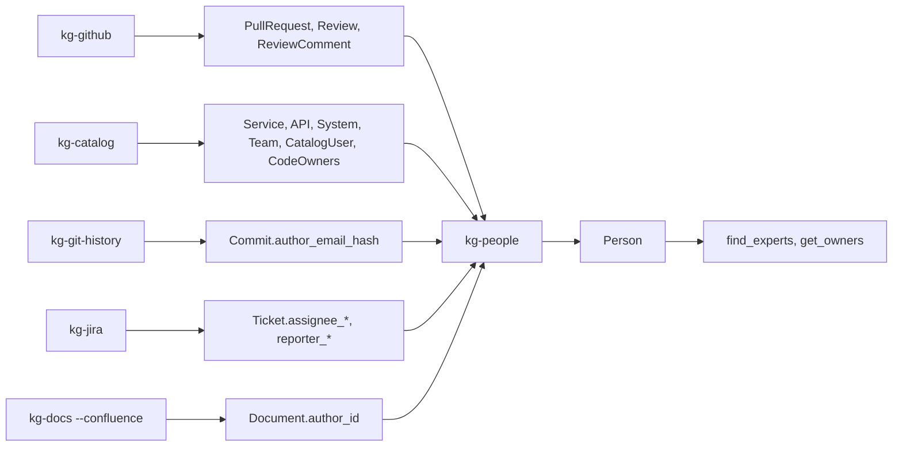

# Stream 4: people, pull requests and service catalog

This stream adds three layers to the graph and two MCP tools:

- GitHub pull requests, reviews and review comments (`kg-github`, Dagster asset `github_prs`).
- The service catalog from Backstage `catalog-info.yaml` and `CODEOWNERS` (`kg-catalog`, asset `service_catalog`).
- People merged from all sources (`kg-people`, asset `people`).
- MCP tools `find_experts` and `get_owners` (`mcp/people.go`).



## 1. Graph

| Node | Id | Main properties |
|---|---|---|
| `:Source:PullRequest` | `github:<owner>/<repo>#<number>` | `key`, `title`, `text` (body), `state` (open, closed, merged), `author` (login), `merged_at`, `url`, `base`, `head`, `ticket_keys`, `commit_shas` |
| `:Source:Review` | `<pr id>/review/<id>` | `author`, `state`, `text`, `date` |
| `:Source:ReviewComment` | `<pr id>/comment/<id>` | `author`, `text`, `path`, `line`, `outdated` |
| `:Source:Service`, `:API`, `:System`, `:Team` | `catalog:<kind>:<namespace>/<name>` | `name`, `title`, `type`, `lifecycle`, `owner` (entity ref or CODEOWNERS handle), `folder` |
| `:Source:CatalogUser` | `catalog:user:<namespace>/<name>` | `email_hash`, `github`, `member_of` |
| `:Source:CodeOwners` | `codeowners:<repo>` | `rules` (JSON `[pattern, owners]`), `content_hash` |
| `:Source:Person` | `person:<alias id>` or `person:<hash>` | `name`, `github`, `atlassian`, `catalog`, `names`, `email_hashes`, `systems`, `bot`, `merge_rule` |

| Edge | From → to | Method, confidence |
|---|---|---|
| `CONTAINS` | PullRequest → Commit (by sha, includes the merge or squash commit) | `sha`, 1.0 |
| `REFERENCES` | PullRequest → Ticket (Jira key in title, head branch or body) | `key`, 1.0 |
| `MODIFIES` | PullRequest → File | `github`, 1.0 |
| `PART_OF` | Review, ReviewComment → PullRequest | `github`, 1.0 |
| `ON` | ReviewComment → File; → smallest Symbol that contains the line | `github` 1.0; `github-line` 0.7 |
| `OWNS` | Team → Service, API, System (`via: catalog`); Team → File (`via: codeowners`, `pattern`) | 1.0 |
| `PART_OF` | Service, API → System; Team → parent Team | `catalog`, 1.0 |
| `IMPLEMENTED_IN` | Service → Repository (catalog file at the root) or → each File of its folder | `catalog`, 1.0 |
| `PROVIDES_API`, `CONSUMES_API`, `DEPENDS_ON` | Service → API, Service → Service | `catalog`, 1.0 |
| `AUTHORED` | Person → Commit, PullRequest, Review, ReviewComment, Document | `identity`, 1.0 |
| `REVIEWED {state}` | Person → PullRequest (not the PR author) | `identity`, 1.0 |
| `ASSIGNED`, `REPORTED` | Person → Ticket | `identity`, 1.0 |
| `MEMBER_OF` | Person → Team | `identity`, 1.0 |
| `OWNS` | Person → Service (catalog `owner: user:x`), → File (CODEOWNERS `@login` or email) | `identity`, 1.0 |
| `MAYBE_SAME {name}` | Person → Person (same full name, no shared key) | `name`, 0.6 |

Changes to the other sources (small and additive):

| File | Change |
|---|---|
| `sources/history.py` | Reads `%ae`; stores `author_email_hash` and `author_github` (GitHub noreply address) on `Commit` |
| `sources/jira.py` | Reads `assignee` and `reporter`; stores `assignee_id`, `assignee_name`, `assignee_email_hash` and the same for `reporter` |
| `sources/documents.py` | Stores the Confluence `author_id` and `owner_id` (Atlassian account ids) |
| `vectors.py` | `_source_texts` also embeds `PullRequest`, `Review` and `ReviewComment` into `source_embedding` |
| `graph/neo4j_writer.py` | Full-text index `review_text` (PRs, reviews, comments) and index `person_github` |
| `mcp/sources.go` | `search_knowledge` finds PRs and reviews (`kind: PullRequest`); `get_change_history` returns `pull_requests` per commit |

## 2. Person merge rules

`kg-people` reads the identities that the sources stored and merges them with a union-find.
A merge needs confidence 0.9 or more (`MERGE_CONFIDENCE`).

| Order | Rule | Confidence | Merges |
|---|---|---|---|
| 1 | Same strong key: hashed email, Atlassian account id (Jira and Confluence share it), GitHub login, catalog entity ref | 1.0 | yes |
| 1 | A GitHub PR commit that has both a login and a git email joins the two (GitHub made that link) | 1.0 | yes |
| 1 | A GitHub noreply email (`123+login@users.noreply.github.com`) joins the commit to the login | 1.0 | yes |
| 2 | An entry in `people-aliases.yaml` joins all of its keys, and every cluster that has one of its names | 1.0 | yes |
| 3 | Same full name (two or more words) without a shared key | 0.6 (`NAME_ONLY_CONFIDENCE`) | no: `MAYBE_SAME` edge only |

A commit without an email has no strong key. It gets no person; it is never merged by name.

### Alias file

```yaml
# people-aliases.yaml
people:
  - id: alice                 # optional; gives the stable id person:alice
    name: Alice Smith         # display name; also joins clusters with this name
    emails: [alice@example.com, a.smith@old.example.com]   # hashed when read, never stored
    github: [alice-gh]
    atlassian: [5b10ac8d82e05b22cc7d4ef5]                  # Jira / Confluence accountId
    catalog: [user:default/alice]
    names: [Alice S.]         # more names that are this person (explicit, so allowed)
```

Use it to confirm a `MAYBE_SAME` pair: `MATCH (a:Person)-[r:MAYBE_SAME]->(b) RETURN a.name, a.github, b.name, b.github`.

### Emails

- The graph never stores an email address. Sources store `email_hash`: SHA-256 of `PEOPLE_EMAIL_SALT|<lower-case email>`, first 24 hex characters.
- `:Person` has no `text` and is not embedded.
- The alias file holds emails in plain text. Keep it out of public repositories, or write `email_hashes` instead of `emails`.

## 3. Configuration

| Variable | Used by | Default |
|---|---|---|
| `GITHUB_TOKEN` | `kg-github` | none (60 unauthenticated requests per hour) |
| `GITHUB_API_URL` | `kg-github` | `https://api.github.com` |
| `GITHUB_REPOSITORIES` | Dagster `github_prs` | the github.com URLs of `GIT_REPOSITORIES`, only when `GITHUB_TOKEN` is set; format `owner/repo=graph-name,owner/other` |
| `PEOPLE_ALIASES` | `kg-people`, Dagster `people` | `people-aliases.yaml` in the working folder (CLI); none (Dagster) |
| `PEOPLE_EMAIL_SALT` | all sources that hash emails | `kg-people-v1`. Changing it changes every hash: run all sources with `--full` again |

Helm: `sources.github.repositories`, `sources.github.apiUrl`, `sources.people.aliasesFile`, and
`GITHUB_TOKEN` in `sources.credentials`.

The token needs read access to pull requests and contents (fine-grained) or `repo` scope (classic).

## 4. Run

Run the steps in this order:

1. `kg-ingest-code --repo /path/to/shop --name shop`
2. `kg-git-history --repo /path/to/shop --name shop`
3. `kg-github --repo acme/shop --name shop` (`--full` ignores the cursor; `--max` limits PRs per run, default 1000)
4. `kg-catalog --repo /path/to/shop --name shop` (`--force` writes when nothing changed)
5. `kg-jira --project SHOP` and `kg-docs --confluence ENG`, if you use them
6. `kg-people --aliases people-aliases.yaml`
7. `kg-embed --sources`

Dagster: `service_catalog` runs per repository after `code_snapshot`. `github_prs` and `people` run in
the `sources_every_15_min` schedule; `people` depends on `git_history`, `jira_issues`,
`confluence_pages`, `github_prs` and `service_catalog`.

Incremental behaviour:

| Stage | What makes a run cheap |
|---|---|
| `kg-github` | Cursor `github:<owner>/<repo>:updated` in `SyncState`; PRs are read newest first and the read stops at the cursor |
| `kg-catalog` | One content hash of all entities, rules and file paths, on the `CodeOwners` node; no change means no write |
| `kg-people` | `content_hash` per person (its properties and edges); only changed people are written |

Rate limits: a `403` or `429` with `Retry-After`, or with `X-RateLimit-Remaining: 0`, waits and tries
again. A response with remaining 0 makes the next call wait until `X-RateLimit-Reset`. A wait of more
than 15 minutes fails the run; the next run continues from the cursor.

## 5. MCP tools

| Tool | Input | Output |
|---|---|---|
| `find_experts` | `node` (symbol or file) or `topic`; `repo`, `limit` | People with `score`, `counts` per kind, `last_activity` and up to 5 `evidence` items |
| `get_owners` | `node`: symbol, file path, or a Service, API, System or Team name | `code_owners` (CODEOWNERS), `services` with `owners`, `members`, `part_of`, `apis`, `implemented_in` |

`find_experts` scores:

| Evidence | Weight |
|---|---|
| Commit that changed the node or its file | 1.0 |
| PR author (PR changed the file) | 1.0 |
| Assignee of a ticket that mentions the node or that a commit of the node references | 0.8 |
| Reviewer of a PR that changed the file | 0.6 |
| Author of a Confluence page found for the topic | 0.5 |
| Author of a review comment on the node | 0.4 |
| Reporter of a ticket found for the topic | 0.3 |
| Person owner in CODEOWNERS or the catalog (no decay) | 1.5 |
| Member of the owning team (no decay) | 0.3 |

Each item loses half of its weight every 180 days; undated items count 0.5. Bots (`[bot]`,
dependabot, renovate, github-actions) are left out. For a `topic`, the evidence comes from the top
code chunks of the hybrid search and the top 10 tickets, PRs, reviews and sections of `source_embedding`.

ACL: evidence and owners are shown only when the server may see their `acl` (`repo:<name>` for PRs and
the catalog, `jira:<project>` for tickets). Code is resolved only inside `$repos`. A `Person` carries
the union of the ACL groups of its sources.

## 6. Test

```bash
cd pipeline && .venv/Scripts/python -m pytest -q tests/test_people.py
cd mcp && go vet ./... && go test ./...
```

| Test | Covers | Needs |
|---|---|---|
| `test_github_pagination_incremental_and_rate_limit` | Link pagination, cursor stop, wait on `X-RateLimit-Reset` | fixtures |
| `test_github_rows_and_comment_targets` | PR rows, ticket keys, merge commit, `ON` to the smallest symbol, no plain emails | fixtures |
| `test_entity_refs_and_codeowners`, `test_catalog_build` | entity refs, CODEOWNERS patterns (last match wins, anchoring), all catalog edges, CODEOWNERS fallback | `tests/fixtures/catalog/repo` |
| `test_people_merge_rules` | rules 1 to 3, alias file, no merge by name, ACL union | `tests/fixtures/people-aliases.yaml` |
| `test_github_catalog_people_into_neo4j` | all three stages end to end, incremental second runs | `NEO4J_PASSWORD` |
| `TestRankExperts` (Go) | weights, decay, duplicates, ACL, bots | none |
| `TestPeopleToolsIntegration` (Go) | `find_experts`, `get_owners`, `get_change_history` with PRs, a scoped server sees nothing | `NEO4J_PASSWORD` |

GitHub fixtures in `tests/fixtures/github/` follow the REST API v2022-11-28 response format.

## 7. Limits

- GitHub only. For GitLab, write a class with `changes(since, limit)` that returns the same dict as
  `GitHubForge.changes` and pass it to `github.sync` (see the `Forge` protocol in `sources/github.py`).
- REST, not GraphQL: each PR costs 4 requests (commits, files, reviews, comments), plus 1 request per 100 PRs for the list. 1000 PRs need about 4000 requests; one token has 5000 per hour. Use `--max` for the first run.
- The first run reads at most `--max` PRs (default 1000); older PRs need `--full --max N`.
- PR lists of more than 250 commits and 3000 files are cut by the GitHub API.
- Review comment lines are lines of the PR head. The `ON` edge to a symbol (0.7) uses the current line ranges and can point to moved code; outdated comments get only the file edge.
- A catalog `owner: user:x` becomes a person owner only when the User entity is in the same repository.
- CODEOWNERS teams (`@org/team`) map to the catalog group with the same name, in namespace `default`.
- The `Team` of a CODEOWNERS handle that two repositories share keeps the `repo` of the last run.
- Person ids come from the smallest identity key. A new, smaller key changes the id; give an alias `id` for a stable one.
- `find_experts` reads at most 500 evidence rows (the newest first).
- `search_knowledge` with embeddings for PRs and `find_experts` with a `topic` were not tested against a live embedding model; the Cypher was checked with `EXPLAIN`.
