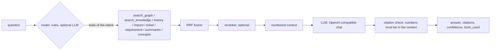

# Stream 2: retrieval and answers

This stream adds a cross-encoder reranker, a query router, the `ask` MCP tool and size limits with
pagination for all MCP tools.



## 1. What was built

| Part | Files | Summary |
|---|---|---|
| Reranker (Go) | `mcp/rerank.go`, `mcp/search.go` | TEI `/rerank` client. Reorders the top RRF candidates in `search_graph`, `search_knowledge`, `get_context_for_ticket` (related code) and `ask`. |
| Reranker (Python) | `pipeline/kg_pipeline/rerank.py`, `pipeline/kg_pipeline/search.py` | Same client for `kg-search`, `kg-eval` and `kg-verify` (all use `search.candidates`). |
| Helm | `templates/configmap-endpoints.yaml`, `values.yaml` | The reranker deployment in `templates/models.yaml` already existed. It is now off by default. The ConfigMap sets `RERANK_URL` and `RERANK_MODEL`. `models.reranker.externalUrl` points to an external TEI when `models.selfHosted=false`. |
| Query router | `mcp/router.go` | Rules classify a question into one of 7 intents and extract ticket keys, requirement references and code names. An optional LLM fallback runs when the rules are not sure. |
| `ask` tool | `mcp/ask.go`, `mcp/llm.go` | Question → router → retrieval → LLM → answer with numbered citations. Invalid citation numbers are removed and reported. |
| Size limits and pagination | `mcp/page.go`, `mcp/tools.go`, `mcp/sources.go` | All tools accept `max_chars` and `cursor`. List results get `next_cursor`. Documents get cut strings and `omitted` counts. |
| Embedding cache | `mcp/embed.go` | The MCP server keeps the last 256 query vectors, so `ask` embeds a question one time for all indexes. |

### 1.1 Router intents

| Intent | Example | Retrieval tools |
|---|---|---|
| `code_location` | "where are users invited in bulk?" | `search_graph` |
| `impact` | "what breaks if I change create_invitation?" | `search_graph`, `impact_analysis` |
| `history` | "why are scenarios not kept in local storage?" | `search_graph`, `get_change_history`, `search_knowledge` |
| `ticket` | "context for PREC-123" | `get_context_for_ticket`, `search_knowledge` |
| `requirement` | "is FR-P10-03-02 implemented?" | `trace_requirement`, `search_knowledge`, `search_graph` |
| `overview` | "explain the architecture of the simulation engine" | `summaries`, `domain_overview`, `search_knowledge`, `search_graph` |
| `people` | "who wrote the scoring module?" | `search_graph`, `get_change_history` |

- Each rule that matches adds its weight to its intent. A ticket key or a requirement reference adds 3.
- Confidence is `0.5 + 0.5 × (top − second) / top`. When the second intent has at least 75 % of the
  top score, its tools are added. A question that matches no rule goes to `code_location` with 0.3.
- With `KG_ROUTER_LLM=on`, a rules confidence below 0.6 goes to the LLM (one word, 20 tokens).
- Feature ids such as `P14-02` count as requirement references, not as Jira keys.

### 1.2 `ask` output

| Field | Content |
|---|---|
| `answer` | Prose with citation numbers such as `[1]` or `[2, 3]` |
| `citations[]` | `n`, `id` (graph node id), `label`, `title`, `path` (code `path:start-end`, requirement source) or `url` (Jira, Confluence), `excerpt` (300 characters) |
| `confidence` | 0 to 1. Valid citations and a clear route raise it. Invalid citations and answers that say the context is not enough lower it. |
| `tools_used` | The retrieval tools that added context |
| `route` | Intent, confidence, method (`rules`, `llm`, `default`), tools and extracted entities |
| `invalid_citations` | Citation numbers from the LLM that were not in the context. They are removed from `answer`. |

`ask` retrieves only through the existing `$repos` scope and the `s.allowed(acl)` check. Commits,
tickets, sections and summaries with an ACL that the server does not have are not put into the
context, so the LLM cannot see or cite them. `:Summary` nodes (stream 3) are optional: when the
index `summary_embedding` does not exist, the step is skipped with a note.

### 1.3 Pagination

| Result type | Behaviour |
|---|---|
| `Rows` (list tools) | The page holds whole rows that fit in `max_chars`. `next_cursor` gives the next page. `truncated`, `total` and `note` ("rows 1-12 of 50; ...") describe the page. A single row larger than the budget is cut, so each page makes progress. |
| `Doc` (one document) | Strings are cut with `…[cut N chars]` and lists are shortened, from mild to hard, until the result fits. `omitted` counts the list items left out per field path, for example `{"affected_code": 120}`. A `cursor` is an error. |

- `max_chars` is 1,000 to 200,000. The default is 30,000.
- A cursor is bound to the tool arguments (a hash without `cursor` and `max_chars`). A cursor used with
  other arguments is an error.
- The tool computes the full result and the page is cut from it. The cursor is correct while the
  graph does not change between the calls.

## 2. Configuration

| Variable | Used by | Default | Effect |
|---|---|---|---|
| `RERANK_URL` | MCP, pipeline | none (off) | TEI base URL, for example `http://kg-reranker:8080` |
| `RERANK_MODEL` | MCP, pipeline | `BAAI/bge-reranker-v2-m3` | Informational. TEI serves one model, set with `--model-id`. |
| `RERANK_API_KEY` | MCP, pipeline | none | Bearer token |
| `RERANK_CANDIDATES` | MCP, pipeline | `30` | RRF candidates that go to the reranker |
| `LLM_BASE_URL`, `LLM_MODEL` | MCP | none (`ask` off) | OpenAI-compatible endpoint. `/v1/chat/completions` is added to the base URL. |
| `LLM_API_KEY` | MCP | none | Bearer token |
| `LLM_REASONING_EFFORT` | MCP | none | Sent as `reasoning_effort`. Use `none` with Ollama and `qwen3.6:35b-a3b` to skip the thinking phase. |
| `LLM_CACHE_DIR` | MCP | none | Cache of `ask` and router answers by hash of model and prompt |
| `KG_ASK` | MCP | on | `off` removes the `ask` tool when an LLM is configured |
| `KG_ROUTER_LLM` | MCP | off | `on` turns on the LLM fallback of the router |

Helm:

| Value | Default | Effect |
|---|---|---|
| `models.reranker.enabled` | `false` | Runs TEI with `models.reranker.model` when `models.selfHosted=true` |
| `models.reranker.externalUrl` | `""` | `RERANK_URL` when `models.selfHosted=false` |

The MCP pod reads `LLM_BASE_URL` and `LLM_MODEL` from the `kg-endpoints` ConfigMap, so `ask` is on in a
cluster. Set `mcp.env.KG_ASK: "off"` to remove it, or `mcp.env.LLM_REASONING_EFFORT: none` for Ollama.

The ConfigMap key `RERANKER_URL` is now `RERANK_URL` (and `RERANKER_MODEL` is `RERANK_MODEL`). No code
read the old names.

## 3. Run and test

1. Run the unit tests:

   ```bash
   cd pipeline && .venv/Scripts/python -m pytest -q
   cd mcp && go vet ./... && go test ./...
   ```

2. Start a local reranker (CPU, about 2.3 GB of model files on the first start):

   ```bash
   docker run -d --name kg-reranker -p 8081:80 ghcr.io/huggingface/text-embeddings-inference:cpu-1.9.4 --model-id BAAI/bge-reranker-v2-m3
   export RERANK_URL=http://localhost:8081
   ```

3. Measure the change on the evaluation set. Run it without and with `RERANK_URL` and compare:

   ```bash
   env -u RERANK_URL kg-eval eval/precept.yaml --json eval-rrf.json
   kg-eval eval/precept.yaml --json eval-rerank.json
   ```

4. Use `ask` from the MCP server:

   ```bash
   export LLM_BASE_URL=http://localhost:11434 LLM_MODEL=qwen3.6:35b-a3b LLM_REASONING_EFFORT=none LLM_CACHE_DIR=.kg-cache/llm
   ```

   Then call `ask` with `{"question": "why are scenarios not kept in local storage?"}`.

| Test | File | Covers |
|---|---|---|
| `TestRouter`, `TestRouterLLMFallback` | `mcp/retrieval_test.go` | 14 questions over all intents, entity extraction, mixed questions, LLM fallback only below 0.6 |
| `TestRerankClient` | `mcp/retrieval_test.go` | httptest TEI: order, batches of 32, auth header, fallback to RRF on error, off when unset |
| `TestAskAnswer`, `TestBuildPromptBudget`, `TestAskACL` | `mcp/retrieval_test.go` | Mock LLM: numbered context, removal of invalid citations, `<think>` removal, cache, no LLM call without context, low confidence when unsure, prompt budget, no `ask` without LLM |
| `TestPagination`, `TestCutString`, `TestToolSchemas` | `mcp/retrieval_test.go` | Cursor walk over 50 rows, cursor bound to arguments, document cut with `omitted`, UTF-8 safe cut, `max_chars` and `cursor` in every tool schema |
| `TestAskIntegration` | `mcp/retrieval_test.go` | Real graph and mock LLM (skips without `NEO4J_PASSWORD`) |
| `test_rerank.py` | `pipeline/tests/` | Fake TEI: order, batches, candidate pool, fallback, off when unset, `search.candidates` with and without the reranker |

## 4. Limits

- **Not measured:** the effect of the reranker on hit@k and MRR. Docker Desktop was stopped, so no
  Neo4j with precept data was available. Run step 3 of section 3 before you turn the reranker on.
- Not run: `TestAskIntegration` and the Helm templates (`helm` is not installed on the build machine).
- One real call to Ollama (`qwen3.6:35b-a3b`, `/v1/chat/completions`, `reasoning_effort: none`)
  returned a one-word router answer in 43 s with the shared server under load.
- The reranker client speaks the TEI API only (`query`, `texts`). Cohere-style `/v1/rerank` servers need
  a small adapter.
- The router rules are written for English questions.
- `confidence` is a heuristic, not a calibrated probability.
- Pagination cuts pages from the full result of the tool. A large result is computed again for
  each page.
- `ask` is not paged. Its output is bounded by the LLM answer (1,200 tokens) and 300-character excerpts.
- `ask` reads the people layer only through commit authors. When a `:Person` layer exists, add it
  to the `people` intent.
