# Stream 6: web UI for humans

The web UI lets people search the knowledge base, ask questions, read entity pages, explore the
graph, check requirement coverage and send feedback. It uses the same tools as the agents, through a
REST layer in the MCP server, so it sees exactly what the server's ACL groups allow.

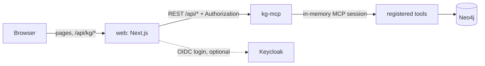

## What was built

| Part | Files | What it does |
|---|---|---|
| REST layer | `mcp/rest.go`, hook in `mcp/main.go` | `/api/*` routes on the existing HTTP listener (`-http`) |
| Web app | `web/` | Next.js 16 (App Router, TypeScript), pinned versions, no runtime CDN |
| Container | `web/Dockerfile` | standalone Next.js output on `node:24.22.2-alpine`, runs as `node` |
| Helm | `templates/web.yaml`, `web:` in `values.yaml` (off), `values-kind.yaml` (on) | Deployment and Service; read-only root file system |
| Tests | `mcp/rest_test.go`, `web/tests/`, `web/e2e/` | Go REST tests, Vitest unit and component tests, Playwright smoke test |

### REST layer

| Route | Result |
|---|---|
| `GET /api/tools` | `{tools: [{name, title, description, input_schema}]}` of every registered tool |
| `POST /api/tools/{name}` | body = tool arguments; result = the tool's structured content. 404 when the tool is not registered, 422 when the tool returns an error, 504 on timeout (120 s) |
| `GET /api/node/{id}` | `{node: {labels, properties}, neighbors}`; neighbours come from `get_neighbors` (limit 100). 404 when the node does not exist or the ACL hides it |
| `GET /api/requirements?repo=` | `{counts, total, requirements}`: verdict counts, and per requirement its evidence (10 symbols at most) and test count |
| `POST /api/feedback` | `{node_id, kind: wrong\|outdated\|helpful\|missing, comment}` → 202 |

- Tool calls go through an in-memory MCP client session on the same `*mcp.Server`. Tools that
  other streams register (`ask`, `get_summary`, `find_experts`, `get_owners`, `get_contract`) work with
  no change here, with the same `KG_ACL_GROUPS` and `$repos` scope.
- `nodeByID` applies the same rules as the tools: `$repos` for code, `acl` (or the document's `acl`
  for a section) for source nodes.
- Bodies are limited to 1 MiB; feedback comments to 4,000 characters.

Extension points for stream 7 (governance, OIDC):

| Hook | Default | Replace with |
|---|---|---|
| `REST.Identity IdentityFunc` | every request is `Caller{Subject: "local"}`; the `Authorization` header is not read | OIDC token check; return an error for 401 |
| `REST.Feedback FeedbackSink` | `logSink` writes one log line | Neo4j sink that creates `:Proposal` / `:Correction` nodes |
| `CallerFrom(ctx)` | returns the REST caller inside any tool handler; nil for MCP clients | use it for per-user ACL or audit |

The caller travels to tool handlers as `_meta["kg/caller"]`. A receiving middleware accepts it only
from the REST session, so an MCP client cannot set it (`TestRESTCallerNotSpoofable`). Set the hooks
after `newREST` in `main.go`.

### Web app

| Page | Route | Data |
|---|---|---|
| Home | `/` | links and search |
| Search | `/search?q=&type=` | `search_graph` and `search_knowledge`; filter All, Code, Tickets, Documents |
| Ask | `/ask` | `ask`; numbered citations link to entity pages; "not configured" notice when the tool is missing |
| Entity | `/entity?id=` | one layout for every label: properties, source link, stale and conflict badges, neighbours grouped by edge type, graph explorer, feedback |
| Domain | `/domain?repo=` | `domain_overview` |
| Requirements | `/requirements?verdict=` | `GET /api/requirements`; coverage bar, filter by verdict, evidence per requirement |

Extra sections per label on entity pages:

| Label | Extra |
|---|---|
| Symbol | code with syntax highlighting (`get_symbol_code`, Shiki on the server), change history |
| File | change history |
| Requirement | verdict, reasoning, gaps, evidence (`trace_requirement`) |
| Ticket | linked issues and commits (`get_context_for_ticket`) |
| all others (Person, Service, Commit, Section, ...) | properties, long text, neighbours, graph |

Badges: "stale" when a node has `stale: true`, `freshness: "stale"` or `status: "stale"`.
"conflict" when it has `conflict: true`, a non-empty `conflicts` list, `verdict: "contradicted"`, or a
`CONTRADICTED_BY` or `CONFLICTS_WITH` edge.

The `ask` result can be `{data: {...}}` or flat, with `answer` (text with `[1]` markers) and
`citations` or `sources` (`{n?, id?, title | name, url?, kind?, snippet?}`). The input is
`{question}`. See `web/src/lib/answer.ts`.

Accessibility and layout: skip link, landmarks, labelled controls, `aria-live` regions for answers and
status, visible focus, keyboard alternative for the graph (a list with "Expand" and "Open"), light and
dark themes (system default, toggle stored in `localStorage`), no horizontal scroll at 375 px.

Security: the browser calls only the web app. The route handler `/api/kg/*` forwards an allow-list
of REST routes and adds the access token on the server; the token is kept in the encrypted Auth.js
cookie and never reaches the browser. The CSP allows only `'self'`.

## Configuration

| Variable | Default | Use |
|---|---|---|
| `KG_API_URL` | `http://localhost:8000` | base URL of kg-mcp (REST at `/api`) |
| `OIDC_ISSUER` | empty (local mode, no login) | Keycloak realm URL, e.g. `https://keycloak.example.com/realms/kg` |
| `OIDC_CLIENT_ID`, `OIDC_CLIENT_SECRET` | none | OIDC client |
| `AUTH_SECRET` | none | Auth.js cookie encryption key (`openssl rand -base64 32`); required with OIDC |
| `AUTH_URL` | none | public URL of the web app; required with OIDC |
| `PORT` | 3000 | listen port |

Helm values (`web:`): `enabled`, `image`, `replicas`, `port`, `apiUrl` (default
`http://<release>-mcp:<mcp.port>`), `oidc.issuer`, `oidc.clientId`, `oidc.url`,
`oidc.existingSecret` (keys `OIDC_CLIENT_SECRET`, `AUTH_SECRET`), `env`, `resources`. The web needs
`mcp.enabled=true`.

## Run and test

Local run against a graph:

```bash
cd mcp && go build -o kg-mcp . && NEO4J_PASSWORD=<password> ./kg-mcp -http :8000
```

```bash
cd web && npm ci && KG_API_URL=http://localhost:8000 npm run dev
```

Local run without a graph (mock API with fixture data):

```bash
cd web && node e2e/mock-api.mjs 8799
```

```bash
cd web && KG_API_URL=http://localhost:8799 npm run dev
```

Tests:

| Command | Tests |
|---|---|
| `cd mcp && go vet ./... && go test ./...` | 5 REST tests with fake tools, plus `TestRESTIntegration` (skips without `NEO4J_PASSWORD`; passed against precept data) |
| `cd web && npm test` | 18 Vitest tests: answer parsing, entity helpers, feedback buttons, Ask chat (answer, not configured, error) |
| `cd web && npm run typecheck` | TypeScript |
| `cd web && npm run build && npm run e2e` | Playwright smoke test against the mock API, desktop and phone (8 runs) |
| `SHOTS=../docs/streams/web-screenshots npm run e2e` | same, and saves the screenshots below |

## Screenshots

### Real graph (precept)

A local Neo4j (`kg-neo4j-web`, bolt port 7706) with precept data: `kg-ingest-code --scip off`,
`kg-git-history`, `kg-domain --no-llm`, `kg-docs` on `precept/docs`, `kg-embed --repo` and
`--sources` (2,486 chunks, 2,173 sections), and `kg-verify --limit 3` on `P10-03-scenario-builder.md`.
`kg-mcp -http` served the REST layer; the web app ran from the production build. The `ask` tool is not
on this branch, so the Ask page shows the "not configured" notice. Script: `web/e2e/real-shots.mjs`.

| Page | Desktop | Phone |
|---|---|---|
| Search | 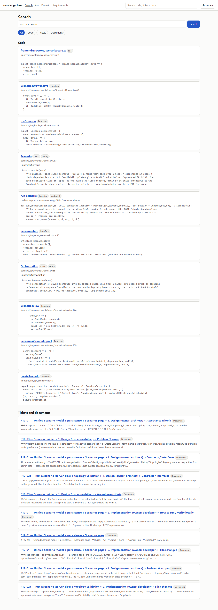 |  |
| Symbol | 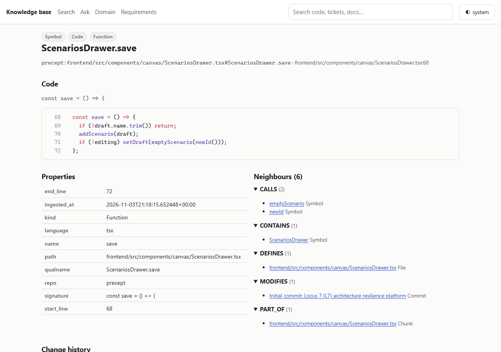 | 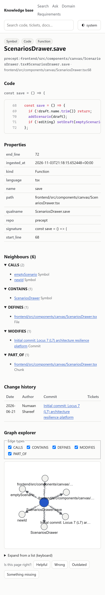 |
| Domain | 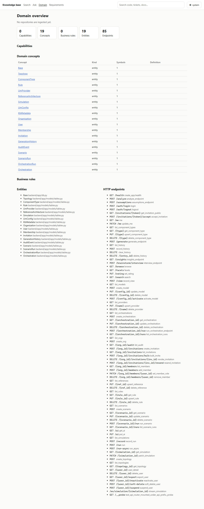 |  |
| Requirements | 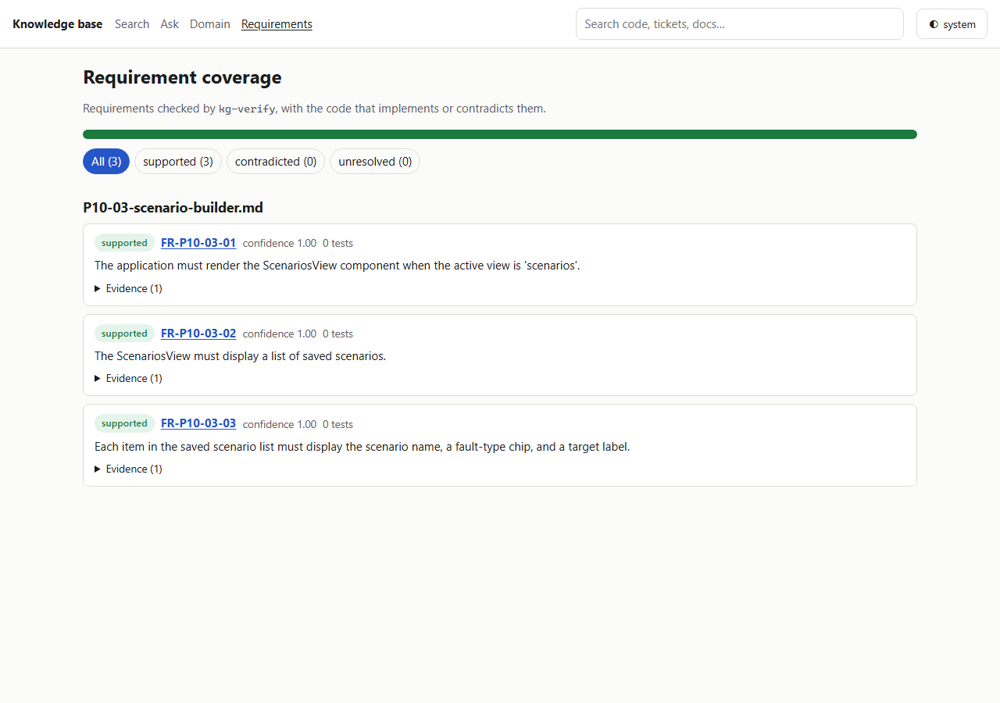 | 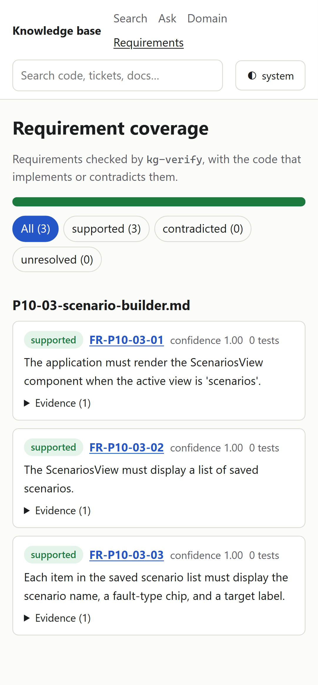 |
| Ask (tool missing) | 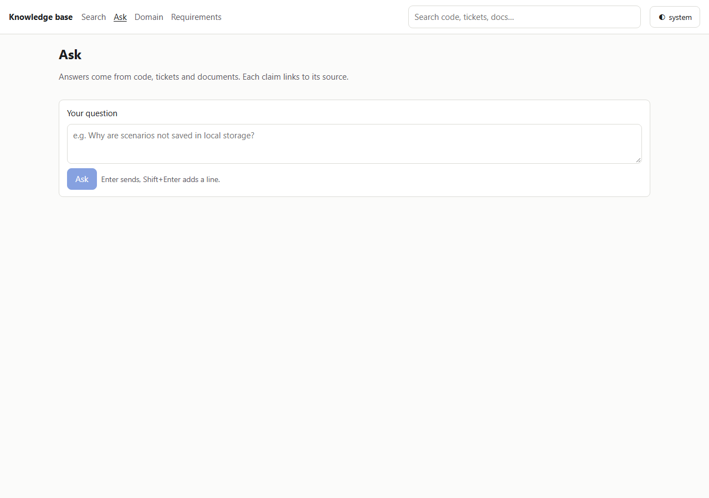 | 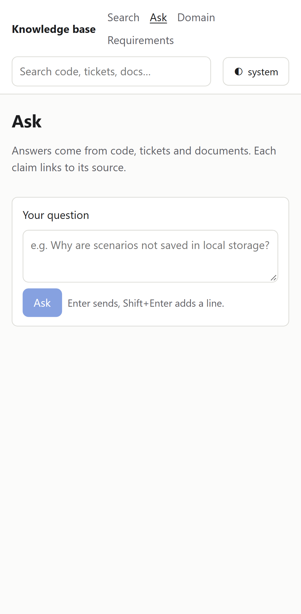 |

### Mock API

These come from the Playwright smoke test against the mock API (`web/e2e/mock-api.mjs`). They show
the parts that the real data above does not have yet: an `ask` answer, a ticket and badges.

| Page | Desktop | Phone |
|---|---|---|
| Search | 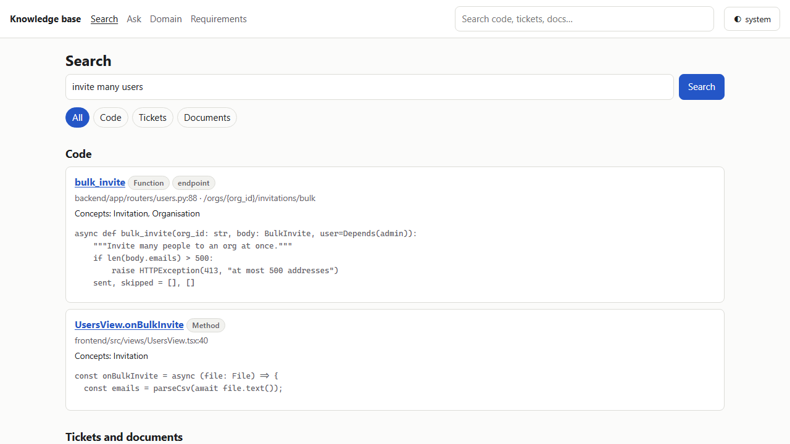 | 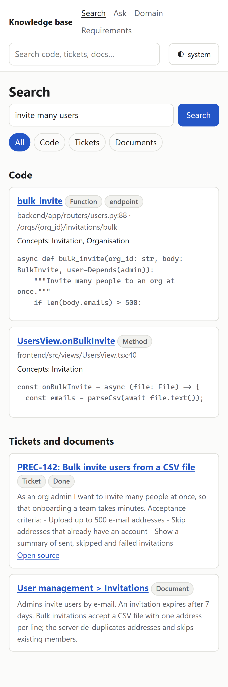 |
| Ask | 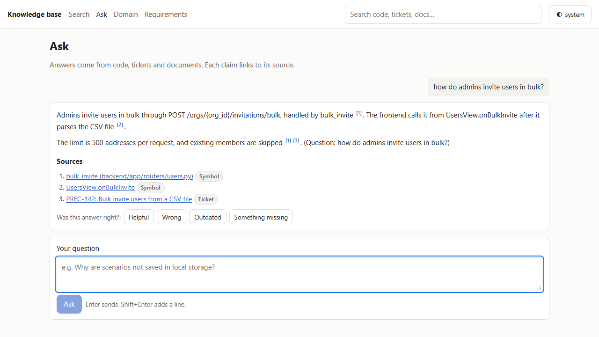 | 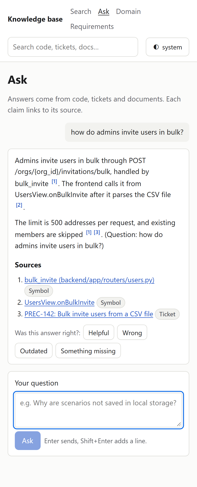 |
| Symbol | 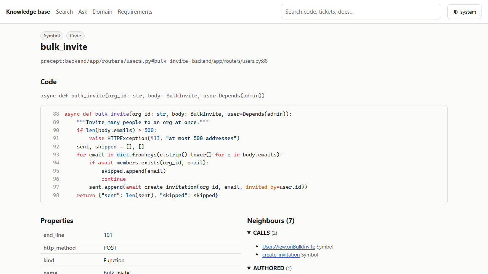 | 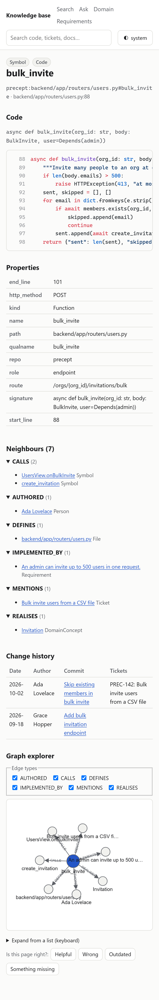 |
| Symbol, dark | 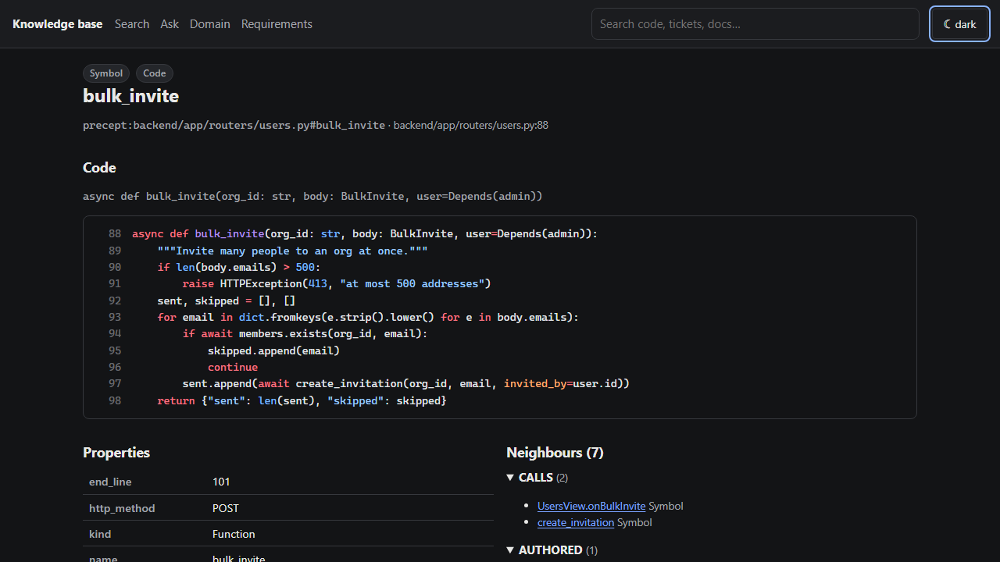 | 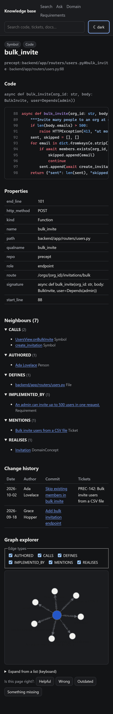 |
| Ticket (stale) | 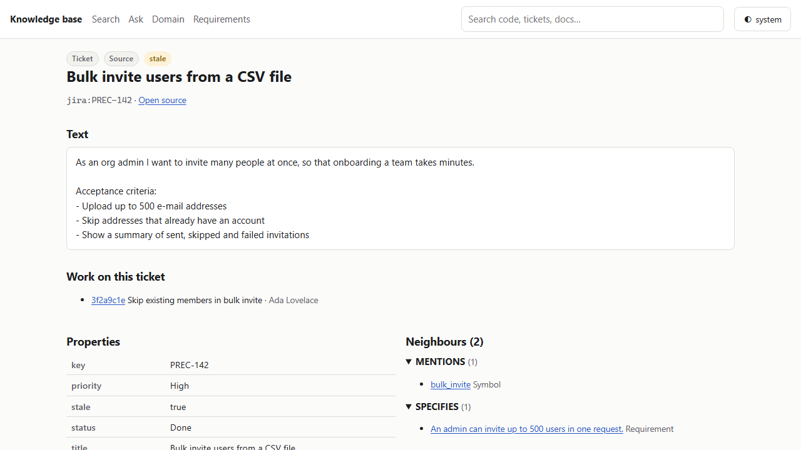 | 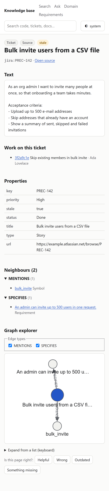 |
| Requirements | 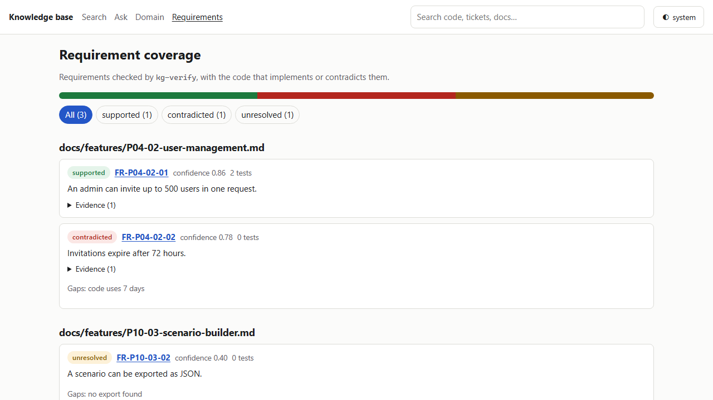 | 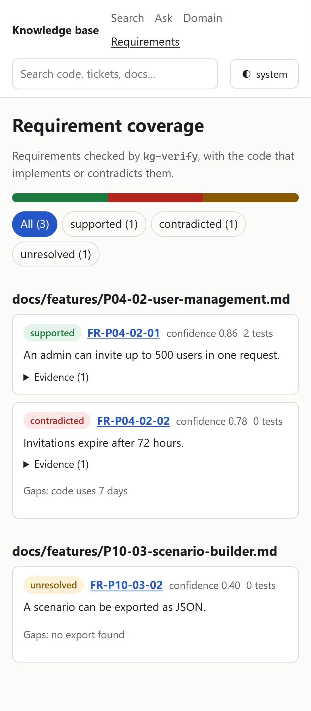 |
| Domain | 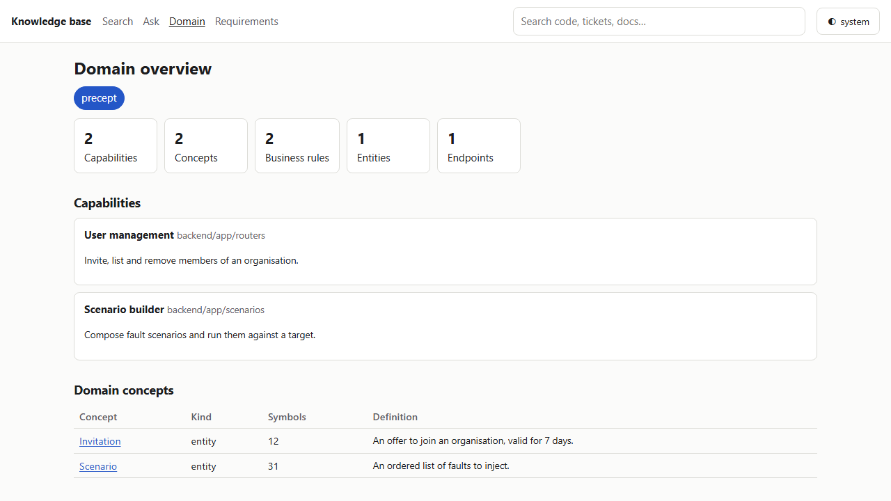 | 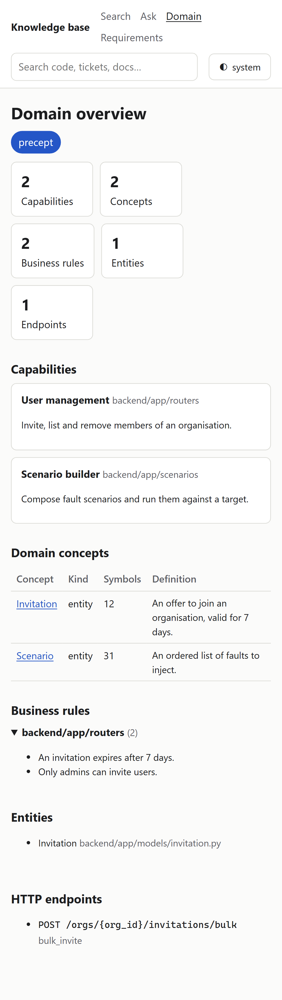 |

## Limits

- Search waits for the query embedding. With the shared Ollama under load, one search took 39 s and
  one hit the 120 s tool timeout; the page then shows "timed out" for that part.
- The Docker image was not built: three `docker build` runs failed in the Docker Desktop build engine
  (`error reading from server: EOF`) while other sessions used Docker. Helm is not installed here, so
  `templates/web.yaml` was not rendered. The standalone server (`.next/standalone/server.js`) was run
  and serves pages.
- The OIDC login was not tested against Keycloak. The access token is not refreshed: when it expires,
  the API rejects calls (once stream 7 checks tokens) until the user signs in again.
- The `ask` tool and the stale and conflict properties come from other streams; the UI follows the
  formats above and shows a notice when a tool is missing.
- `get_neighbors` returns no edge direction, so the graph draws every edge from the expanded node.
- Feedback on answers uses `node_id = "answer:<question>"`, because answers are not graph nodes.
