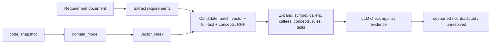

# kg-pipeline

Ingestion pipeline for the knowledge graph. This first part builds the **code layer** from a full
snapshot of each repository.

| Step | Tool | Output |
|---|---|---|
| Mirror the repository | `git clone --mirror` into `$SOURCE_ARCHIVE_PATH/git/<repo>.git` | Replayable source archive |
| Syntax | Tree-sitter (Python, Java, Kotlin, TypeScript/TSX, JavaScript, Go, C#) | `File`, `Symbol` (`Class`, `Interface`, `Enum`, `Function`, `Method`), `Chunk` |
| Exact references | SCIP indexers (scip-python, scip-typescript, scip-java, scip-go, scip-dotnet) | `CALLS`, `USES_TYPE`, `EXTENDS`, `IMPLEMENTS`, `OVERRIDES` with `method=scip` |
| Fallback references | Tree-sitter name matching for files SCIP does not cover | Same edges with `method=treesitter` and a confidence |
| Imports | Path / package resolution | `IMPORTS` to `File`, or to `Module` for external packages |
| IBM ODM | `.brl`, `.dta`, `.rfl`, `.ilr`, `.bom`, `.voc`, `.b2x` parsers | `Rule`, `DecisionTable`, `RuleFlow`, `RulePackage`, `BomClass`, `USES_TERM`, `MAPS_TO` (BOM → Java class) |
| Write | Neo4j, batched `MERGE`, stale data removed per repository | Idempotent snapshot |

Every edge has `method` (`parser`, `scip`, `treesitter`, `b2x`, `name-match`, `odm-vocabulary`) and
`confidence`. Tree-sitter confidence per tier, measured against SCIP on a 420-file repository:

| Tier | Confidence | Correct |
|---|---|---|
| Unique name in the same file | 0.8 | 100% |
| Unique name in an imported file / same Go package | 0.7 | 99% |
| Unique name in the repository | 0.4 | 44% |

## Domain layer, vectors and requirement checks



| Step | Command | Writes |
|---|---|---|
| Roles (no LLM) | `kg-domain --repo R --no-llm` | `Symbol.role` = entity, endpoint (+ `http_method`, `route`), controller, repository, service, dto |
| Domain extraction (LLM per folder) | `kg-domain --repo R [--module path] [--max-modules N]` | `DomainConcept`, `BusinessRule`, `Capability`; `REALISES`, `IMPLEMENTED_BY`, `COVERS`, `USES_CONCEPT` |
| Embeddings | `kg-embed --repo R` | `Chunk.embedding`, `DomainConcept.embedding` (vector indexes `chunk_embedding`, `concept_embedding`) |
| Search | `kg-search "question" --repo R` | Nothing (read only) |
| GraphRAG communities | `kg-communities [--report] [--dry-run] [--level N]` (extra `graphrag` for the Leiden library) | `Community`, `CommunityReport`; `IN_COMMUNITY`, `CHILD_OF`, `REPORTS_ON` |
| Requirement check | `kg-verify --doc spec.md --repo R --out report.md` | `Requirement` with `verdict`; `IMPLEMENTED_BY`, `CONTRADICTED_BY`, `VALIDATED_BY` |

The LLM must cite symbols that exist in the evidence; answers without valid citations are dropped
(domain) or set to `unresolved` (requirements). LLM answers are cached by content hash in
`LLM_CACHE_DIR` (`.kg-cache/llm`; in Dagster `$SOURCE_ARCHIVE_PATH/cache/llm`), so a rerun only
calls the LLM for changed modules.

Settings: `LLM_PROVIDER` (`ollama` | `openai`), `LLM_BASE_URL`, `LLM_MODEL`, `LLM_API_KEY`,
`EMBEDDINGS_URL` (OpenAI-compatible, e.g. TEI), `EMBEDDINGS_MODEL`, `EMBEDDINGS_DIMENSIONS`,
`DOCLING_URL` (for PDF/DOCX requirement documents).

## Run locally

```bash
python -m venv .venv && .venv/Scripts/pip install -e ".[dev]"
NEO4J_PASSWORD=... kg-ingest-code --repo /path/to/repo --name my-repo        # writes to Neo4j
kg-ingest-code --repo /path/to/repo --json out/ --no-neo4j                     # JSON only
pytest                                                                         # NEO4J_PASSWORD set: also the Neo4j test
```

SCIP indexers run when they are on `PATH` (`--scip auto`, the default). Use `--scip off` for
Tree-sitter only, or pass prebuilt indexes: `--scip java.scip,web.scip=frontend` (`=folder` is the
folder the index was built in). `scip-python` does not run on Windows; use the image.

## Image

```bash
docker build -t <registry>/kg-pipeline:0.1.0 .                                          # all indexers, ~3.5 GB
docker build --build-arg WITH_JAVA=0 --build-arg WITH_DOTNET=0 -t <registry>/kg-pipeline:0.1.0-slim .
```

Use it in the Helm chart (`deploy/helm/knowledge-graph`), in `dagster.dagster-user-deployments.deployments[0]`:

```yaml
image: { repository: <registry>/kg-pipeline, tag: 0.1.0, pullPolicy: IfNotPresent }
dagsterApiGrpcArgs: ["--module-name", "kg_pipeline.definitions"]
```

Then set `sources.git.repositories` and `GIT_TOKEN`, open Dagster, and materialize `code_snapshot`
for each repository partition (or turn on the `nightly_code_snapshot` schedule).

## Limits

- SCIP needs a project that builds: `scip-java` runs Maven/Gradle, `scip-go` needs `go list` to
  succeed, `scip-dotnet` needs a restorable solution. When an indexer fails, the files keep the
  Tree-sitter edges and the run logs a warning.
- The ODM parsers follow the Rule Designer file layouts but are not yet checked against real rule
  projects. Check them on your own `.brl` / `.dta` / `.bom` files.
- Each run is a full snapshot. Incremental updates per commit are the next step.
